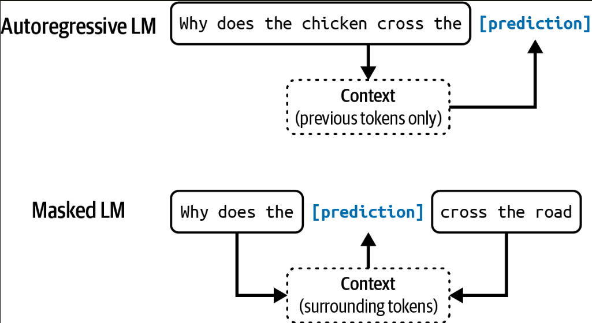
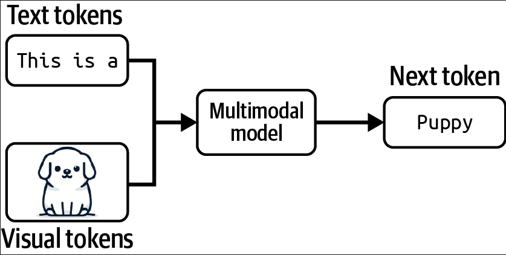
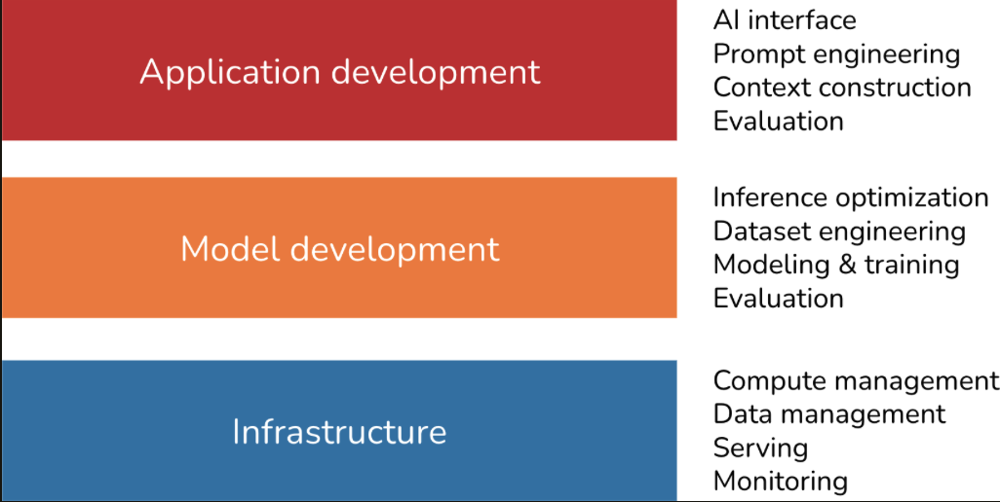

# Chapter 1. Introduction to Building AI Applications with Foundation Models 

The scaling up of AI models has two major consequences. First, AI models are becoming more powerful and capable of more tasks, enabling more applications. 

Second, training large language models (LLMS) requires data, compute resources, and a specialized talent that only a few organizations can afford. This has led to the emergence of *model as a service*: models developed by these few organizations are made to others to use as a service. 

This as turned *AI engineering* - the process of building applications on top of readily available models - into one of the fastest-growing engineering disciplines. 

## The Rise of AI Engineering 

The first language models emerged in the 1950s. 

### From Language Models to Large Language Models

While language models have been around for a while, they've only been able to grow to the scale they are today with *self-supervision*.

#### Language models

A *language model* encodes statistical information about one or more languages. Intuitively, this information tells us how likely a word is to appear in a given context.

The basic unit of a language model is *token*. A token can be a character, a word, or a part of a word (like -tion) depending on the model. 

/// caption
Figure 1-1. An example of how GPT-4 tokenizes a phrase. 
///

The process of breaking the original text into tokens is called *tokenization*.

The set of all tokens a model can work with is the mode's *vocabulary*. You can use a small number of tokens to construct a large number of distinct words, similar to how you can use a few letters in the alphabet to construct many words. The tokenization method and vocabulary size are decided by model developers. 

There are two main types of language models: *masked language models* and *autoregressive language models*. They differ based on what information they can use to predict a token: 

- *Masked language model* - A masked language model is trained to predict missing tokens anywhere in a sequence, using *the context from both before and after the missing tokens*. In essence, a masked language model is trained to be able to fill in the blank. 
- *Autoregressive language model* - An autoregressive language model is trained to predict the next token in a sequence, *using only the preceding tokens*. They are much more popular than masked language models. 

/// caption 
Figure 1-2. Autoregressive language model and masked language model.
///

> **Note**: In this book, unless explicitly stated, *language model* will refer to an autoregressive model.

A language model can use its fixed, finite vocabulary to construct infinite possible outputs. A model that can generate open-ended outputs is called *generative*, hence the term *generative AI*.

You can think of a language model as a *completion machine*: given a text (prompt), it tried to complete that text.

It's important to note that completions are predictions, based on probabilities, and not guaranteed to be correct.

While completion is powerful, completion isn't the same ad engaging in a conversation. 

#### Self-supervision 

*Self-supervision* - Supervision refers to the process of training ML algorithms using labeled data, which can be expensive and slow to obtain. Self-supervision helps overcome the data labeling bottleneck to create larger datasets for models to learn from, effectively allowing models to scale up. 

With supervision, you label examples to show the behaviors you want to model to learn, and then train the model on these examples. Once trained, the model can be applied to new data. 

A drawback of supervision is that data labeling is expensive and time-consuming. 

Self-supervision helps overcome the data labeling bottleneck. In self-supervision, instead of requiring explicit labels, the model can infer labels from the input data. Language modeling is self-supervised because each input sequence provides both the labels (tokens to be predicted) and the contexts the model can use to predict these labels. 

> **Note:** Self-supervision differs from unsupervision. In self-supervised learning, labels are inferred from the input data. In unsupervised learning, you don't need labels at all. 

Self-supervised learning means that language models can learn from text sequences without requiring any labeling. 

How large does a language model have to be to be considered *large*? A model's size is typically measured by its number of parameters. A *parameter* is a variable within an ML model that is updated through the training process. In general, though this is not always true, the more parameters a model has, the greater its capacity to learn desired behaviors. 

One question: *why do larger models need more data?* Larger models have more capacity to learn, and, therefore, would need more training data to maximize their performance. 

### From Large Language Models to Foundation Models

The word *foundation* signifies both the importance of these models in AI applications and the fact that they can be built upon for different needs. 

A model that can work with more than one data modality is also called a *multimodal model*. A generative multimodal model is also called a large multimodal model (LLM). 

/// caption 
Figure 1-3. A multimodal model can generate hte next token using information from both text and visual tokens. 
///

> **Note:** This book uses the term foundation model to refer to both large language models and large multimodal models. 

Foundation models also mark the transition from task-specific models to general-purpose models. 

*Foundation models, thanks to their scale and the way they are trained, are capable of a wide range of tasks.*

There are multiple techniques you can use to get the model to generate what you want. You can craft detailed instructions with examples of the desirable product descriptions. This approach is *prompt engineering*. 

Using a database to supplement the instructions is called *retrieval-augmented generation* (RAG). You can also *finetune* - further train - the model on a dataset of high-quality product descriptions. 

### From Foundation Models to AI Engineering 

*AI engineering* refers to the process of building applications on top of foundation models. 

If traditional ML engineering involves developing ML models, AI engineering leverages existing ones. The availability and accessibility of powerful foundation models lead to three factors that, together, create ideal conditions for the rapid growth of AI engineering as a discipline: 

- *Factor 1: General-purpose AI capabilities* - Foundation models are powerful not just because they can do existing tasks better. They are also powerful because they can do more tasks. 
- *Factor 2: Increased AI investments* - As AI applications become cheaper to build and faster to go to market, returns on investment for AI become more attractive. Companies rush to incorporate AI into their products and processes. 
- *Factor 3: Low entrance barrier to building AI applications* - Models as a service. In this approach, models are exposed via APIs that receive user queries and return model outputs. *Anyone, and I mean anyone, can now develop AI applications*.

## Planning AI Applications 

It might be worthwhile to take a step back and consider why you're building this and how you should go about it. It's easy to build a cool demo with foundation mod els. It's hard to create a profitable product. 

### Use Case Evaluation 

A few examples of different levels of risks, ordered from high to low: 

1. *If you don't do this, competitors with AI can make you obsolete.*
2. *If you don't do this, you'll miss opportunities to boost profits and productivity.*
3. *You're unsure where AI will fit into your business yet, but you don't want to be left behind.*

#### The role of AI and humans in the application 

Here are three key points relevant to the current discussion: 

- *Critical or complementary* - If an app can still work with AI, AI is complementary to the app. The more critical AI is to the application, the more accurate and reliable the AI part has to be. People are more accepting of mistakes when AI isn't core to the application.
- *Reactive or proactive* - A reactive feature shows its responses in reaction to users' requests or specific actions, whereas proactive features shows its responses when there's an opportunity for it.
    - Because reactive features are generated in response to events, they usually, but not always, need to happen fast. On the other hand, proactive features can be precomputed and shown opportunistically, so latency is less important. 
    - Because users don't ask for proactive features, they can view them as intrusive or annoying if the quality is low. Therefore, the proactive predictions and generations typically have a higher quality bar.
- *Dynamic or static* - Dynamic features are updated continually with user feedback, whereas static features are updated periodically. 

Involving humans in AI's decision-making processes is called *human-in-the-loop*. 

**Crawl-walk-run for AI automation**

1. Crawl - means human involvement is mandatory. 
2. Walk - means AI can directly interact with internal employees.
3. Run - means increased automation, potentially including direct AI interactions with external users.

#### AI product defensibility 

In a way, building applications on top of foundation models means providing a layer on top of these models. This also means that if the underlying models expand in capabilities, the layer you provide might be subsumed by the models, rendering your application obsolete. 

In AI, there are generally three types of competitive advantages: technology, data, and distribution - the ability to bring your product in front of users. With foundation models, the core technologies of most companies will be similar. The distribution advantage likely belongs to big companies.

The data advantage is more nuanced. Big companies likely have more existing data. However, if a startup can get to market first and gather sufficient usage data to continually improve their products, data will be their moat. 

### Setting Expectations 

The next s tep is to figure out what success looks like: how will you measure success? The most important metric is how this will impact your business. S

To ensure a product isn't put in front of customers before it's ready, have clear expectations on its usefulness threshold: how good it has to be for it to be useful. Usefulness thresholds might include the following metrics groups: 

- Quality metrics to measure the quality of the chatbot's responses. 
- Latency metrics including TTFT (time to first token), TPOT (time per output token), and total latency. What is considered acceptable latency depends on your use case. If all of your customer requests are currently being processed by humans with a median response time of an hour, anything faster than this might be good enough.
- Cost metrics: how much it costs per inference request. 
- Other metrics such as interpretability and fairness. 

### Milestone Planning 

Once you've set measurable goals, you need a plan to achieve these goals. How to get to the goals depends on where you start. Evaluating existing models to understand their capabilities. The stronger the off-the-shelf models, the less work you'll have to do. 

A good initial demo doesn't promise a good end product. It might take a weekend to build a demo but months, adn even years, to build a product.

### Maintenance 

Product planning doesn't stop at achieving its goals. You need to think about how this product might change over time and how it should be maintained. 

Building on top of foundation models today means committing to riding this bullet train. 

Model *inference*, the process of computing an output given an input, is getting faster and cheaper. 

However, even good changes can cause friction in your workflows. You'll have to constantly be on your guard and run a cost-benefit analysis of each technology investment. 

Some changes are easier to adapt to. However, as each model has its quirks, strengths, weaknesses, developers working with hte new model will need to adjust their workflows, prompts, and data to this new model. Without proper infrastructure for versioning and evaluation in place, the process can cause a lot of headaches.

Some changes are harder to adapt to, especially those around regulations. Technologies surrounding AI are considered national security issues for many countries, meaning resource for AI, including compute, talent, and data, are heavily regulated.

Some changes can even be fatal. If you build your product on top of a model trained using other people's data, can you be certain that your product's IP will always belong to you? 

## The AI Engineering Stack 

Let's look into the fundamental building blocks of AI engineering. 

To best understand AI engineering and how it differs from traditional ML engineering, the following section breaks down different layers of the AI application building process and looks at the role each layer plays in AI engineering and ML engineering.

### Three Layers of the AI Stack

There are three layers to any AI application stack: application development, model development, and infrastructure. When developing an AI application, you'll likely start from the top layer and move down as needed: 

- *Application development* - With models readily available, anyone can use them to develop applications. This is the layer that has seen the most action in the last two years, and it is still rapidly evolving. Application development involves providing a model with good prompts and necessary context. This layer requires rigorous evaluation. Good applications also demand good interfaces. 
- *Model development* - This layer provides tooling for developing models, including frameworks for modeling, training, finetuning, and inference optimization. Because data is central to model development, this layer also contains dataset engineering. Model development also requires rigorous evaluation. 
- *Infrastructure* - At the bottom is the stack is infrastructure, which includes tooling for model serving, managing data and compute, and monitoring. 

/// caption 
Figure 1-14. Three layers of the AI engineering stack. 
/// 

While the level of excitement and creativity around foundation models is unprecedented, many principles of building AI applications remain the same. 

With foundation models, you experiment with different models, prompts, retrieval algorithms, sampling variables, and more.

### AI Engineering Versus ML Engineering 

In short, AI engineering differs from ML engineering in that it's less about model development and more about adapting and evaluating models. In general, model adaptation techniques can be divided into two categories, depending on whether they require updating model weights. 

*Prompt-based techniques, which include prompt engineering, adapt a model without updating the models weights.*

*Finetuning, on the other hand, requires updating model weights.*

#### Model development 

*Model development* is the layer most commonly associated with traditional ML engineering. It has three main responsibilities: modeling and training, dataset engineering, and inference optimization. 

#### Modeling and training 

*Modeling and training* refers to the process of coming up with a model architecture, training it, and finetuning it. 

##### On the differences among training, pre-training, finetuning, and post-training

Training always involves changing model weights, but not all changes to model weights constitute training. 

- *Pre-training* - refers to training a model from scratch - the model weights are randomly initialized. 
- *Finetuning* - means continuing to train a previously trained model - the model weights are obtained from the previous training process. Because the model already has certain knowledge from pre-training, finetuning typically requires fewer resources (e.g., data and compute) than pre-training. 
- *Post-training* - conceptually, post-training and finetuning are the same and can be used interchangeably. It's usually post-training when it's done by model developers. 

#### Dataset engineering 

*Dataset engineering* refers to curating, generating, and annotating the data needed for training and adapting AI models. 

Regardless of how much data you need, expertise in data is useful when examining a model, as its training data gives important clues about the model's strengths and weaknesses.

#### Inference optimization 

*Inference optimization* means making models faster and cheaper. 

### Application development 

The application development layer consists of these responsibilities: evaluation, prompt engineering, and AI interface. 

#### Evaluation 

*Evaluation* is about mitigating risks and uncovering opportunities. Evaluation is necessary throughout the whole model adaptation process. Evaluation is needed to select models, to benchmark progress, to determine whether an application is ready for deployment, and to detach issues and opportunities for improvement in production.

To summarize, these challenges chiefly arise from foundation models' open-ended nature and expanded capabilities. 

#### Prompt engineering and context construction 

**Prompt engineering* is about getting AI models to express the desirable behaviors from tyhe input alone, without changing the model weights. 

Prompt engineering is not just about telling a model what to do. It's also about giving the model the necessary context and tools to do a given task. 

#### AI interface 

*AI interface* means creating an interface for end users to interact with your AI applications. Before foundation models, only organizations with sufficient resources to develop AI models could develop AI applications. These applications were often embedded into the organizations' existing products. 

## AI Engineering Versus Full-Stack Engineering 

The increased emphasis on application development, especially on interfaces, brings AI engineering closer to full-stack development. 

## Summary 

This chapter serves two purposes. One is to explain the emergence of AI engineering as a discipline, thanks to the availability of foundation models. Two is to give an overview of the process needed to build applications on top of these models. 

This chapter discussed the rapid evolution of AI in recent years. It then traced how language models incorporated other data modalities to become foundation models, and how foundation models gave rise to AI engineering. 

The rapid growth of AI engineering is motivated by the many applications enabled by the emerging capabilities of foundation models.

Before building an application, an important yet often overlooked question is whether you should build it. 

Many principles from ML engineering are still applicable to AI engineering. However, AI engineering also brings with it new challenges and solutions.

One aspect of AI engineering is that it especially challenging to capture in writing is the incredible amount of collective energy, creativity, and engineering talent that the community brings. 

One consolation is that since AI is great at information aggregation, it can help us aggregate and summarize all these new updates. But tools can help only to a certain extend. The more a overwhelming a space is, the more important it is to have a framework to help us navigate it. 