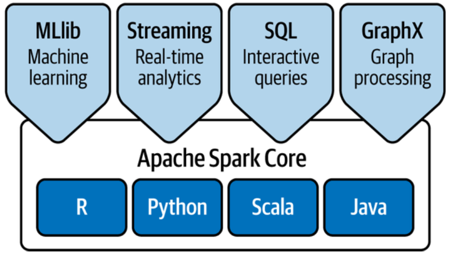
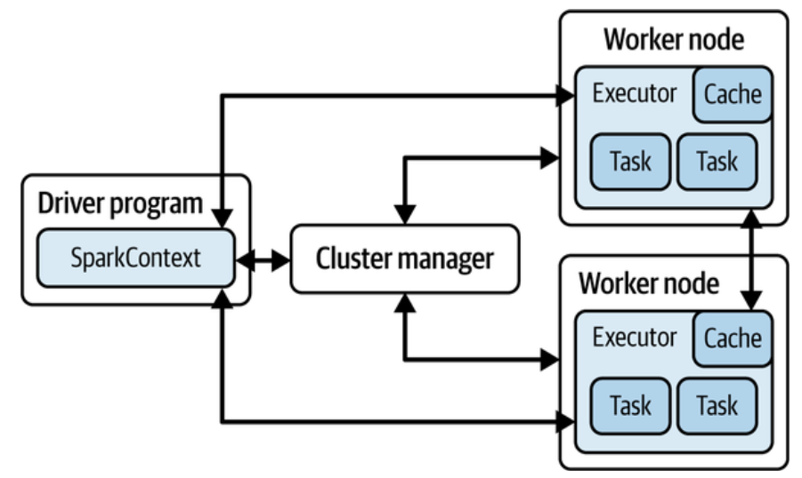
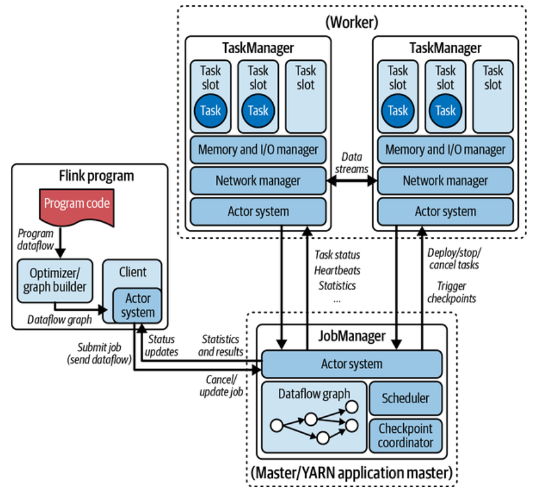
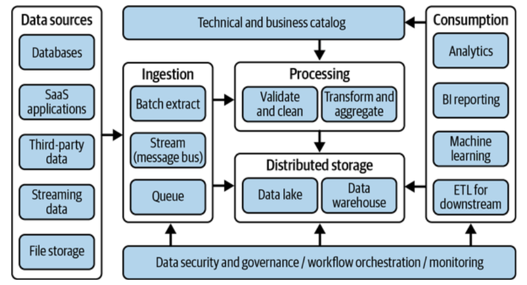
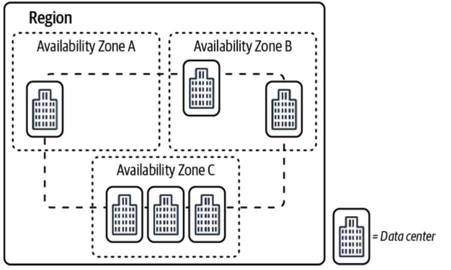

# Chapter 2. Prerequisite Knowledge for Aspiring Data Engineers 

## Types of Databases 

### **Hierarchial Databases**

Hierarchial databases store data in a tree kind of structure that maps parent records and child records adn each one of them is treated as a node of the tree. 

### **Relational Databases** 

Relational databases have a simple tabular storage structure where each entity type is treated as a table or view, entities within the tables and views are treated as records, and attributes of the entity are treated as columns of the table or view.

Structured Query Language (SQL) is a programming language that interacts with databases. 

SQL commands are categorized as follows: 

- *Data Definition Language (DDL)*
    - **DDL** helps manage objects and their structures, such as `CREATE` tables, views, indexes, and more.

- *Data Manipulation Language (DML)*
    - **DML** helps modify the data using `INSERT`, `UPDATE`, and `DELETE` statements.

- *Data Query Language (DQL)*
    - **DQL** helps retrieve data from the database using `SELECT` statements. 

- *Data Control Language (DCL)*
    - **DCL** helps database administrators manage authorization on database objects and data in tables using `GRANT` statements. 

- *Transaction Control Language (TCL)*
    - **TCL** helps the database engine make automatic changes to the database, for example reverting erroneous transactions using `ROLLBACK` statements. 

### NoSQL Databases 

When you have a use case that will have variable schema, which means each record may have a different set of attributes, then NoSQL databases are a great fit. 

Some of the popular NoSQL databases types are key value store, document store, graph database, in-memory database, and search database. 

### OLTP Versus OLAP 

OLTP systems primarily perform record-level processing and serve frontend applications that require request responses in a few seconds. Conversely, OLAP systems primarily perform column-level operation and serve analytics and business intelligence (BI) reporting use cases. 

## Overview of Bif Data 

In simple terms, big data represents terabyte - to petabyte- scale data, collected from various sources through different frequencies, that is complex to process. 

Oftentimes big data is referred to as the five **Vs**. 

The following provides an explanation of each of the five Vs:

- *Volume:* This represents the amount of data you have or receive for analytics, which depends on your organization and the use case. 

- *Velocity:* This represents the speed or the frequency at which data is being collected or processed for analysis. 

- *Variety*: This refers to the different forms or types of data you receive for processing or analysis. In general, there are three types of data.

    1. Structured: This refers to data that has a fixed schema or is readable by distributed processing frameworks such as MapReduce, Apache Spark, or Apache Flink.
    2. Semi-structured: Data where some parts of fields are structured and other parts are unstructured, are treated as semi-strucured. 
    3. Unstructured: Datasets of which a schema cannot be applied are treated as unstructured. 

- *Veracity:* This represents how reliable or truthful your data is. 
- *Value* - This is often referred to as the worth of the data you have collected, as it is meant to give insights that can help a business drive growth. 

The primary challenge from big data is to efficiently process it, as single-server-based processing frameworks cannot scale to process such a large volume of data. Big data needs a distributed processing framework that can process data in parallel with a cluster of servers. 

## Distributed Processing Frameworks for Big Data 

In simple terms, distributed processing means that the processing happens in a multinode cluster instead of a single virtual or physical machine. The Apache Hadoop framework has become popular because of its massive parallel processing capability on top of commodity hardware and its fault-tolerant nature, which has made it more reliable. 

Hadoop clusters consist of a master node and several data nodes that can scale horizontaqlly as the data or processing volume increases. The common storage layer build on top of all the data node disks is called Hadoop Distributed File System (HDFS). 

### MapReduce 

MapReduce is a distributed processing framework, originally designed to process data concurrently form HDFS by splitting data into 64 MB or 128 MB chunks. It primarily consists of the following processes: 

- *A map process* 
    - This process takes input as key-value pairs then processes and transforms them and writes another key-value pair as intermediate output. 

- *A reduce process*
    - This takes key-value pairs as input, aggregates them, and writes output as another key-value pair. 

- *A combiner process*
    - The combiner process is an optional stage that acts as a mini-reducer. It aggregates records available in a single data node before it reaches the reducer stage. 

### Spark 

Apache Spark is an open source framework that provides optimzed query execution compared to MapReduce and does most of its processing in-memory to boost performance. 

/// caption 
Figure 2-1. Apache Spark langauges and libarary support
///

Spark represents the data is reads or writes as Resilient Distributed Datasets (RDDs), DataFrames, or Datasets and it providers the following two operations: 

- *Transformations* - Transformations are operations in which you create a new RDD, DataFrame, or Dataset from an existing one after applying transformation rules such as map, filter, join, and more. It is executed in a lazy manner, which means transformations are only executed when Spark invokes an actions operation. 

- *Actions* - Actions are operations that triggert transformations and write the final output to an external location ore return the output to the Spark driver program. 

Figure 2-2 shows the high-level Spark architecture, where: 

- Spark provides the option to execute in a standalone mode or in a cluster mode. In cluster mode, you have a cluster manager and the drive program submits a job to the cluster. The job gets split into multiple tasks that get executed in different worker nodes. 

- Each worker node may have more than one executor, with each executor having a fixed amount of memory and CPU cores for execution. The executor may execute a map transofmration task, or an actions that writes to the output location. 

- Each worker node has its own cache memory to which you can write small datasets that may be repeatdly used by multiple tasks; the tasks will get a performance boost as the request dataaset will be in memory. 

/// caption 
Figure 2-2. Apache Spark architecture in cluster mode
///

### Flink 

Apache Flink is an open source dsitributed processing framework primarily designed for real-time stream processing of high throughput workloads. 

It provides advanced capabilities such as out-of-order event processing, exactly once semantics, and backpressure control. 

Figure 2-3 shows the high-level Flink architecture and its two primary componenets - JobManager and Task Manager: 

- *JobManager:* JobManager has three subcomponenets (ResourceManager, Dispatcher, and JobMaster) that help to schedule new tasks, coordindate checkpoints, react to task failures or completion, and more. You can increase the reliability of a cluster by having more JobManagers where one becomes the leader and the other stays on standby to provide high availability. 

- *TaskManager:* TaskManagers or workers execute the tasks of a dataflow that includes multiple task slots. For a job, you will have a least one TaskManager and one task slot that scale horizontally for concurrent execution. 

/// caption 
Figure 2-3. Apache Flink high-level architecture 
/// 

Client applications or programs submit a job to the JobManager and may stay active to receive the result; they can also close the session to let the job run in the background. 

### Hive 

Apache Hive is a popular open source applicaiton that data analysts and data scientist use to query or prepare data for analytics. 

Hive keeps all its schema metadata in a relational database, maintained by the Hive Metastore Server (HMS). HMS enables you to define a virtual table schema on top of the data available in HDFS (or other object stores), so that end users can query them using SQL standards.

### Presto 

Similar to Hive, Presto (or PrestoDB) is also an open source, distributed SQL query engine that is optimized for low-latency data access from the distributed file system. It's used for complex queries, aggregations, joing, and window functions. It is capable of querying from the schema defined in HMA or other object stores. 

Presto has become a popular alternative to Hive because of its higher performance and in-memory processing capability. 

### Trino 

In January 2019, a few engineers of the original Presto project left Meta and forked the open source Presto to better serve the opeen source community. They named it PrestoSQL, which got rebranded as Trino in December 2020. 

## What Is a Data Lake? 

A data lake is treated as a centralized repository that can store structured, semi-structured, and unstructured datasets as any scale. Data lakes store the raw data as it is, on top of which you can integrate distributed processing frameworks to process and query the petabyte-scale datasets. 

While managing a data lake, it is important to make sure the data lake does not end up as a data swamp. A data swamp represents a repository of data that has become unmanagable over time and lacks structure, metadata, and governance around it. 

Most data warehouses support tiered storage and different data distribution techniques that you can integrate based on your use cases. 

Data marts are smaller in data size compared to data warehouse and may have aggregated data for a specific use case. 

## Data Warehouse Versus Data Lake 

Ideally you need to have both data lakes and data warehouses in your organization as both serve different use cases. Data warehouses are not meant to store all historical data and are best utilized to store the last few years of data needed for analytics with lower latency. Compared to that, data lakes are generally meant to store both structured and unstructured datasets and store historical data to support analytics ad well as time series or machine learning use cases. 

Data warehouses follow a "schema on write" approach where the schema of the tables are defined first and then the read is ingested. But data lakes follow a "schema on read" approach, which means the data is stored in a storage layer and a virtual schema is applied on top of it while reading or querying the data to represent the datasets as a table or view.

## ETL Versus ELT

You may choose between extract, transform, and load (ETL) or extract, load and transform (ELT): 

- *Extract:* Extract represents fetching the data from a data source such as databases, third-party APIs, FRP systems, or object stores. The extraction process may involve fetching all datasets or incremental datasets based on the use case. 

- *Transform:* Transform represents modifying the data based on consumption pattern. The transformation process can be done using SQL or a dsitributed process framework, such as Spark, or any single-threaded programming language, such as Python.

- *Load:* Load represents saving the data in a storage layer from which end users intend to query the data. The storage layer can be a database, data lake, or data warehouse. 

If the data gets transformed first before getting loaded into the target, then it is ETL; if the extracted data gets loaded first and then gets transformed, then it is ELT. 

There is no clear winner between ETL and ELT; you need to choose the approach that provides better efficiency for your use case. 

## Different Ways to Process Data 

### Batch Processing Pipeline 

If you have datasets that need to be processed in a regular interval by combining data collected over time, then it's treated as a batch execution. 

In general, batch jobs process a higher volume of data, and they may take more time to process. 

### Real-Time Stream Processing 

Batch jobs are best suited for bounded datasets, but you may have data sources that are unbounded, such as streaming data, which need to be processed on a continuous basis and therefore require real-time stream processing. 

In general, the data volume for real-time stream processing systems are smaller compared to batch jobs and involve additional complexities such as processing out-of-order records, lare arriving records, checkpointing, and retries for failed processing. 

### Event-Driven Processing 

Event-drive processing is somehwat similar to batch processing but is triggered on a particular event. 

## High-Level Architecture Overiew of Data Processing Pipelines 

Figure 2-4 shows a high-level architecture for a data pipeline irrespective of the technologies you choose to integrate. This architecture can evolve based on specific use case requirements. 

/// caption 
Figure 2-4. High-level architecture for data pipeline 
/// 

Let's understand each block of the architecture diagram: 

- *Data sources:* This component of the architecture highlights different data sources that you may plan to integrate in your data pipeline. 

- *Ingestion:* You need to extract the full or incremental data from the data sources through the ingestion layer. 

- *Distribured storage:* The ingestion layer pushes raw input data to the distributed storage layer, which may include a data lake, data warehouse, or database for further processing. 

- *Processing:* The raw input data gets validated against data quality, then enriched, transformed, and pushed to the final distributed storage layer. 

- *Technical and business catalog:* Once the data is in the storage layer, you can integrate a metadata catalog (which may include databases, tables, and column-level information) for data discovery. 

- *Consumption:* Data consumers consume data from a data lake or data warehouse for analytics, BI reporting, machine learning, or to further transform the data to push to downstream systems. 

- *Data security and governance:* - This spans all preceding componenets to enable data security and governance that includes fine-grained access control, data encryption, data masking, data lineage, data sharing, and more. 

- *Workflow orchestration:* The data ingestion and processing jobs can be orchestrated through a workflow service that may help monitor jobs execution status, enable retry in case of job failures, and build reporting for all pipelines. 

- *Monitoring:* This compomnenet helps monitor compute infrastructure health, analyze logs for troubleshooting, audit access logs, and build alerting for failures. 

## CI/CD

CI/CD are the core componenets of DevOps that allow you to integrate and validate code merged by devlopers and then create a build that can be released for deployment easier by automating most of the processes: 

- *Continuous integration:* Continuous integration (CI) integrates code from multiple developers in a repository and creates an automated build that has gone through test case validations. 

- *Continuous delivery:* Continuous devlivery (CD) delievers the code to a preproduction environment for quality assurance and validates the build in an equivalent runtime environment. 

- *Continous deployment:* Continuous deployment (CD) automatically deploys the build to a production environment. 

## Cloud Computing and AWS 

Traditionally if an organization needs a set of servers for their applications, they need to pay in advance to preprovision the servers, configure them with necessary software libraries, and them amke them available for application teams. 

This has several challenges, such as: 

- Longer time for procurement 
- Additional cost 
- Inability to scale capacity when needed
- Complexity of managing infrastructure spread across different geographies 

## What Is Cloud Computing? 

Cloud computing refers to a vast amount of remote computing resources that may include physical servers, virtual machines, networking componenets, managed services (related to storage, database, analytics), machine learning, and many more that are available in various locations throughout the world. 

The following are the key benefits of cloud computing: 

- *Agility*: Amazon Web Services (AWS) offers multiple services that solve different business problems and map to different technology domains such as data, AI, IoT, AppDev, storage, and more. You get the flexibility to choose, experiment, and deploy quickly to validate your business idea. 

- *Elasticity:* Depending on business demand, you can scale your capacity up and down, isntead of provisioning for the highest capacity you need. 

- *Cost savings:* You can access a pay-as-you-go pricing model. 

- *Deploy globally in minutes:* Avoiding the server provisioning delay, you can make servers available in any AWS region in minutes with a few clicks. 

## An Overview of Amazon Web Services 

AWS is a cloud computing platform that provides computing resources (i.e., servers) plus many managed services to reduce the operational burden of customers. 

The AWS global infrastructure consists of Regions and Availability Zones (AZs). AWS Regions are geographically separated areas that consist of two or more Availability Zones, which are separated from each other but are connected through low latency, high throughput, and a redundant network. Figure 2-5 shows an AWS Region with three Availability Zones that are connected through the network. 

/// caption 
Figure 2-5. AWS Region and Availability Zone example 
/// 

In AWS, most of the services are regional, which menas you need to first choose an AWS Region based on your busienss and customer presence, then choose the AWS services in that Region. But there are a few services that are global in nature, such as AWS Identity and Access Management (IAM). 

## Getting Started with AWS

### Create an IAM User for Authentication

