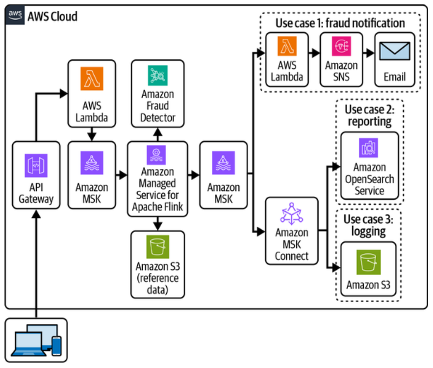
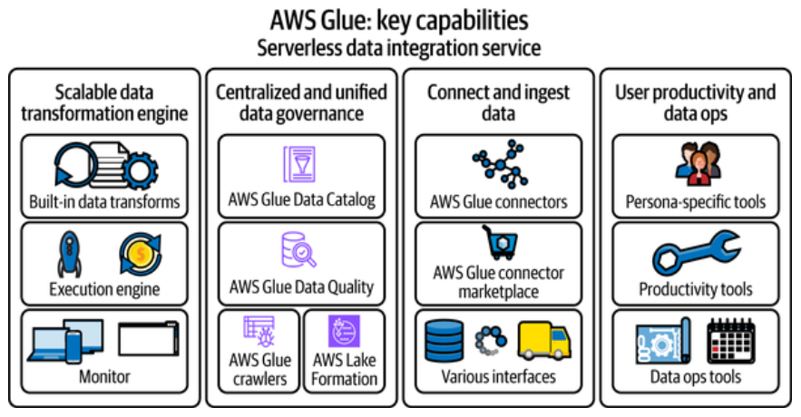
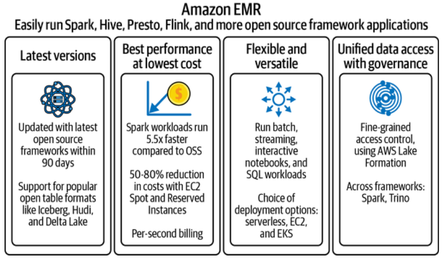
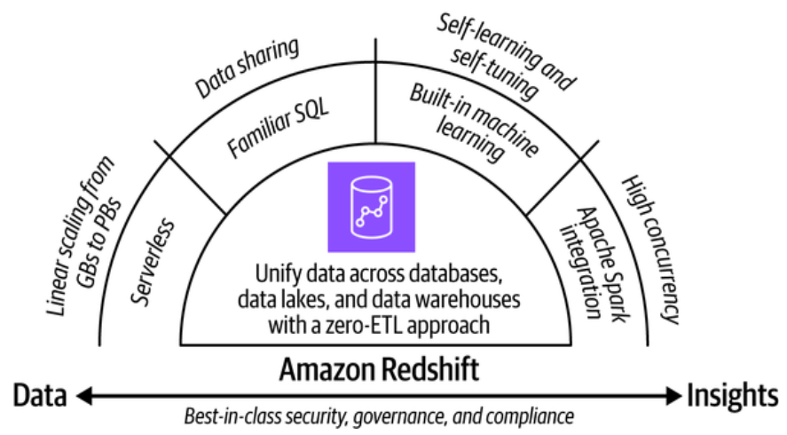
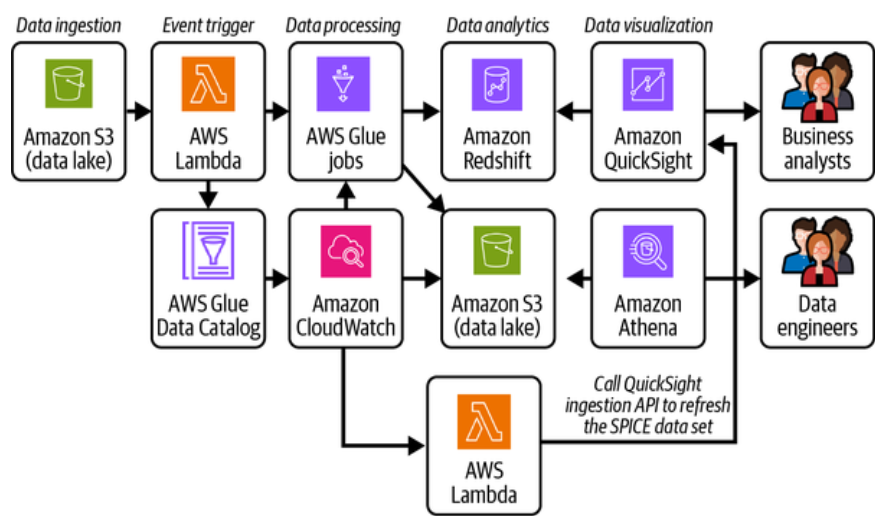
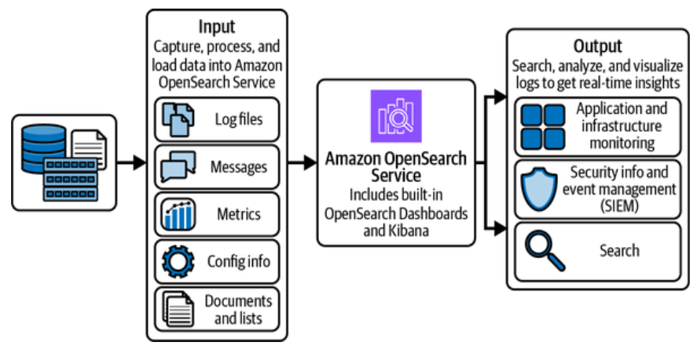

# Chapter 3. Overview of AWS Analytics and Auxiliary Services

This chapter aims to equip you with foundational knowledge of the primary AWS services in scope for the AWS Certified Data Engineer Associate certification. 

By understanding these services, you will gain insights into how AWS enables scalable, flexible, and cost-effective data analysis solutions. 

Additionally, we will dive into auxiliary services that enhance and support analytics workloads, such as Amazon S3 for data storage, AWS Lambda for serverless processing, and AWS IAM for security and access management. 

## AWS Analytics Services

AWS provides a comprehensive set of analytics services designed to meet all your data analytics needs, enabling organizations of all sizes and industries to reinvent their business with data. With the broadest selection of analytics services, AWS empowers users to process, analyze, and visualize vast amounts of data efficiently and effectively. 

### Amazon Kinesis Data Streams 

Amazon Kinesis Data Streams is a real-time, fully managed and scalable data streaming service that allows you to collect, process, and analyze data continuously. 

Feature highlights include: 

- *Easy administration* - The service is fully managed, meaning you do not need to worry about provisioning, managing, or maintaining the infrastructre.

- *Native AWS services integration* - Integrates natively with a range of other AWS services, creating a seamless and cohesive ecosystem for your data streaming needs. 

- *Autoscaling with on-demand mode* - Streams in the on-demand mode require no capacity planning and automatically scale to handle gigabytes of write and read throughput per minutes. 

- *Flexible retention options* - Provides flexible data retention options, allowing you to retain data in your streams from 24 hours up to 7 days by default, and up to 365 days with extended retention. 

- *Reduced latency with enhanced fan-out* - The **enhanced fan-out feature** significantly reduces latency by providing dedicated throughput per consumer. 

Some common use cases include: 

- Streaming log and event data 
- Powering event-driven applications 
- Evolving from batch to real-time analytics 

### Amazon Data Firehose 

Amazon Data Firehouse, previously known as Amazon Kinesis Data Firehose, is a fully managed near-real-time streaming ETL (extract, transform, and load), service. Amazon Data Firehose continuously processes data streams, automatically scales based on the data volume, and delivers data within seconds. 

Feature highlights include: 

- *Native integration with AWS services* - Natively integrates with various AWS services, facilitating seamless data flow and processing. 

- *Integration with popular third-party destinations* - Integrates with popular third-party services, enabling versatile data streaming solutions. This integration extends the utility of Data Firehose, allowing you to leverage various tools for data analysis, monitoring and visualization.

- *Easy to set up* - Designed to be straightforward and user-friendly, requiring no custom code to set up data streams. 

- *Serverless* - Removes the complexity of managing the underlying infrastructure. It automatically scales to match the throughput of your data streams and adjusts capacity based on the incoming data volume. 

- *Enable lightweight transformation* - Allows for lightweight data transformations before loading the data into the final destination. 

Some common use cases include: 

- Streaming into data lakes and warehouses 
- Streaming log data into SIEM tools 

### Amazon Managed Service for Apache Flink 

Amazon Managed Service for Apache Flink, previously known as Amazon Kinesis Data Analytics, is a fully managed service that simplifies building and running real-time streaming applications with Apache Flink. 

Feature highlights include: 

- *Fully compaytible with Apache Flink* - An open source distributed processing engine, offering powerful programming interfaces for both stream and batch processing. 
    - Supports *Stateful computing* - allows applications to maintain and manage state information over time, enabling critical tasks such as session management, anomaly detection, and complex event processing. 
    - Ensures *exactly-once-processing* - guarantees that each event is processed precisely once, when in the case of failures or retires. 

- *Interactive development experience with Studio notebook* - Provides an interactive development environment that allows customers to build, test, and deploy real-time streaming applications with ease. 

- *Flexible APIs with multilanguage support* - Offers flexible APIs in Java, Scala, Python, and SQL specialized for different use casese including stateful event processing, streaming ETL, and real-time analytics.

- *AWS service integrations with connectors* - Offers seamless integration with various AWS services through a rich set of built-in connectors. 

Some commone use cases include: 

- Real-time analytics 
- Fraud detection 
- Event-driven applications 

### Amazon Managed Streaming for Apache Kafka 

Amazon Managed Streaming for Apache Kafka (Amazon MSK) is a fully managed service that simplifies the process of buildilng and running applications that use Apache Kafka to process real-time streaming data. Amazon MSK provides high availability, security, and seamless integration with other AWS services, making it an ideal choice for enterprises loooking to implement event-drive architectures and real-time data processing pipelines. *

Feature highlights include: 

- *Fully compatible with Apache Kafka* - MSK runs native versions of Apache Kafka ensuring complete compatibility with existing Kafka applications and tools. 

- *Managed scaling with Amazon MSK Serverless* - Amazon MSK Serverless is an option within Amazon MSK that automatically scales your Kafka workloads based on demand, eliminating the need to manually manage cluster capacity. 

- *Extended data retention with tiered storage* - Amazon MSK offers tiered storage, which enables you to retain data for extended periods cost-effectively. With thiered storage, older data is automatically moved to a lower-cost storage tier. 

- *Amazon MSK Connect* - Amazon MSK Connect is a managed feature of Amazon MSK that streamlines streaming data between Apache Kafka and various sources or destinations. 

- *Automated data replication with Amazon MSK Replicator* - Amazon MSK Replicator provides a fully managed solution for replicating data across Amazon MSK clusters, even across different AWS Regions. 

Some common use cases include: 

- Real-time data analytics and processing 
- Building event-driven architectures and microservices 
- Implementing change data capture (CDC)
- Powering IoT data streaming solutions 

### Reference Architecture: Streaming Analytics 

#### Pattern with Apache Flink and MSK 

The following reference architecture illustrates a streaming analytics pipieline employing Amazon MSK and Amazon Service for Apache Flink for real-time fraud detection. As you'll see in Figure 3-1, events are ingested through an API Gateway and then streamed into Amazon MSK. Subsequently, Apache Flink applications perform real-time computations, such as anomaly detection or data enrichment, utilizing reference data from Amazon S3.

The processed output supports three primary use cases: 

1. Delivering fraud detection notification via Lambda and Amazon SNS
2. Enabling real-time search and reporting with Amazon OpenSearch Service 
3. Facilitating long-term log storage in Amazon S3. This architecture is well suited for event-driven applications, fraud monitoring, and the processing of high-velocity logs.

/// caption 
Figure 3-1. Real-time fraud detection system 
///

### AWS Glue

AWS Glue is a fully managed, serverless data integration service that simplifies the process of discovering, preparing, and loading data for analytics. As you'll see in Figure 3-2, AWS Glue provides a comprehensive suite of tools, including a data catalog, ETL capabilities, and support for event-driven workflows, enabling data engineers to quickly and easily build scalable and cose-effective data pipelines.

/// caption 
Figure 3-2. AWS Glue key capabilities 
/// 

Feature highlights include: 

- *Scalable data transformation engine* - AWS Glue features a robust, serverless ETL engine that supports various deployment options to match different workload requirements. This versatility allows organizations to select the mist approrpriate processing model for their specific needs.
    - Batch processing - Glue provides Apache Spark-based ETL jobs that can efficiently handle large-scale data transformations. 
    - Real-time - Glue Streaming ETL uses Apache Spark Structured Streaming to manage continuious data flows. 
    - Additionally, Glue offers lightweight Python shell jobs for simpler transformations. 

- *Centralized technical catalog and unified data quality control* - AWS Glue provides a centralized platform for managing and governing your data assets. This unified approach enhances data discovery, compliance, and consistent management practices across the organization. 
    - The AWS Glue Data Catalog serves as a centralized technical metadata repository. 
    - Glue Crawlers automatically discover, catalog, and classify data from various sources, populating the Glue Data Catalog with schema definitions and metadata. 
    - This catalog integrates seamlessly with AWS Lake Formation and Amazon DataZone, providing fine-grained access control and enabling data sharing. 
    - Glue Data Quality features allow you to define, run, and monitor data quality rules, ensuring the integrity and reliability of your data assets.

- *Tailored ETL interfaces* - AWS Glue enhances user productivity by providing a variety of interfaces tailored to different personas, including data engineers, data scientists, and data analysts. Additionally, AWS Glue includes robust monitoring and logging capabilities, allowing users to track job performance, troubleshoot issues, and ensure that data oeprations run smoothly and efficiently.  

- *Connect and ingest data with ease* - AWS Glue simplifies the process of connecting to and ingesting data from a wide array of sources through its extensive library of built-in connectors. 

Some common use cases include: 

- Building and managiing data lakes
- Data warehouse ETL 
- Real-time data processing 
- Data preparation for machine learning 
- Data integration from multipel sources 

### AWS Glue DataBrew

AWS Glue DataBrew is a visual data preparation tool that allows users to clean, normalize, and transform data without writing any code.

Feature highlights include: 

- *Visual data exploration and profiling* - AWS Glue DataBrew offers robust data profiling capabilities. 

- *No-code daata transformation* - AWS Glue DataBrew enables users to perform complex data transformations without writing code. 

- *Automated data quality and validation* - AWS Glue DataBrew includes automated data quality checks and validation rules that can be applied to datasets.

- *Reproducible and auditable workflows* - AWS Glue DataBrew enables the creation of reusable recipes, which are sequences of data transformation steps that can be applied to multiple datasets or rerun on updated data. 

Some common use cases include: 

- Ad-hoc data exploration and analysis 
- Data preparation for business intelligence (BI) reporting 
- Data cleaning and preprocessing for machine learning 

### Amazon Athena

Amazon Athena is a serverless, interactive analytics service built on open source frameworks, supporting open table and file formats. It enables users to analyze petabytes of data in Amazon S3 and 30 other data sources, including on-premises and cloud systems, using SQL or Python. Built on Trino, Presto, and Apache Spark, Athena requires no infrastructure management, offering a simplified way to query data where it resides. Its pay-per-query pricing model and support for various data formats provide a cost-effective and flexible solution for ad-hoc analysis, log processing, and building data-driven applications. 

Feature highlights include: 

- *Serverless SQL query engine* - Athena's core functionality is its serverless SQL query engine, which allows users to analyze data using ANSI SQL. 

- *Amazon Athena for Apache Spark* - Amazon Athena offers the ability to run Apache Spark workloads alongside SQL queries. 

- *Native support for open table formats* - Athena provides native support for open table formats, most notably Apache Iceberg. 

- *Federated query and prebuilt data source connectors* - Athena's federated query capability, coupled with its wide array of prebuilt data source connectors, enables querying data from various sources beyond Amazon S3 without data movement. 

Some common use cases include: 

- Data lake exploration and analytics 
- Business intelligence reporting 
- Log analysis and operational intelligence 

### Amazon EMR 

As shown in Figure 3-3, Amazon EMR (Elastic MapReduce) is a cloud-native big data platform that simplifies the processing and analysis of vast amounts of data. It manages the complexities of running popular open source frameworks like Apache Hadoop, Apache Spark, and Presto on dynamically scalable clusters. By abstracting cluster management tasks, EMR allows users to focus on extracting insights from their data efficiently and cost-effectively.

/// caption 
Figure 3-3. Amazon EMR value proposition
///

Feature highlights include: 

- *Support for multiple big data frameworks* - Amazon EMR natively supporst a comprehensive range of open source big data frameworks, including Apache Hadoop, Apache Spark, Apache HBase, Apache Flink, and Presto. It also supports open table formats like Apache Iceberg, Apache Hudi, and Delta Lake, enabling advanced data management features like time travel and schema evolution.

- *Versatile workload and user interfaces* - Users can interact with EMR through multiple interfaces, such as command-line tools, APIs, or interactive notebooks. 

- *Flexible deployment options* - You can run EMR on EC2, EKS, Serverless. 

Some common use cases include: 

- Large-scale batch data processing
- Real-time data processin 
- Big data analytics and machine learning

### Amazon Redshift

Amazon Redshift is a managed, petabyte-scale data warehouse service htat enables users to store and analyze large volumes of data using standard SQL. It is designed to handle datasets ranging from a few hundred gigabytes to several petabytes, offering fast query performance through its Massively Parallel Processing (MPP) architecture.

/// caption 
Figure 3-4. Amazon Redshift feature highlights 
///

Feature highlights include: 

- *Scalbility and elasticity* - Amazon Redshift offers exceptional scalability and elasticity to meet evolving data warehousing demands.

- *Seamless integration with the AWS ecosystem* - Amazon Redshift integrates deeply with the AWS analytics ecosystem. 

- *Secured data collaboration* - With Amazon Redshift data sharing, you can seamlessly share live data across Redshift clusters, workgroupsm AWS accounts, and regions without duplicating or moving the data.

- *Maximize value with machine learning* - Amazon Redshift empowers organizations to maximinze the value of theri data by integrating machine learning capabilities directly within the data warehouse. 

Some commone use cases include: 

- Empowering business intelligence and reporting
- Enabling big data analytics 
- Accelerating machine learning with SQL 
- Monetizing data assets 

### Amazon QuickSight

Amazon Quicksight empowers organizations with unified business intelligence (BI) at scale. Designed to provide fast, east-to-understand insights from data, it helps businesses make informed decisions. Quicksight is both scalable and severless, enabling it to support thousands of users without requiring infrastructure management. With Amazon Quicksight Q, business analysts can use natrual language to discover, build, and share insights in seconds. 

Feature highlights include: 

- *Severless and scalable architecture* - Amazon Quicksight's serverless architecture allows it to seamlessly accommodate varying numbers of users without requring manual infrastructure management.

- *Super-fast, Parallel, In-memory Calculation Engine (SPICE)* - By storing data in-memory, SPICE reduces data load tiems and accelerates query performance. It automatically replicates data for high availability, allowing thousands of users to simultaneously perform fast, interactive analyses without compromising performance. 

- *Embedded analytics* - Quicksight enables organizations to embed interactive dashboards and analytics into their own applications, portals, or websites. 

- *Generative BI* - Generative BI, powered by Amazon QuickSignt Q, allows users to interact with their data through natural language queries. 

- *Pixel-perfect reports* - Amazon QuickSight allows users to create and deliver pixel-perfect reports tailored to specific formatting and layout requirements. 

Some common user cases include: 

- Business reporting 
- Embedded analytics in customer applications

### Reference Architecture: Lakehouse with Glue, Redshift, and Athena 

Figure 3-5 illustrates a modern lakehouse setup, combining a centralized Amazon S3 dat alake with Amazon Redshift as the data warehouse. 

Data is initially ingested into the Amazon S3 data lake. Subsequently, an AWS Lambda function triggers AWS Glue jobs to transform the raw data into structured fornats, storing the processed data abck in Amazon S3 for downstream analytics.

Amazon Redshift then consumes this curated data for high-performance SQL analytics. Simultaneously, Amazon Athena enables interactive, serverless querying of raw and semi-structured data directly within Amazon S3. 

Amazon QuickSight provides business users and analysts with visualization dashboards, while another AWS Lambda function triggers SPICE refreshes for near-real-time reporting. This architecture supports ad-hoc queries, batch reporting, and BI use cases across large datasets. 

/// caption 
Figure 3-5. Lakehouse pattern with AWS Glue, Amazon Redshift, and Amazon Athena
/// 

### Amazon OpenSearch Service 

Amazon OpenSearch Service is a managed solution that simplifies deploying, operating, and scaling OpenSearch workloads in the cloud.  As illustrated in Figure 3-6, OpenSearch, an open source search and obervability suite, empowers users to derive insights from large volumes of unstructured data. With built-in visualization tools like OpenSearch Dashboards, users can search, analyze, and explore their data without worrying about infrastructure management complexitites. 

/// caption 
Figure 3-6. Amazon OpenSearch reference use cases 
/// 

Feature highlights include: 

- *Managed OpenSearch solutions* -  Amazon OpenSearch Service provides both provisioned OpenSearch clusters and OpenSearch Serverless options, offering flexibility for different workloads. 
    - Provisioned clusters suit predictable workloads, while serverless configraitons are ideal for dynamic, on-demand scaling, reducing the need for infrastructure management and improving operational efficiency.

- *Price-performant features* - Amazon OpenSearch Service offers multiple features designed to optimize performance and cost. 
    - It supports Gravitron instance for enhanced performance and cost savings, as well as the OpenSearch-optimized OR1 instance type, designed specifically to deliver superior performance for heavy operational analytics workloads. 
    - Additionally, tiered storage allows users to store infrequently ac cessed data cost-effectively while ensuring fast access to frequently queried data, helping optimize costs for different data patterns.

- *Managed data ingestion and transformation* - Amazon OpenSearch Services streamlines data ingestion through OpenSearch Ingestion, powered by Data Prepper. 
    - This fully managed service automates the process of ingesting, filtering, enriching, transforming, and touritn data to OpenSearch domains or serverless collections. 
    - It scales automatically to accomodate changing data volumes, eliminating the need for managing complex, multinode ingestion pipelines. 

- *Comprehensive security governance* - Amazon OpenSearch provides comprehensive security governance, including fine-grained access control, encyption at rest and in transit, and integration with AWS Identity and Access Management (IAM). These features ensure that your data remains secure and compliant with industry standards. 

- *Integration with open source tools* - OpenSearch Service integrates natively with popular open source tools such as OpenSearch Dashboards for data visualization, and log ingestion solutions like Logstash, Fluent Bit, and Fluentd. This allows users to maintain familiar workflows while leveraging the benfigts of a fully managed service. 

Some common use cases include: 

- Log analytics and observability 
- Lexical search 
- Semantic search and retrieval-augmented generation (RAG)

### Amazon DataZone 

Amazon DataZone is a data management service designed to streamline cataloging, discovering, governing, and consuming data cross various sources, including AWS, on-premises, and third-party platforms.
    - It provides a unified portal for efficient data management, enabling collaboration among data engineerrs, scientists, analysts, and business users while ensuring appropriate data access and governance. 

Feature highlights include: 

- *Managed business data catalog* - Amazon DataZone's core feature is its managed business catalog, which provides a centralized repository of data assets enriched with business context.
    - It automatically extracts metadata from sources like data lakes and data warehouses, ensuring that hte catalog is always comprehensive and up-to-date. 
    - Additionally, Amazon DataZone leverages large language models (LLMS) to recommend accurate metadata, metadata, genearting consistent business descriptions and names for data assets. 

- *Personalized data portal* - The personalized data portal offers a unified interface for  data producers and consumers. 
    - This web-based application allows users to access, analze, and collaborate on data assets without logging into the AWS Management Console. 
    - Users can search the catalog, request access to data, and perform analyses using tools such as Amazon Redshift or Amazon Athena, all within a single streamlined environment.  

- *Governed data sharing* - Amazon DataZone simplifies data sharing across teams, departments, opr business units with fine-grained access control and approval workflows for data subscriptions. Additionally, Amazon DataZone offers the ability to group data assets into predefined data products, simplifying cataloging and discovery for specific business use cases. 

- *Automated data quality and data lineage management* - Amazon DataZone provides automated tools for managing both data quality and lineaage. Organizations can define rules to assess dataset accuracy, completeness, and consistency. The data lineage capabilities offer an end-to-end view of data movementg over time, helping users understand data provenance, trace changes, and conduc root cause analysis. 

Some common use cases include: 

- Enterprise data cataloging 
- Cross-business unit or cross-account data sharing 
- Streamelined analytics workflows 

### AWS Lake Formation  

AWS Lake Formation simplifies centralized data governance, security, and global data sharing for analytics an machine learning workloads. It integrates with the AWS Glue Data Catalog, providing a unified platform for managing data permissions with fine-grained access controls. The service facilitates both internal and external data sharing while offering comprehensive auditing by tracking user- and role-based data interactions. 

Feature highlights include: 

- *Centralized data permission management* - AWS Lake Formation provides a centralized interface to manage permmissions for data lakes and data warehouses in AWS. Users can define and manage access controls using database-like grants. This security model applies not only to AWS services such as Amazon Redshift, Amazon Athena, and Amazon EMR, but also extends to third-party platforms like Starburst and Dremio, ensuring a unified security fraemwork for all data consumers. 

- *Advanced data governance at scale* - Lake Formation helps organizations implement fine-grained access controls (FGAC) and tag-based access contols (TBAC) for more scalable data governance. 
    - With FGAC, users can cnotrol access at multiple levels, including database, table, and column levels, allowing for a granular appraoch to data security. 
    - With TBAC, users can label data resources with tags and manage data access based on tags. 
    - This feature enables organizations to enforce policies and track compliance effectively across a large number of users and services. 

- *External data sharing* - Lake Formation integrates with AWS Data Exchange to facilitate external data sharing without requiring data movement. 
    - This allows organizations to license structured tables to external parties suchas partners, vendors, or clients. 
    - Data consumers can query and analyze this shared data using Lake Formation - compatible engines like Athena, reducing ETL overhead and accelerating insights from third-party data. 

AWS Lake Formation plays a crucial role in simplifying data governance within and beyond organizational boundaries. Interally, it allows administrators to enforce fine-grained and tag-based access controls across teams and accounts, ensuring users have appropriate access while maintaining compliance. 

## Auxiliary Services for Analytics

To build complete and efficient analytics solutions on AWS, it's essential to understand the auxiliary services that work in conjunction with these core analytics offerings. 

In this section, we will explore the key auxiliary AWS services that support and enhance analytics workloads. 

### Application Integration 

Application integration services enable communication and coordination between applications, microservices, and distributed systems. 

In analytics workloads, application integration services play a crucial role in enabling real-time data ingestion, triggering analytical processes, and orchestrating data pipelines. 

The application integration services covered in this certification include: 

- *Amazon EventBridge* - A serverless event bus that enables you to build event-driven architectures by routing events from various sources to target services for processing and analysis. The service makes it easy to connect application using data from your own applications, integrated SaaS, and AWS services. 

- *Amazon Simple Queue Service (Amazon SQS)* - A managed message queuing service that enables decoupling and scaling of microservices, distributed systems, and serverless applications. It allows you to send, store, and receive messages between microservices at scale. 

- *Amazon Simple Notification Service (Amazon SNS)* - A managed pub/sub messaging service for application-to-application and application-to-person communication. It enables message fan-out from one producer to multiple subscribers. 

- *Amazon Managed Workflows for Apache Airflow (Amazon MWAA)* - A managed service for Apache Airflow that allows you to orchestrate data pipelines and workflows. With Amazon MWAA, you can design directed acyclic graphs (DAGs) that define and orchestrate your workflows without the operational burden of managing the infrastructure. 

- *AWS Step Functions* - Acts as a serverless orchestration service that provides tight integration with over 220 AWS sevices, enabling you to define and execute workflows that automate processes, handle errors, and ensure the propert sequence of steps in your data pipelines. 

- *Amazon AppFlow* - A managed integration service that enables secure and automated data trasnfer between SaaS applications and AWS services. 

### Compute and Containers 

Compute and container services in AWS form the backbone of cloud-based applications. These services aencompass virtual servers, serverless computing, and container orchestration platforms, enabling you to choose the optimal compute model for your workloads.

In analytics workloads, these compute services are essential for processing, transforming, and analyzing vast amounts of data, particularly for customers who are self-managing their analytics workloads in the cloud. 

The key compute and container services include: 

- *Amazon EC2* - Provides scalable virtual servers in the cloud, allowing you to launch virtual servers with a wide range of instance types and configurations. 

- *Amazon Elasatic Container Service (Amazon EC2)* - A fully managed container orchestration service that simplifies running and managing Docker containers. It deeply integrates with the AWS environment and provides as easy-to-use-solution for running container workloads on AWS. 

- *Amazon Elastic Kubernetes Service (Amazon EKS)* - A managed Kubernetes service that makes it easy for oyu to ruyn Kubernetes on AWS and on-premeiss. Amazon EKS manages the availability and scalability of the Kubernetes control plan, making it easy to deploy, manage, and scale containerized workloads. 

- *Amazon Elastic Container Registry (Amazon EC2)* - A fully managed container registry that makes it easy to store, manage, and deploy container images securely and at scale. 

- *AWS Lamnda* - A serverless computer service that lets you run code without provisioning or managing compute resources. It allows you to take actions in response to events, ideal for event-driven or real-time data processing tasks. 

- *AWS Serverless Application Model (AWS SAM)* - An open source framework that streamlines the development and deployment of serverless applications, offering a simplified syntax to define functions, APIs, and databases. 

- *AWS Batch* - A fully managed batch processing service that dynamically provisions the optimal compute resources based on the volume and specific requirements of the batch jobs you submit. It can provision workloads on ECS clusters, EKS clusters, and EC2 instances. 

By leveraging these compute and container services, you can build scalable and efficient analytics solultions on AWS, whether you prefer the flexibility of virtual machines, the simplicity of serverless, or the portability of containers. 

### Database 

AWS offers a wide range of database services designed to support diverse data models and workload requirements. These include relational databases, key-value stores, document databases, in-memory data stores, graph databases, and more. 

AWS database services are integral to analytics workflows, serving as the original data store for structured and unstructred data. They act as data sources for analytics workloads, enabling real-time analytics, data warehousing, opperational analytics, and more. 

Key database services include: 

- *Amazon Relataional Database Service (Amazon RDS)* - Simplifies the setup, operation, and scaling of relational databasses in the cloud. It supports multiple database engines like MySQL, PostgreSQL, Oracle, and SQL Server. 

- *Amazon Aurora* - A high-performance, fully managed relational database compatible with MySQL and PostgreSQL. It offers enhanced speed and availability by separating compute and storage layers, allowing for automatic scaling and replication across multiple Availability Zones. 

- *Amazon DynamoDB* - A fast and flexible key-value database providing single-digit millisecond latency at any scale. It's ideal for applications requiring consistent, low-latency performance. 

- *Amazon DocumentDB* - A fully managed NoSQL database service comatible with MongoDB, optimized for JSON documents and scalable performance. 

- *Amazon Keyspaces (for Apache Cassandra)* - A scalable, highly available, and managed Apache Cassandra - compatible database service. Apache Cassandra is an open source, distributed NoSQL database engine ideal for handling large volumes of data across many servers without a single point of failure. 

- *Amazon MemoryDB* - A durable, in-memory database service that delivers ultra-fast performance for modern applications, copmatible with Redis data structures and APIs. 

- *Amazon Neptune* - A managed graph database service for building and running applications that work with highly connect dataasets, optimized for storing and navigating graph structures. 

### Storage 

AWS offers a comprehensive suit of storage services designed to cate to various data types and access patterns. 

In analytics workloads, these storage services are foundational for storing, managing, and archiving data. 

Key storage services include: 

- *Amazon Elastic Block Store (Amazon EBS)* - Provides easy-to-use, scalable, and high-performance block-storage volumes for Amazon EC2 instances. EBS volumes deliver consistent, low-latency performance, making them suitable for applications that require rapid access to data. 

- *Amazon Elastic File System (Amazon EFS)* - A scalable, elastic file storage service that lets you share file data across Amazon EC2 instnaces. It supports the Network File System (NFS) protocol, enabling concurrent access and file sharing among instances. 

- *Amazon S3* - An object storage service that allows organizations to store and retrieve any amount of data from anywhere. It offers industry-leaving scalability, data availability, security, and performance, making it ideal as the storage layer for data lakes. 

- *Amazon S3 Glacier* - A secure, durable, and low-cost storage class within Amazon S3 designed for data archiving and backup use cases. It provides a cost-effective solution for infrequently accessed data, with retrieval times ranging from milliseconds to hours. 

- *AWS Backup* - A fullt managed backup service taht simplifies the creation, management, and restoration of backups across multiple AWS services, including Amazon EBS, Amazon EFS, and Amazon S3. It helps ensure data protection and enables quick recovery in case of disasters. 

### Machine Learning 

Machine learning (ML) is a field of study within artificial intelligence that focuses on developing algorithms using mathematical and statistical modelsd, with an objective to imitate human intelligence. 

AWS offers a few services to serve different use cases of customers with different integration options. 

- *Amazon SageMaker* - A fully managed machine learning service that enables data scientists and ML engineers to build, train, and deploy ML models into a production-ready environment. It provides features and workflows that can help developer productivity and fast-track your model development and deployment. Sagemaker natively integrates with other AWS services that enables data science teams to query data from their data lake or data warehouse, store model artifacts in a object store, integrate security with AWS IAM, enable model inference with an API service layer, and provide end-to-end monitorint capability for operational efficiency. 

- *Amazon Bedrock* - A fully managed service that enables you to choose from high-performing foundation models (FMs) available in Bedrock or import your own custom model to fast-track your generative AI application development. 

- *Amazon Q* - A generative AI-powered assistant built on Amazon Bedrock that includes several capabilities. 
    - Amazon Q Business - can help answer questions, provide sumamries, and generate content. 
    - Amazon Q Developer - helps improve developer productivity by transforming code or generating new code. 

### Migration and Transfer 

With the popularit of cloud services in and AWS, a lot of customers are looking to migrate their workloads to AWS, which requires a large amount of historical data transfer. 

- *AWS Database Migration Service (DMS)* - A managed service that helps move data between data stores such as between AWS cloud services and from on-premises or other cloud providers to AWS. You can migrate from relational or NoSQL databases to AWS databases or object stores by defining the data movement as a one-time full load activity or by loading incremental data on a continuous basis. 

- *AWS DataSync* - An online data transfer and discovery service that enables the secure transfer of files or objects from, to, and between AWS services. If you have a large volume of NFS or HDFS files and plan to migrate to an AWS object store then DataSync might be a good option. 

- *AWS Data Exchange* - An AWS service that provides a data marketplace with data from AWS and other third parties with a subscription pricing model. It helps streamline data consumption and also enables you to sell your data to external cusomters through the marketpalce. It makes the data available in a secured manner that can be accessed through files, APIs, or Amazon Redshift queries. 

- *AWS Snow Family* - Enables processing of data at the edge or moving perabyte-scale data to and from AWS. It includes the AWS Snowball and Snowcone services. Snowball is popular for moving petabyte-scale data and is available with compute or storage optimized options. Snowcone is the most compact service and is specifically designed to be used outside of traditional data centers. 

- *AWS Transfer Family* - Enables secure transfer of data to and from AWS over SFTP, AS2, FTPS, FTP protocols. You can move data to and from the Amazon S3 object store or Amazon EFS. It is a fully managed service that provides workflow to easily configure, run, and monitor files being transferred. 

### Networking and Content Delivery 

As AS is a public cloud that is being used by millions of customers, network isolation, low-latency access, and domain routing are some of the key componenets for security and efficiency. 

- *Amazon Virtual Private Cloud* - Provides virtual network isolation, which you can integrate to deploy workloads that need to be logically isolated from other workloads. An AWS VPC includes the option to create a public subnet or a private subnet. 
    - A public subnet wil h ave a route to the internet, which means applications deployed in a public subnet can be configured to be accessible from the internet. 
    - Private subnets are meant ot be accessible within the VPC only and are not accessible over the internet. 

- *AWS PrivateLink* - Enables applications hosted within a VPC to access other AWS services through the AWS network, without getting routed through the internet. 

- *Amazon Route 53* - Provides a highly scalable and available Domain Name System (DNS) weith which domains such as *example.com* can get routed to a designated IP address of a server, which serves the response for the HTTP/HTTPS request. 
    - It provides several features to configure domain routing such as latency-based routing, IP-based routing, geo-based routing, DNS failover, health-check monitoring, and many more. 

- *Amazon CloudFront* - A content delivery network (CDN) service from which you can serve geospecific requests from CloudFront's nearby edge locations in a secure manner, which reduces network latency and improves performance.
    - It also provides computing at the edge through CloudFront Functions and Lambda@Edge features. 
    - It natively integrates with the Amazon S3 obejct store and supports conintuous deployment with real-time metrics and loging capabilities. 

### Security, Identity, and Compliance

AWS defines security as its top priority and makes sure all of its services are built with security at their core. It provides several products to address different security needs including identity management, user authentication, authorization, data encryption at rest and in transift, securing applications from external security attacks, and features that can enable you to monitor and audit access requests. 

Key security, identity, and compliance services include: 

- *AWS Identity and Access Management (IAM)* - A fully managed global service that enables authentication of users and authorized access to AWS resources. 
    - You can integrate external identity services to enable single sign on, implement fine-grained access control on AWS actions, enable just-in-time temporary credential vending, and much more. 

- *AWS Key Management Service* - A managed service htat helps you create and manage encryption keys in AWS. It is able to encrypt data at rest taht is stored in object stores, databases, or filesystems. 
    - You can take advantage of certain advanced features of AWS KMS such as multiregion KMS keys (replica of KMS keys in each region), creating KLS keys in an external store (protect AWS resources using cryptographic keys outside of AWS), and connecting KMS keys using private VPC endpoints. 

- *Amazon Macie* - A manged service that enables detecting sensitive data from storage layers such as Amazon S3 and sends notifications of respective stakeholders. 
    - It leverages macine learning and pattern matching to automatically detecty sensitive data in a cost-effective way. 

- *AWS Secrets Manager* - Enables storing and managing sensitive data elements such as database credentials, so that developers can avoid hardcoding them in scripts. 
    - You can control access to the secrets using IAM roles and let your application code refer to the Secrets Manager keys to get the credentials. 

- *AWS Shield* - Provides protection against distributed denial of service (DDoS) attacks for applications deployed in AWS. 
    - Additionally, AWS Shield Advanced managed threat protection service helps improve security by providing DDOS detection, mitigation, and response capabilities. 

- *AWS WAF* - An AWS service that acts as a firewall for web applications hosted on AWS by protecting HTTP or HTTPS requests. 
    - You can control access to your web content using WAF as it supports integration with multiple AWS resources such CloudFront distribution, the REST APIs of API Gateway, application load balancers, AppSync GraphQL APIs, Cognito u ser pool, and many more.

### Management Governance 

To be operationally efficient, AWS offers several services that you can integrate in your data analytics workloads to automate resource creation using infrastructure as code (IaC), enable observability through logging and monitoring, and improve management and auditability of resources. 

- *AWS CloudFormation* - A managed service that enables you to automate the creation and deployment of AWS services using an IaC approach. It reduces your effort compared to manually deploying, tracking failure, and rolling back failed deployments. 

- *AWS CloudTrail* - A managed service that keeps track of all the events of API actions taken by any user, role, group, or a service, which enables autiding actions and meeting compliance needs. 
    - It keeps track of activities including actions taken through SDKs, the console, and the CLI. 
    - CloudTrail is active by default when you create an AWS account. 

- *Amazon CloudWatch* - An AWS service that enables logging and monitoring of AWS resources and applications you are running in AWS. 
    - You can monitor metrics, define alarms, build dashboards, and analyze logs to improve system performance. 

- *AWS Config* - An AWS service that helps audit configuration changes in AWS resources and also provides a detailed view of how resources are related to each other. 
    - The AWS resources are entities such as EBS volume, VPC, security groups, VPC endpoints, and more. 
    - You can leverage AWS Config to identify how configuration values have changed for a resource over time and also build alerting for configuration changes. 

- *Amazon Managed Service for Prometheus* - A managed offering for the open source Prometheus solution, which is popular for metrics monitoring and alerting. 
    - It has native integration for container-based applications and also can be integrated into an organization-wide metrics monitoring solution. 
    - The managed offering from AWS helpsd integrate autoscaling capability and reduce operational overhead compared to a self-manged setup. 

- *Amazon Managed Grafina* - A managed offering for the open source Grafana solution, which is popular for building visualzations on top of metrics, traces, and logs. 
    - It is a great solution for observability and can be easily integrated on top of Prometheuss, Elastic, and many third-party prdocucts.  
    - The managed offering from AWS helps reduce operational overhead and integrate security standards. 

- *AWS Systems Manager* - An AWS service that provides visibility and control of your infrastructure on AWS. You can leverage Systems Manager for applications management, node management, change management, and operations management. 
    - It provides a visual interface that offers a common view across your infrastructures and also enables you to automate a lot of operational taks. 

### Developer Tools 

AWS offers a comprehensive set of tools and services that empower developers to efficiently develop, build, test, and deploy applications on the AWS platform. 

In the context of analytics workloads, AWS Developer Tools play a crucial role in the rapid devlopment and deployment of data processing pipelines and applications. 

Key developer tools and service includes: 

- *AWS Command Line Interface (AWS CLI)* - A unified command-line tool that enables developers to manage AWS services directly from the terminal, facilitating automation through scripts and commands. 

- *AWS CloudShell* - A browser-based, preauthenticated shell that provides command-l;ine access to AWS resources directly from the AWS Management Console, simplifying access wihtout the need for local installation or configuration. 

- *AWS Cloud Development Kit (AWS CDK)* - An open source software development framework that allows developers to define cloud infrastructure using familiar programming languages such as TypeScript, Python, Java, .NET, and Go. Infrastructure is then provisioned through AWS CloudFormation, ensuring infrastructure-as-code practices.

- *AWS Code Services* - Includes AWS CodeCommit, AWS CodeBuild, AWS CodeDeploy, and AWS CodePipeline. This suite of managed services facilities continuous integration and continuous delivery (CI/CD) workflows. 
    - AWS Code Services enable developers to store and version-control their code (CodeCommit), build and test their applications (CodeBuild), automate the deployment of their applications to various compute services (CodeDeploy), and orchestrate the entire release process (CodePipeline). 

### Cloud Financial Management 

Effective cost management is essential when working with cloud services, especially in data-intensive analytics workloads. AWS provides Cloud Financial Management tools that empower organizations to monitor, manage, and optimize their cloud spending. 

Key Cloud Financial Management tools include: 
 
- *AWS Cost Explorer* - A tool that helps you visualize, understand, and manage your AWS costs and usage ov er time. It provides a set of default reports and the ability to create custom reports, allowing you to analyze your cost and usage data, forecast spending, identify trends, and uncover areas for potential savings. 

*AWS Budgets* - Allows you to set custom and usage budgets for your AWS services. You can configure alerts to notify you via email or Amazon SNS when your actual or forecasting costs exceed your defined thresholds. This proactive approach helps you stay within your budget and avoid unexpected expenses. 

### AWS Well-Architected Tool 

The AWS Well-Architected tool is a service in AWS that provides a trusted framework that you can utilize to apply design best practices from AWS, implement improvements, and monitor progress. 

It explains best practices, categorized as six pillars: 

1. Security 
2. Reliability 
3. Sustainability 
4. Operational Excellence 
5. Performance Efficiency 
6. Cost Optimization 

