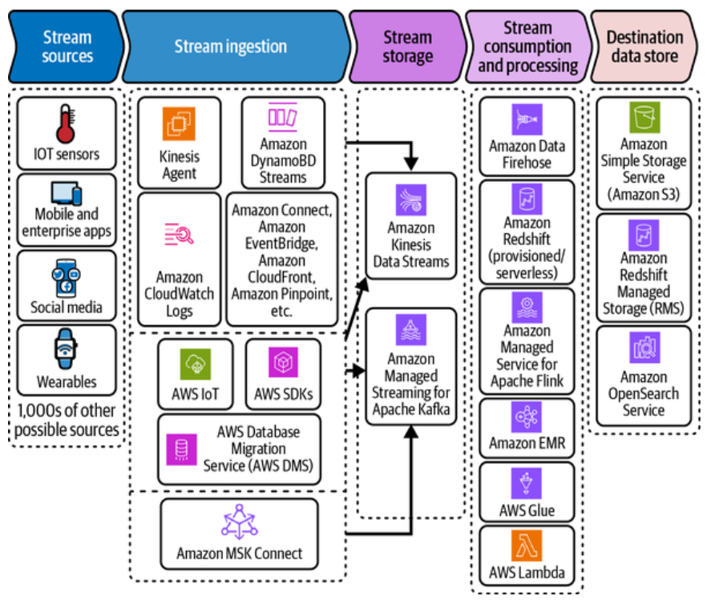
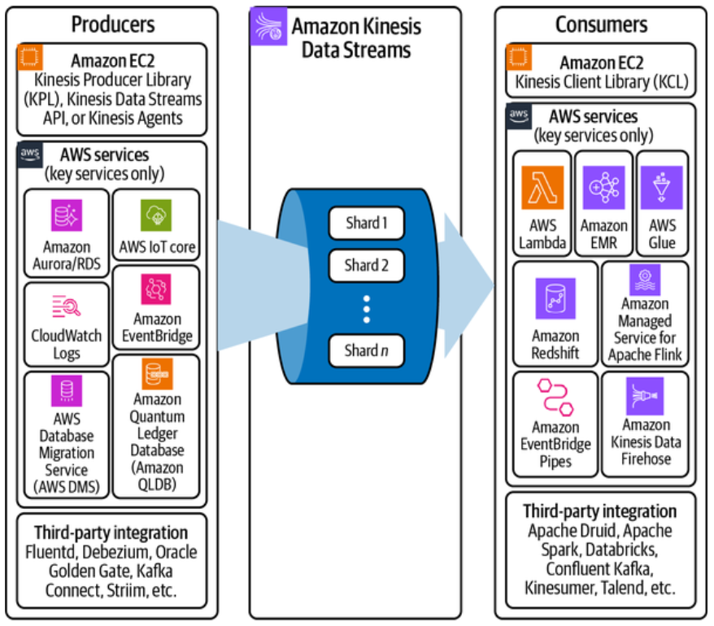
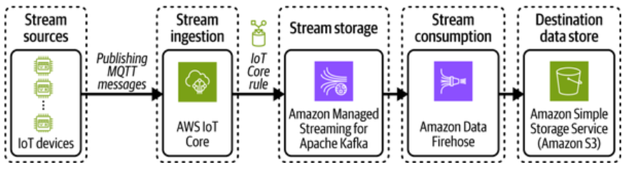
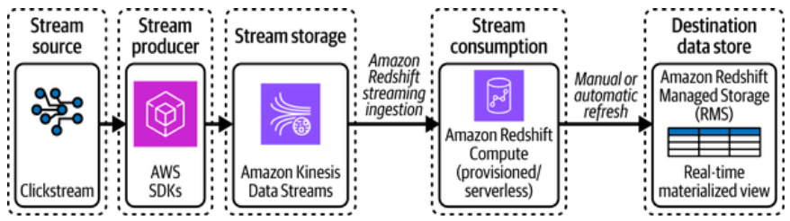
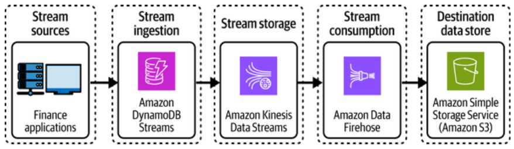
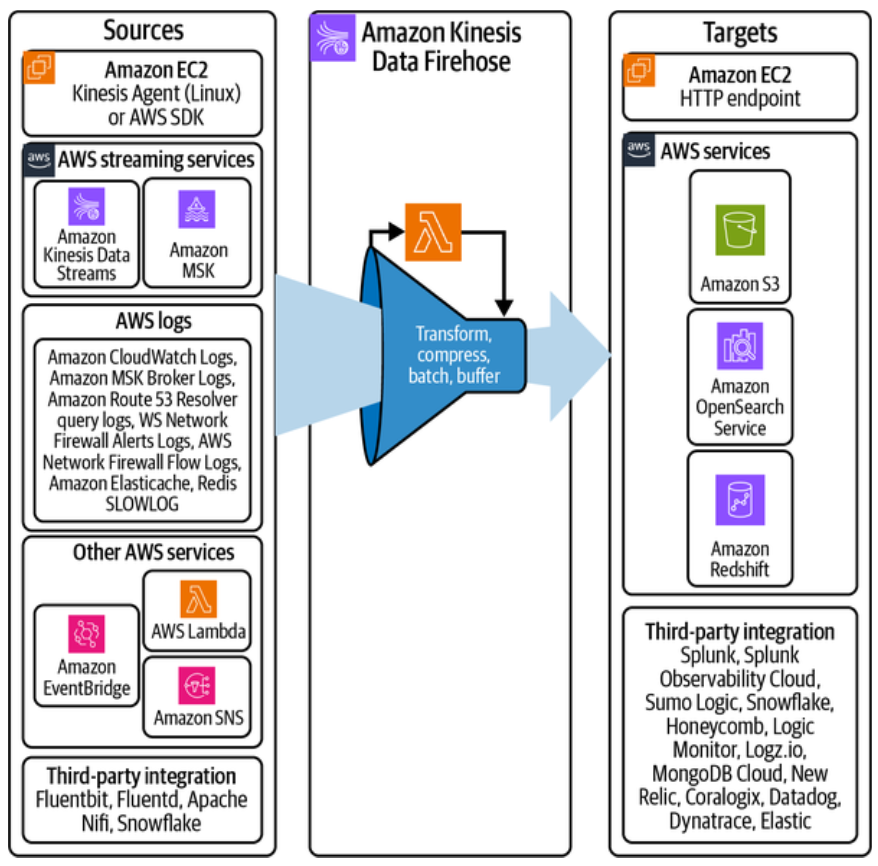
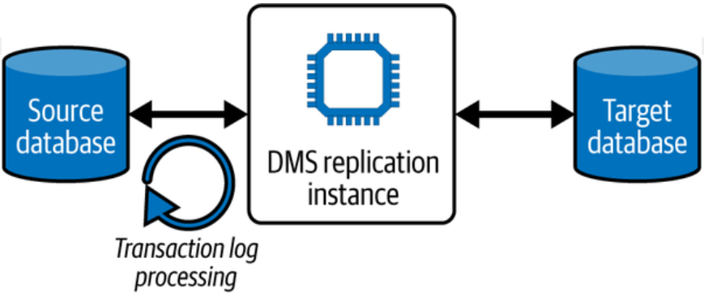
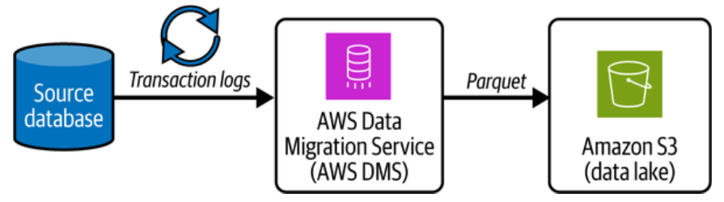
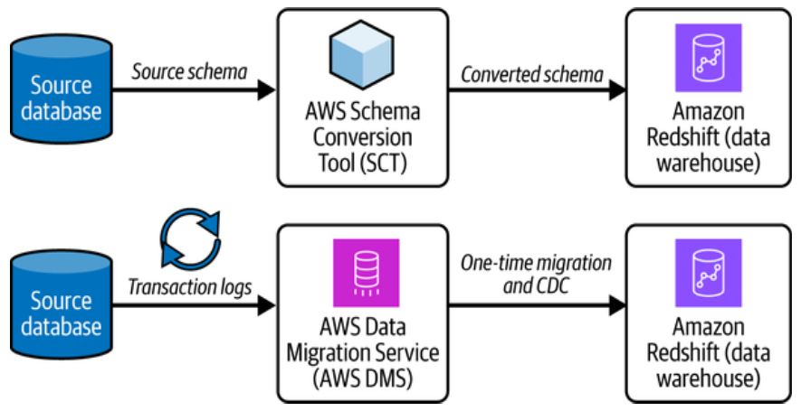

# Chapter 4. Data Ingestion and Transformation 

The ability to efficiently collect, ingest, and transform data from diverse sources is crucial for driving valuable insights and well-informed decisions. 

For data engineers, optimizing this end-to-end data ingestion and transformation process is a core responsibility. 

In this chapter, you wil learn how to do the following: 

- Design and implement efficient data ingestion pipelines using appropriate AWS services. 
- Choose the right AWS services for real-time/near-real-time and batch data processing. 
- Build reliable data pipeline for both batch and real-time scenarios. 
- Implement efficient data transformation strategies. 
- Apply best practices for data ingestion and transformation. 
- Orchestrate complex data workflows. 

## Data Ingestion 

Data Ingestion is the process of importing data from various sources into AWS storage and processing systems. Organizations typically deal with the following three ingestion patterns: 

- *Real-time streaming* - This is high-velocity data requiring immediate ingestion and/or processing. Streaming data is characterized by a continuious flow of small data records. 

- *Batch* - Ingesting batch data means periodic data loads at scheduled intervals. Larger volumes of data are processed together and the focus is on throughput over latency. 

- *Near real time* - Near real time is data with semi-frequent updates with slight delay tolerance. While ingesting it, it is important to balance between timeliness and efficiency. Typically CDC (change data capture) mechanisms are used for ingestion. 

Modern organizations typically need to ingest data from multiple sources such as streaming sources that generate events and messages, database files, and third parties. 

## Real-Time Streaming Data Ingestion 

Organizations have thousands of data sources that typically simultaneously emit messages, events ranging in size from a few bytes to several megabytes (MB). 

A streaming data pipeline for data analytics typically consists of five primay componenets, as show in Figure 4-1. 

This Pipelinei ingests and optionally transforms strewaming data in real time. It then loads into target analytics data stores for further processing, reporting, and analytics: 

1. *Stream sources* - Streaming data sources can be application logs, clickstream logs, mobile apps, etc. 

2. *Stream ingestion* - The stream ingestion layer is responsible for ingesting data into the stream storage layer. It provides the ab ility to collect data from tens of thousands of data sources and ingest in near real time. After collecting data, the data is sent to stream storage containing a stream name, data value, and sequence number. 
    - Kinesis Agent is a standalone Java application that can be used to monitor files and ingest new data continuously into Kinesis Data Streams. 
    - DynamoDB Streams - captures and provides a stream of time-ordered sequences of item-level modifications in any DynamoDB table.
    - Data produced from many AWS services such as Amazon Cloudwatch, Amazon Connect, Amazon EventBridge, Amazon CloudFront, Amazon PinPoint, etc. can stream data directly into Kinesis Data Streams. 
    - AWS IoT Core can connect to IoT devices and stream data into Kinesis Data Streams and Amazon MSK. IoT devices can send public data to AWS IoT Core using MQTT messages. AWS IoT C ore can then route the data into Kinesis Data Streams or Amazon MSK. 
    - Amazon MSK Connect can continuously ingest data from files, perform change data capture from databases, and load streaming data into Amazon MSK. 
    - If these out-of-the-box stream producers don't work for your use case, you can build custom stream producers using AWS SDK and Kinesis Produceres Library (KPL). This option has high implementation complexity and high operational overhead; carefully evaluate your needs before choosing this option. 

3. *Stream storage* - This is the central layer for streaming data pipelines. They can collect data from stream producers, store it for a set duration of time, and distribute the stored data to consumers. 
    - Stream data collectors store streaming data in the order it wasa received for a set duration of time, and cen replay it indefinitely during that time. 
    - They decouple thes tream producers from stream consumers. In AWS there are two stream data collectors. 
        - Amazon Managed Streaming for Apache Kafka (Amazon MSK)
        - Amazon Kinesis Data Streams

4. *Stream consumption and processing* - Stream consumers read data from stream storage nad load it into the target data store. They can either load the data as is into the target data store or apply transformations before loading the data into the target data store for analytics. The following are the relevant stream consumption and processing services: 
    - Amazon Data Firehose
    - Amazon Redshift (Provisioned/Serverless) compute 
    - Amazon Managed Streaming for Apache Flink (MSF)
    - AWS Glue streaming jobs 
    - Apache Spark Streaming or Apache Flink in Amazon EMR 
    - AWS Lambda 
    - A custom application with Kinesis Consumer Library (KCL)

5. *Destination data store* - The storage layer used for analytics streaming data pipeliens needs fast, inexpensive, and repeatable reads and write of large data streams. You should be able to load large volumes of continuously streaming data with low latenct. The most common target data storess for streaming data in the context of data and analytics are typically the following: 
- Data lakes: Amazon S3
- Data warehouses: Amazon Redshift 
- Search and log analytics solutions: Amazon Redshift 
- Search and log analytics solutions: Amazon OpenSearch

/// caption 
Figure 4-1. Streaming data pipeline for data analytics in AWS
///

### Kinesis Data Streams Versus Amazon MSK

When choosing between the AWS streaming services KDS and Amazon MSK for your streaming data ingestion needs, it's important to carefully assess your specific requirements and use case. 

A direct integration significantly simplifies your solution and will be the one with elasat operational overhead. Amazon Kinesis Data Streams offers direct integrations with many AWS services, as shown in Figure 4-2.

/// caption 
Figure 4-2. Integration for Amazon Kinesis Data Streams 
/// 

Kinesis offers AWS-focused integrations and simplicity in operational management. On the other hand, Amazon MSK is an open source ecosystem with richer connections and a higher level of flexibilty.

|Attribute|Kinesis Data Streams|Amazon MSK (Managed Streaming for Apache Kafka)|
|---------|--------------------|----------|
| Management overhead|Low|Low(Amazon MSK Serverless) to medium (Amazon MSK Provisioned)
| Scalability | Scale in seconds with one click | Scale in minutes with one click|
|Throughput| On-demand scaling is available, but scaled within certain limits| Highest throughput of two options|
| Open source|No|Yes|
|Data retention|You can retain data for up to 365 days.| You can retain data for a longer duration and it is configurable. With the tiered storage feature of Amazon MSK, you can cost-efficiently store vast amounts of data in Amazon S3.| 
|Latency|70 milliseconds when using enhanced fan-out consumers, 200-500 millisecond without the enhanced fan-out| Lowest| 
/// caption
Table 4-1. Comparison between Kinesis Data Streams and Amazon MSK
///

### Sample Streaming Ingestion Use Cases 

#### Ingesting streaming data from IoT devices into a data lake 

To achieve this, you can use the ELT architecture described in Figure 4-3. 

/// caption 
Figure 4-3. Streaming ingestion architecture for IoT data into an Amazon S3 data lake
///

In this architecture, the IoT devices publish MQTT messagse to AWS IoT Core. An IoT Core rule will then load these streaming messages into Amazon MSK. 

Once the data is read into Amaazon MSK, you'll need a consumer to load it into the Amazon S3 data lake. This is where Amazon Data Firehose (ADF) comes into play. 

Often, the incoming data is not in a format that is optimized for data lake consumption. It is produced in formats like JSON. ADF has built-in transformations to support converting JSON to optimized Apache Parquet and Apache ORC formats. These columnar data formats save space anda enable faster queries on the Amazon S3 data lake. 

#### Ingeting click streams into a data warehouse for real-time reporting 

Figure 4-4 presents an architecture diagram for ingesting clickstream data into an Amazon Redshift data warehouse using the streaming ingestion feature. 

/// caption 
Figure 4-4. Streaming ingestion for Amazon Redshift data warehouse 
/// 

Using this feature, you can directly ingest streaming data from KDS, Amazon MSK, or self-managed Apache Kafka into Amazon Redshift in real time with minimal operational overhead and implementation complexity. 

The data read from the stream is loadsed into a materialized view (MV) witihn the Amazon Redshift database. Sources typically stream data in semi-structured formats like JSON. You can either use the Amazon Redshift data format called SUPER or shred the data into individual columns. You can define transformations in the MV definition to apply businesss logic on incoming data. 

As the MV is refreshed, Amazon Redshift automatically and incrementally consumes the new data from the stream and loads it into it. The incremental refresh ensures that only the newest records are loaded, rather than reloading the entire dataset. 

The MV refresh can be set to run manually or automatically. 

#### Streaming Amazon DynamoDB data into a centralized data lake 

The third use case is to ingest financial data from a DynamoDB database into an Amazon S3 data lake for real analytics. DynamoDB has a feature called DynamoDB Streams that captures and streams changes made to DynamoDB in real time. The changes can be loaded into KDS using a direct integration between DynamoDB Streams and KDS. This data can be delivered through any consumer that KDS supports. 

/// caption
Figure 4-5. Streaming finance data from DynamoDB into S3
///

#### Ingesting AWS logs into log analytics solutions 

This use case is to ignest logs from AWS services into Amazon OpenSearch for real-time monitoring and analysis. 

You can use subscription filters in Amazon CloudWatch log groups to ingest data directly to ADF, as shown in Figure 4-6. The data can be delivered to the Amazon OpenSearch service or third-party log analytics solutions like Splunk.

/// caption 
Figure 4-6. Integrations for Amazon Data Firehose
///

ADF is designed for batch-oriented, higher-latecny, data processing, making it suitable for applications that can tolerate higher latency. It automatically delivers data to the selected destination in batches, with typical latencies of a few minutes to an hour. It has native integration with the following targets, making it an oprerationally efficient and low implementation complexity solution to load data into these supported targets: 

- Multiple third-party solutions like Splunk, Dynatrace, etc. 
- Amazon Redshift and Amazon OpenSearch
- Amazon S3 to Iceberg format tables or plain Parquet 

ADF is a good hoice for use cases that require streaming ingestion to Iceberg Tables of S3 data lakes for data lake ingestion, log data collection, and data backup. 

ADF has the capability of taking an optional backup of the raw incoming data into an Amazon S3 bucket. While applying transformations, if any records have errors, they are routed into a separate S3 location. 

## Ingesting Data Using Zero-ETL Integrations 

Zero-ETL is a set of integrations that minimizes the need to build complex ETL data pipelines to extract data. Zero-ETL integrations facilitate continuous, point-to-point data movement without the need to create ETL data pipelines. 

AWS offers zero-ETL integrations into Amazon S3 data lakes, Amazon Redshift data warehouses, and Amazon OpenSearch from a variety of sources, including the following: 

- AWS relattional databases: Amazon Aurora, Amazon RDS
- AWS NoSQL databases: Amazon DynamoDB, Amazon DocumentDB
- SaaS applications: Salesforce, ServiceNow, Zendesk, SAP, etc. 
- Files from Amazon S3

> Note: zero-ETL integrations offer *near-real-time latency*. 

Table 4-2 shows the zero-ETL integrations available in AWS. 

| |Amazon S3 (datalake)|Amazon Redshift (data warehouse)| Amazon OpenSearch (search and log analytics)|
|-|--------------------|--------------------------------|---------------------------------------------|
|**Amazon DynamoDB**| Amazon DynamoDB zero-ETL integration with Amazon S3 enables integration of DynamoDB data with Iceberg format tables in Amazon S3 | Amazon DynamoDB zero-etl integration with Amazon Redshfit enables high-performance analytics on DynamoDB data in Amazon Redshift | Amazon DynamoDB zero-ETL integration with Amazon OpenSearch Service provides advanced search capabilities such as full-text and vector search, on Amazon DynamoDB data | 
|**Amazon DocumentDB** | | |Amazon DocumentDB zero-ETL integration with Amazon OpenSearch Service provides advanced search capabilities, such as fuzzy search, cross-collection searech, and multilingual search, on Amazon DocumentDB documents | 
| **Amazon Aurora MySQL & Amazon Aurora Postgres** | | Amazon Aurora zero-ETL integration with Amazon Redshift makes transactional data from Aurora available in Amazon Redshift for analytics | |
| **Amazon RDS MySQL** | | Amazon RDS MySQL zero-ETL integration with Amazon Redshift makes transactional data from RDS MySQL avilable in Amazon Redshift for Analytics | |
| **Amazon S3** | | Simplifies data ingestion from Amazon S3 to Amazon Redshift using auto-copy | Amazon OpenSearch Serevice zero-ETL integration with Amazon S3, an efficient way to query operational logs in Amazon S3 data lakes, removing the need to switch between tools to analyze data | 
| **SaaS applications** | Zero-ETL integration is available | Amazon Redshift and support for zero-ETL integrations from SaaS applications | |
| **Amazon CloudWatch Logs** | | | Amazon OpenSearch Service zero-ETL integration with Amazon CloudWatch Logs enables direct querying and visualization of log data in near real time |
|**Amazon Security Lake** | | | Amazon OpenSearch Service zero-ETL integration with Amazon Security Lake enables direct searching and analysis of security data |

## Ingesting Data from Databases with CDC Using AWS Data Migration Service

When zero-ETL integrations are not available and/or when you want to load data into a data lake, you can use the AWS Data Migration Service (DMS), an AWS service that leverages change data capture (CDC) capabilities to enable near-real-time data ingestion from databases int oAWS services like Amazon S3, Amazon Redshift, Amazon RDS, and others. 

This technique monitors and captures insert, update, and delete operations perfomed on a database in near real time. It provides a stream of change events reflecting the actual data modifications occuring, including details like operation type, data values, before and after the change, timestamp, and contextual information. CDC enables capturing data source changes with low impact, without directly querying the transactional systems. 

As illustrated in Figure 4-7, DMS uses a replication instance to connect to the source database, capture changes using transaction logs, and stream those data changes to the target in near real time.

/// caption 
Figure 4-7. Change data capture (CDC) using AWS DMS
/// 

This CDC approach  reduces the impact on source databases during data migration compared to bulk extraction methods. DMS supports homogeneous and heterogenous database migrations while providing features like multi-az deployment for high availability. 

DMS can perform one-time migration of data in addition to performing CDC. 

### Supported Sources for AWS DMS

- On-premises databases such as Oracle, Microsoft SQL Server, MySQL, MariaDB, PostgreSQL, MongoDB, SAP Adaptive Server Enterprise (ASE), IBM Db2

- Third-party managed database services such as Microsoft Azure SQL Database, Microsoft Azure PostgreSQL, Microsoft Azure MySQL, Google Cloud for MySQL, Google Cloud for PostgreSQL, OCI MySQL Heatwave 

- Amazon RDS database instances including Amazon RDS Oracle, Amazon RDS Microsofty SQL server, Amazon RDS MySQL, Amazon RDS MariaDB, Amazon RDS PostgreSQL, Amazon Aurora MySQL, Amazon Aurora PostgreSQL, Amazon RDS for IBM Db2 LUW.

- Amazon S3 data lakes 

- Amazon DocumentDB

### Supported Targets for AWS DMS

- Amazon RDS database instances (Oracle, SQL Server, MySQL, MariaDB, PostgreSQL, Aurora)
- Amazon Redshift data warehouses 
- Amazon S3 data lakes 
- Amazon DynamoDB NoSQL databases
- Amazon OpenSearch clusters 
- Amazon Kafka clusters 
- Kinesis Data Streams for real-time data streaming 
- Amazon DocumentDB document databases 
- Amazon Neptune graph databases 
- Databases like Oracle, SQL Server, PostgreSQL hosted on EC2 or on premises 

### Sample Use Cases 

#### Ingesting data into an Amazon S3 data lake using DMS 

Figure 4-8 presents the architecture diagram for loading data from source databases into an Amazon S3 data lake in near real time using AWS DMS. 

/// caption 
Figure 4-8. Change data capture (CDC) into Amazon S3
///

When loading data into S3, DMS doesn't preserve the transaction order by default. Configure the target S3 endpoint settings to specify a folder path for storing CDC transaction files. 

DMS allows you to control the frequency at which CDC files are written to the S# target during a data replication task. This is done by setting the following extra connection attributes. Choose these values in such a way as to avoid files that are too small or too large (more than 1 GB): 

- `cdcMaxBatchInterval` - This attribute specifies the maximum time (in seconds) to accumulate CDC data before writing it to the S3 target as a file. A higher value means less frequent files writes, but larger files sizes. 

- `cdcMinFileSize` = This attribute sets the minimum file size (in KB) before AWS DMS will write a CDC file to the S3 target. A higher value means fewer, larger files. 

To enable faster queries on the loaded data, set the target file format to Apache Parquet instead of the default CSV.

#### Ingesting data into Amazon Redshift using DMS

For those source databases that don't have a zero-ETL integration with Amazon Redshift, you can use AWS DMS to ingest data using CDC techniques. For Schema conversion to Redshift format you can use the AWS Schema Conversion Tool (SCT), and for the ont-time data migration and ongoing replication, you can use AWS DMS. DMS also supports creating schemas; however, for good performance, it is recommended to use AWS SCT instead of DMS for schema conversion. 

Figure 4-9 presents the architecture diagram for both one-time schema conversion and ongoing CDC from supported source databases and Amazon Redshift. 

/// caption 
Figure 4-9. Change data capture (CDC) into Amazon Redshift using AWS DMS
///

#### Converting schema using DMS Schema Conversion 

DMS Schema Conversion facilitates database migrations between different types. You can first create a report to assess the complexity of your migration. Then you cna convert databases schemas and code objects and apply converted code to your target database. 

DMS Schema Conversion automatically converts your source database schemas and most of the database code objects to a format compatible with the target database. This includes: 
    - tables 
    - views
    - store procedures 
    - functions 
    - data types 
    - synonyms 
    - and so on... 

Any object that can't be converted are clearly marked. 

#### Injesting files from on premises 

AWS DataSync is a managed data transfer service that makes it simple and fast to move large amounts of file data online between on-premises storage systems and AWS storage services. 

With DataSync, you can schedule one-time or recurring data transfers to keep data updated between your on-premises servers, NAS, and AWS storage like S3 and EFS. DataSync copies only changed files/objects after the initial data seeding, minimizing times for subsequent syncs. 

#### Injesting third-party datasets 

AWS Data Exchange is a service that simplifies that process of accessing and integrating third-party data. It serves as a marketplace where data providers can publish  and sell their datasets, and data consumers can easily discover, subscribe to, and integrate the data they need. 

Once subscrubed, data consumers can access the datasets through a user-friendly console or API. With its robust governance features and seamless integration with other AWS services, AWS Data Exchange simplifies the process of accessing and leveraging third-party data to drive business insights and innovation. 

### Best Practices for Data Ingestion 

