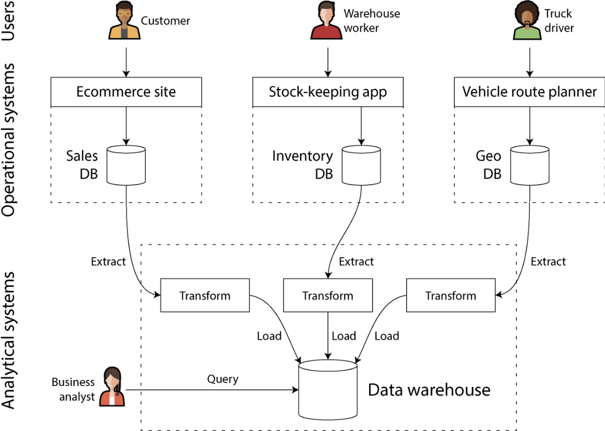
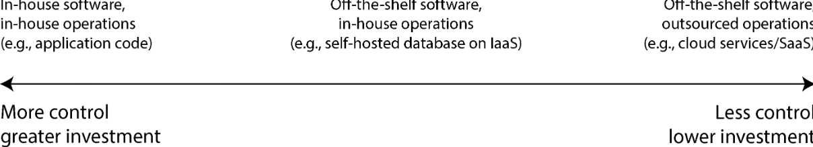

# Chapter 1. Trade-Offs in Data Systems Architecture

> **“There are no solutions; there are only trade-offs[…]. But you try to get the best trade-off you can get, and that’s all you can hope for.”** - *Thomas Sowell*

- We call an application *data-intensive* if data management is one of the primary challenges in developing the application[…]. We usually worry about things like storing and processing large data volumes, managing changes to data, ensuring consistency in the face of faults and concurrency, and making sure services are highly available. 
- Such applications are typically built from standard building blocks that provide commonly needed functionality.
- This book is a guide to help you make decisions about which technologies to use and how to combine them.

Some terminology: 

- *Backend development* - the server-side code that handles requests.
- *Frontend development* - the client-side code.

## Operational Versus Analytics Systems 

- *Operational systems* - backend services and data infrastructure where data is created. Here, the application code both reads and modifies the data in its databases, based on the actions performed by the users. 
- *Analytical systems -* contain a read-only copy of the data from operational systems, they are optimized for the types of data processing that are needed for analytics
- *Data engineers* - the people who know how to integrate operational and analytical systems and who take responsibility for the organization’s data infrastructure more widely.
- *Analytics Engineers* - the people who model and transform data to make it more useful for the business analysts and data scientists in an organization.

### Characterizing Transaction Processing and Analytics

- *Online Transaction Processing (OLTP)* - interactive applications with access patterns that are based on user input.
    - Typically looking up a small number of records by a key - known as a *point query*.
    - Records are inserted, updated, or deleted based on the user’s input.
- *Online Analytical Processing (OLAP)* - Usually an analytical query scans over a huge number of records and calculates aggregate statistics (such as count, sum, or average) rather than returning the individual records to the user.

| **Property** | **Operational Systems (OLTP)** | **Analytical Systems (OLAP)** |
| --- | --- | --- |
| Main read pattern | Point queries (fetch individual records by key) | Aggregate over large number of records. |
| Main write pattern | Create, update, and delete individual records | Bulk import (ETL) or event stream |
| Human user example | End user of web / mobile application | Internal analyst for decision support |
| Machine use example | Checking if an action is authorized | detecting fraud / abuse patterns |
| Types of queries | Fixed, predefined by application | Arbitrary, ad-hoc exploration by analysts |
| Query volume | Lots of small queries | Few queries, each is complex |
| Data represents | Latest state of data (current point in time) | History of events that happened over time |
| Dataset size | Gigabytes to Terabytes | Terabytes to Petabytes |
|  |  |  |

> **Note:** The meaning on *online* in *OLAP* is unclear; it probably indicates that queries are not just for predefined reports, but that analysts use the OLAP system interactively for explorative queries.
>

### Data Warehousing

- *Data Warehouse* - a separate database system (other than the OLTP system) to run analytical queries on.
- *Extract-Transform-Load (ETL)* - data is extracted from OLTP databases, transformed into an analysis-friendly schema, cleaned up, and then loaded into the data warehouse.
    - Sometimes the order of the *transform* and *load* steps in swapped, resulting in *ELT*.
    - ETL processes have been generalized to *data pipelines*.

/// caption
A simplified outline of ETL into a data warehouse.
///

- *Hybrid transactional / analytical processing (HTAP)* - aims to enable OLTP and analytics in a single system without requiring ETL from one system to another.
    - Many HTAP systems internally consist of an OLTP system couples with a separate analytical system, hidden behind a common interface.
    - It is useful when the same application needs to both perform analytics queries that scan a large number of rows and read and update individual records with low latency. Fraud detection can involve this kind of workload.

#### From Data Warehouse to Datalake

A data warehouse often uses a *relational* data model that is queried through SQL, this works well for business analysts but is less suited for the needs of data science tasks like: 

- Creating *features,* i.e., turning rows and columns of a database table into a vector or matrix of numerical values. This process is called *feature engineering*.
- Using natural language processing (NLP) techniques on data to try and extract structured information from it.
- Extracting structured information from photos by using computer vision techniques.

The answer is a *data lake* - a centralized data repository that holds a copy of any data that might be useful for analysis, obtained from operational systems via ETL processes. Sometimes called the *sushi principle*; raw data is better.

#### Beyond the Datalake

- Organizations have been paying more attention to the management and operation of analytical systems and data pipelines. Drive by issues of governance, privacy and compliance with regulations such as the General Data Protection Regulation (GDPR) and the California Consumer Privacy Act.
- Streaming events and stream processing allows analytics systems to respond to events much faster. This can be valuable depending on the application and its time-sensitivity.
- *Reverse-ETL* - when outputs of analytical systems are made available to operational systems.

### Systems of Record and Derived Data

- *Systems of record* - also known as the *source of truth*; holds the authoritative or *canonical* version of data.
- *Derived data systems* - the result of taking existing data from another system and transforming or processing it in some way. It can be recreated for the original source.
    - Technically speaking, derived data is *redundant*, in the sense that it duplicates existing information.
- The distinction between a system of record and a derived data system depends not on the tool, but on the way you use it in your application.

## Cloud Versus Self-Hosting

/// caption 
The spectrum of decisions on outsourcing software and its operations
///

### Pros and Cons of Cloud Services

Using a cloud service, rather than running comparable software yourself, essentially outsources the operation of that software to the cloud provider. This could potentially be cheaper than buying your own but there are some downsides. 

- Having no control over it.
- If your team has the experience and hardware its significantly cheaper to self-host.

### Cloud Native System Architecture

- *Cloud-native* - used to describe an architecture that is designed tot ake advantage of cloud services.

## Distributed Versus SIngle-Node Systems

A system that involves several machines communicating via a network is called a *distributed system*.

- Each of the processes participating in a distributed system is called a *node*.

You may want to use this system for various reasons: 

- *Inherent distribution* - if an applications involves two or more interacting users, each using their own device, then the system is unavoidably distributed.
- *Requests between cloud services* - if data is stored in one service but processed in another, that data must be transferred over to the other.
- *Fault tolerance / high availability* - you can use multiple machines to give you redundancy.
- *Scalability* - you can potentially spread load across multiple machines.
- *Latency* - if you have users around the world, you might want to have servers in various regions worldwide so that each user can be served from a sever that is geographically close to them.
- *Elasticity* - if your application is busy at some times and idle at others, a cloud deployment can scale up or down to meet the demand.
- *Specialized hardware* - different parts of the system can take advantage of different types of hardware to match their workload.
- *Legal compliance* - some countries have data residency laws that require data about people in their jurisdiction to be stored and processed geographically within that country.
- *Sustainability* - if you have flexibility on where and when to run your jobs, you might be able to run them at a time and in a place where plenty of renewable electricity is available and avoid running them when the power grid is under strain.

### Problems with Distributed Systems

- Every request and API call that traverses the network needs to deal with the possibility of failure.
- Making a call to another service is still vastly slower than calling a function in the same process.
- Troubleshooting a distributed system os often difficult, how do you figure out where the problem lies?
    - Techniques for diagnosing problems in distributed systems are developed under the heading of *observability*, which involves collecting data bout the execution of a system and allowing that data to be queried in ways that allow both high-level metrics and individual events to be analyzed.
    - *Tracing* tools allow you to track which client called which server for which operation and how long each call took.

### Microservers and Serverless

- The most common way to distributing a system across multiple machines is to divide them into clients and servers and let the clients make requests to the servers.
- *Microservices architecture* - in a microservice architecture, a service has one well-defined purpose; each service exposes an API that can be called by clients via the network, and each service has one team that is responsible for maintenance.
    - Microservices are primarily a technical solution to a people problem: allowing different teams to make progress independently without having to coordinate with each other.
- *Serverless* or *function as a service (FaaS)*, is another approach to deploying services, in which the management of the infrastructure is outsourced to a cloud vendor. You only pay for the time that your application code is running rather than having to provision resources in advance.
    - The term “serverless” can also be misleading; each serverless function execution still runs on a server, but subsequent exeuctions might run on a different one.

### Cloud Computing Versus Supercomputing

- *High-performance computing* (HPC) also known as *supercomputing* is another way of building large-scape computing systems.

### Summary

The theme of this chapter has been to understand trade-offs — that is, to recognize that many questions do not have one right answer, but several possibilities that each have pros and cons. We explored some of the most important choices that affect the architecture of data systems, and we introduced terminology that will be used through the rest of the book.

We started by making a distinction between operational (transaction processing, OLTP) and analytical (OLAP) systems and exploring how they differ, not only in managing different types of data with different access patterns, but also in serving different audiences. Along the way, we encountered the concepts of data warehouses and data lake, which receive data feeds from operational systems via ETL. In Chapter 4 we will see the operational and analytical systems often use very different internal data layouts because of the different types of queries they need to serve. 

We then compared cloud services, a comparatively recent development, to the traditional paradigm of self-hosted software that has previously dominated data systems architecture. Which of these approaches is more cost-effective depends a lot on your particular situation, but it’s undeniable that cloud native approaches are bringing big changes to the way data systems are architected — for example, in the way they separate storage and compute. 

Cloud systems are intrinsically distributed, and we briefly examined some of the trade-offs of distributed systems compared to using a single machine. In some situations you can’t avoid going distributed, but it’s advisable not to rush into making a system distributed if it’s possible to keep it on a single machine. In Chapter 9 we will cover the challenges with distributed systems in more detail. 

Finally, we saw that a data system’s architecture is determined not only by the needs of the business deploying the system, but also by privacy regulations that protect the rights of the people whose data is being processed — an aspect that many engineers are prone to ignoring. How we translate legal requirements into technical implementations has not yet been formalized, but it’s important to keep this question in mind as we move through the rest of this book.