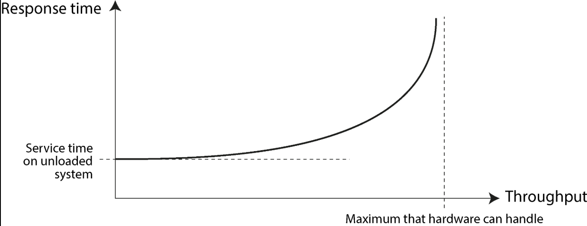
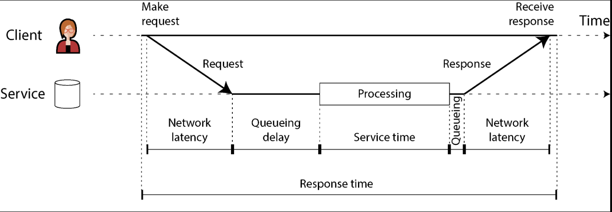
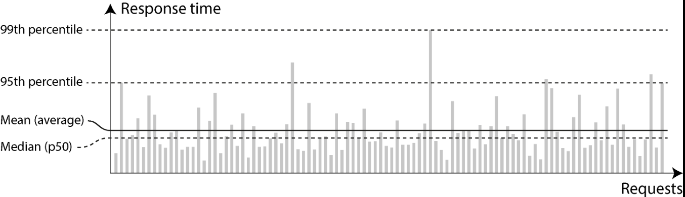
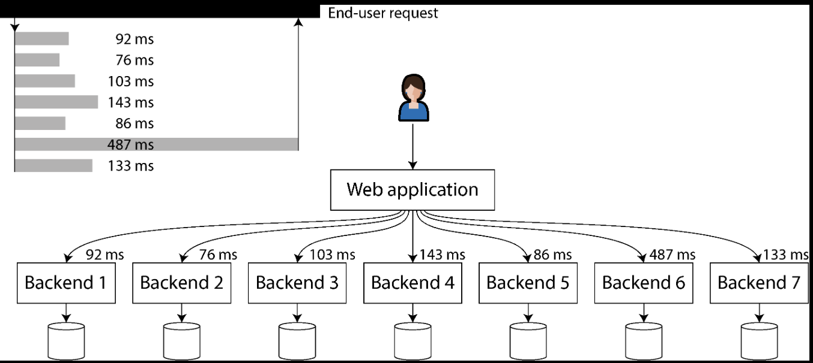

# Chapter 2. Defining Nonfunctional Requirements

> *”The internet was done so well that most people think of it as a natural resource like the Pacific Ocean, rather than something that was man-made. When was the last time a technology with a scale like that so error-free?”* - *Alan Kay*
> 

- *Functional requirements* are what the functionality of your application must offer, things like buttons, what screen, and what operations is supposed to do in order to fulfill the purpose of your software. 

- *Nonfunctional requirements* are requirements that might not be specifically written down but are important, think things like fast, reliable, secure, legally compliant, easy to maintain, etc. 

## Describing Performance

Most discussion of software performance consider two main types of metrics: 

- *Response time* - the time from when a user makes a request until they receive the requested answer. The unit of measurement is seconds, or milliseconds, or microseconds.
- *Throughput* - the number of requests per second, or the data volume per second, that the system is processing. For a given allocation of hardware resources, there is a *maximum throughput* that can be handled.
    - The unit of measurement is “somethings per second.”
- *Queueing* - when a request arrives on a highly loaded system, the CPU is likely already is the process of handling an earlier request, and therefore the incoming request needs to wait until the earlier request has been completed.

/// caption
As the throughput of a service approaches its capacity, the response time increases dramatically because of queueing.
///

**When an Overloaded System Won’t Recover*** 

- *Retry storm* - if a long queue of requests is waiting to be handled, response times may increase so much that clients time out and resend their requests, this causes the rate of requests to increase even further, making the problem worse.
- *Metastable failure* - when the load is reduced again, such a system may remain in an overloaded state until it is rebooted or otherwise reset.
- *Exponential backoff* - to avoid retires overloading a service, you can increase and randomize the time between successive retries on the client side and temporarily stop sending requests to a service that has returned errors or timed out recently.
    - This is done using a *circuit breaker* or a *token bucket* algorithm.
- *Load shedding* - the server can detect when it is approaching overload and start proactively rejecting requests.
- *Backpressure* - send back responses asking clients to slow down

If throughput is likely to increase beyond the current hardware’s capability, the capacity needs to be expanded; a system is said to be *scalable* if its maximum throughput can be significantly increased by adding computing resources.

### Latency and Response Time

- *Response time* - this is what the client sees; it includes all delays incurred anywhere in the system.
- *Service time* - the duration for which the service is actively processing the client’s request
- *Queueing delays* *-* as a server can process only a small number of things in parallel, it takes only a small number of slow requests to hold up the processing of subsequent requests — an effect known as *head-of-line blocking*.
- *Latency* - is a catchall term for time during which a request is not being actively processed — that is, during which it is *latent*.
    - *Network latency* or *network delay* - refers to the time that a request and response spend traveling through the network.

/// caption
Response time, service time, network latency, and queueing delay
///

### Average, Median, and Percentiles

Because the response time varies from one request to the next, we need to think of it not as a single number, but as *distribution* of values that we can measure.

/// caption 
Illustrating mean and percentiles: response times for a sample of 100 requests to a service
///

- Variation in network delay is also known as *jitter*
- High-response time percentiles, also known as *tail latencies.*

### Use of Response Time Metrics

Even if only a small percentage of backend calls are slow, the chance of getting a slow call increases if an end-user request requires multiple backend calls, so a higher proportion of such end-user requests end up being slow — also known as *tail latency ampli*f*ication*

/// caption 
When several backend calls are needed to serve a request, just a single slow call can slow down the entire end-user request. 
///

## Reliability and Fault Tolerance

- *Reliability* - meaning, roughly, “continuing to work correctly, even when things go wrong.”
    - *Fault* - a fault occurs when a particular *part* of a system stops working correctly.
    - *Failure* - a failure occurs when the system *as a whole* stops providing the required service to the user.

### Fault Tolerance

We call a system *fault-tolerant* if it continues providing the required service to users in spite of certain faults occurring. If a system cannot tolerate a certain part becoming faulty, we call that part a *single point of failure* (SPOF), because a fault in that part escalates to cause the failure of the whole system. 

Counterintuitively, in such fault-tolerant systems, it can make sense to *increase* the rate of faults by triggering them deliberately This is called *fault injection.* 

- *Chaos engineering* is a discipline that aims to improve confidence in fault-tolerance mechanisms through experiments such as deliberately injecting faults.

### Hardware and Software Faults

### Humans and Reliability

## Scalability

*Scalability* - the term we use to describe a system’s ability to cope with increased load. 

- Scalability means considering questions like:
    - If the system grows in a particular way, what are our options for coping with the growth?
    - How can we add computing resources to handle the additional load?
    - Based on current growth projections, when will we hit the limits of our current architecture?

### Understanding Load

- *Linear scalability* - considered a good thing, if load scales linearly lol duh

### Shared-Memory, Shared-Disc, and Shared-Nothing Architecture

- *Vertical scaling* or *Scaling up* - moving to a more powerful machine.
- *Shared-memory architecture* - you can get parallelism on a single machine by using multiple processes or threads. All the threads belonging to the same process can access the same RAM, and hence the name.
    - The problem with this is that the cost grows faster than linearly.
- *Shared-disk architecture* - uses several machines with independent CPUs and RAM but stores data on an array of disks that is shared among the machines, which are connected via a fast network.
- *Shared-nothing architecture (also horizontal scaling or scaling out)* - involves a distributed system with multiple nodes, each of which has its own CPUs, RAM, and disks. Any coordination between nodes is done at the software level, via a conventional network.

### Principles for Scalability

There is no such thing as a generic, one-size-fits-all scalable architecture (informally known as (*magic scaling sauce*). 

A good general principle is not to make things more complicated than necessary. If a single-machine database will do the job, it’s probably preferable to a complicated distributed setup.

## Maintainability

Software does not wear out or suffer material fatigue, so it does not break in the same ways as mechanical objects do. But the requirements for an application frequently evolve, the environment that the software runs in changes (such as dependencies and the underlying platform), and it may have bugs that need fixing. 

Because computer systems are often intertwined with the human organizations they support, maintenance of such systems is as much a problem as a technical one. 

Although we cannot always predict which decisions might create maintenance headaches in the future, in this book we will pay attention to several principles that are widely applicable: 

- *Operability* - make it easy for the organization to keep the system running smoothly.
- *Simplicity* - make it wast for new engineers to understand the system, by implementing it using well-understood, consistent patterns and structures and avoiding unnecessary complexity.
- *Evolvability* - make it easy for engineers to make changes to teh system in the future, adapting it and extending it for unanticipated use cases as requirements change.

### Operability: Making Life Easier for Operations

Automation is not always better for operability. However, some amount of automation is important — the sweet spot will depend on the specifics of your particular application and organization. 

Good operability means making routine tasks easy, allowing the operations team to focus on high-value activities. Data systems can help by doing the following: 

- Allowing monitoring tools to check the system’s key metrics and supporting observability tools to give insights into the system’s runtime behavior. A variety of commercial and open source tools can help here.
- Avoiding dependency on individual machines (allowing machines to be taken down for maintenance while the system as a whole continues running uninterrupted).
- Providing good documentation and an easy-to-understand operational model (”If I do *X*, *Y* will happen”).
- Providing good default behavior, but also giving administrators the freedom to override defaults when needed.
- Self-healing where appropriate, but also giving administrators manual control over the system state when needed.
- Exhibiting predictable behavior, minimizing surprises.

### Simplicity: Managing Complexity

Small software projects can have delightfully simple and expressive code, but as projects get larger, they often become very complex and difficult to understand. This complexity slows down everyone who needs to work on the system, further increasing the cost of maintenance. A software project mired in complexity is sometimes described as a *big ball of mud*.

The idea is that *essential* complexity is inherent in the problem domain of the applications, while *accidental* complexity arises only because of limitations of our tooling. Unfortunately, this distinction is also flawed, because boundaries between the essential and the accidental shit as our tooling evolves. 

One of the best tools we have for managing complexity is *abstraction*. A good abstraction can hide a great deal of implementation detail. 

### Evolvability: Making Change Easy

It’s extremely unlikely that your system’s requirements will remain unchanged forever. They are much more likely to be in constant flux: you learn new facts, previously unanticipated use cases emerge, business priorities changes, users request new features, new platforms replace old platforms, legal or regulatory requirements change, growth of the system forces architectural changes, etc

The ease with which you can modify a data system and adapt it to changing requirements is closely linked to its simplicity and its abstractions. Loosely coupled, simple systems are usually easier to modify than tightly coupled, complex ones. Since this is such an important idea, we will use a different work to refer to ability on a data system level: *evolvability*.

One major factor that makes change difficult in large systems is irreversibility. Irreversible actions need to be taken very carefully. Minimizing irreversibility improves flexibility.

## Summary

In this chapter we examined several examples of nonfunctional requirements: performance, reliability, scalability, and maintainability. Through these topics, we also encountered principles and terminology that will be relevant throughout the rest of this book. 

We discussed how to measure performance (e.g., use response time percentiles) and the load on a system (e.g., using throughput metrics), and how these metrics are used in SLAs. Scalability is a closely related concept: if focuses on ensuring that performance stays the same when load grows. We saw some general principles for scalability, such as breaking a task into smaller parts that can operate independently, and we will dive into greater technical detail on scalability techniques in the following chapters. 

To achieve reliability, you can use fault-tolerance techniques, which allow a system to continue providing its services even if a component (e.g., a disk, a machine, or another service) is faulty. We saw examples of hardware faults that can occur and distinguished them from software faults, which can be harder to deal with because they are often strongly correlated. Another aspect of archiving reliability is to build resilience against humans making mistakes, we saw blameless postmortems as a technique for learning from incidents. 

Finally, we examined several facets of maintainability, including supporting the work of operations teams, managing complexity, and making it easy to evolve an application’s functionality over time. There are no easy answers to how to achieve these goals, but one approach that can help is to build applications using well-understood building blocks that provide useful abstractions. The rest of this book will cover a section of building blocks that have proved to be valuable in practice.