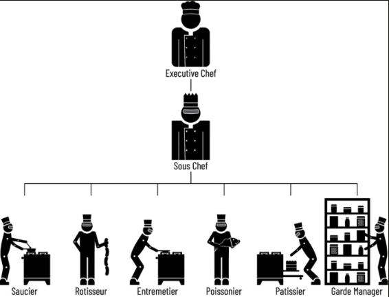

# Introduction

AI shifts how humans create software. 

When we say vibe coding, we mane that you have AI write your codde - you're no longer typing in code by hand. 

## Let's Be Precise: What Is Vibe Coding? 

When we refer to *manual coding* or *traditional coding*, we're talking aboiut pre-AI style software development, where you type in code by hand. 

Vibe coding progression: 

- *code completions* - where your IDE would autocomplete code based on what you had typed. 
- *chat coding* - ask AI to examine or modifyu code or generate new code, and it would emit an answer. The need to copy and pasete your answer back into the IDE by hand. 
- *agentic coding* - where AI autonously generates, refines, and manages code.

## So, What Are the Benefits of Vibe Coding? 

Vibe coding lets you build thigns *faster*, be more *ambitious* about what you can build, build things more *autonomously*, and have more *fun*, and explore more *options*. (FAAFO)

## Why This Book Now 

The goal of this book is to explain why vibe coding matters *and* how to do it effectively - even at the team and enterprise level. 

Professional kichen metaphor used in this book: 

- You're the head chef of the kitchen 
- AI represents the army of chegs who help bring your vision to life. 

/// caption
Figure 0.1: The Kitchen Brigade
///
