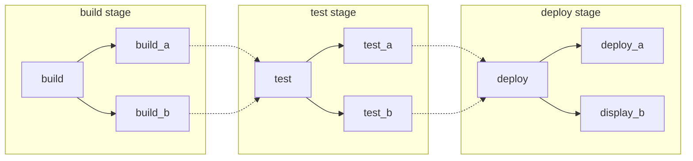
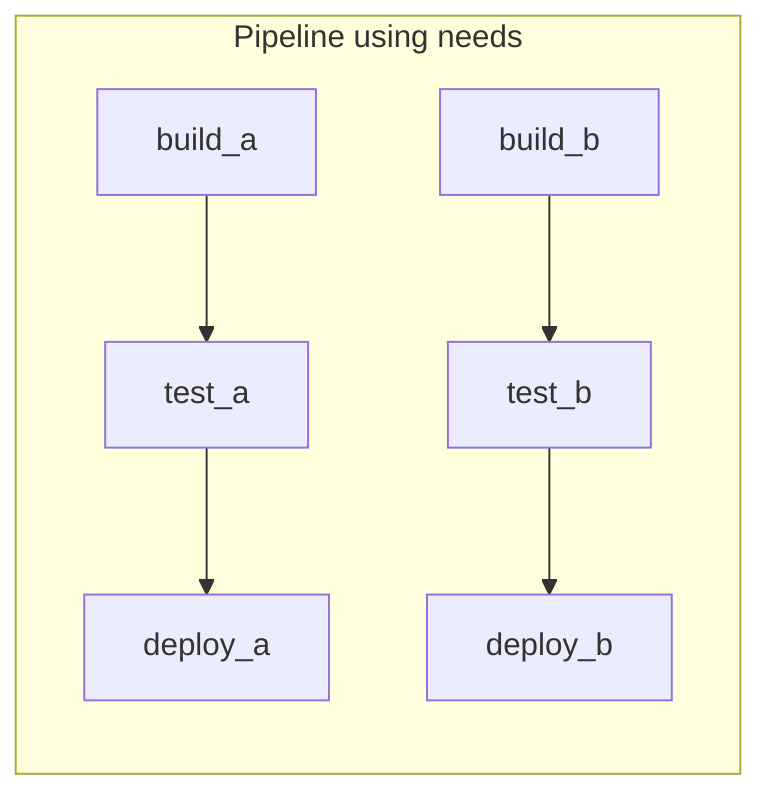
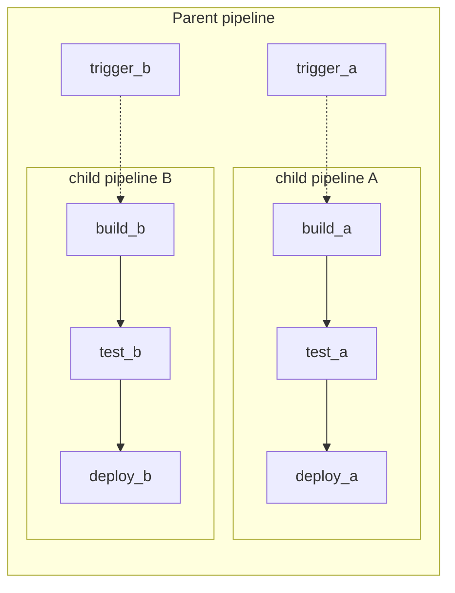

# Stages and Jobs 

## Learning Objectives 

- Identify how piopeline stages are defined throughout the `.gitlab-ci.yml` file. 
- Identify the default behavior of stages when not user-defined. 

## The `.gitlab-ci.yml` file 


The presence of a `.gitlab-ci.yml` file in a repository is what give GitLab the signal that we will be using CI/CD for this project. 

Your basic pipeline will take your code through a series of ***stages***. In each of those stages, ***jobs***, are run. 

- Stages define ***when*** to run jobs.
- Jobs define ***what*** to do. 

Your code can have many jobs running at any stage in the pipeline.

With a combination of stages, jobsm and a few other keywords, there are many types of pipelines with many architectures you can construct to meet your needs.

## Types of Pipelines 

Multiple types of pipelines can run in a project, including: 

- Branch pipelines
- Tag pipelines
- Merge request pipelines
- Merged results pipelines
- Merge trains 

### Branch Pipeline

Your pipeline can run every time you commit changes to a branch. 

This type of pipeline is called a **branch pipeline**. They display a `branch` label in pipeline lists. 

This pipeline runs by default. No configuration is required. 

Branch pipelines: 

- Run when you push a new commit to a branch. 
- Have access to some predefined variable. 
- Have access to protected variables and protected runners when the branch is a protected branch.

### Tag pipeline 

A pipeline can run every time you create or push a new tag. 

This type of pipeline is called a **tag pipeline**. They display a `tag` label in pipeline lists. 

This pipeline runs by default. No configuration is required. 

Tag pipelines: 

- Run when you create/push a new tag to your repository.
- Have access to some predefined variable. 
- Have access to protected variables and protected runners when the branch is a protected branch.

### Merge request pipeline 

Instead of a branch pipeline, you can configure your pipeline to run every time you make changes to the source branch in a merge request. 

This type of pipeline is called a **merge request pipeline**. They display a `merge request` label in pipeline tests. 

Merge request pipelines do not run by default. You must configure the jobs in the `.gitlab-ci.yml` file to run as merge request pipelines. 

### Merged results pipeline 

A **merged results pipeline** runs on the result of the source and target branches merged together. It's a type of merge request pipeline.

These pipelines do not run by default. You must configure the jobs in the `.gitlab-ci.yml` file to run as a merge request pipeline, and enable merged results pipelines. 

THese pipelines display a `merged results` label in pipeline lists. 

### Merge trains 

In projects with frequent merges to the default branch, changes in different merge requests might conflict with each other. Use **merge trains** to put merge requests in a queie. Ecah merge request is compared to the other, earlier merge requests, to ensure they all work together. 

Merge trains differ from merged results pipelines, becaused merged results pipelines ensure the changes work with the content in the default branch, but not content that others are merging at the same time. 

These pipelines do not run by default. You must configure the job in the `.gitlab-ci.yml` file to run a a merge request pipeline, enabled merged results pipeline, and enable merge trains. 

These pipelines display a `merge train` lable in pipeline lists.

## Pipeline architecture 

Pipelines are the fundamental building b locks for CI/CD in GitLab. The following are some of the important concepts related to them. 

You can structure your pipelines in different methods, each with their own advantages. These methods can be mixed and matched if needed: 

- **Basic**: Good for straightforward projects where all the configuration is in one place. 

- **Pipelines with the `needs` keyword**: Good for large, complex projects that need efficient execution. 

- **Parent-child pipelints**: Good for monorepos and projects with lots of independently defined components. 

- **Multi-project pipelines**: Good for larger products that require cross-project interdependencies, liek those with a microservices architecture. 

You'll find the keyword **stage** is found i almost all running pipelines

As it is possible to define your own stages, it is important to understand the default behavior of stages when not user-defined. Wihtout user-defined stages, GitLab will run your jobs in the following order as part of these stages: 

- `.pre`
    - If present, jobs in this stage will run before any other jobs. 

- `build`

- `test`
    - Any jobs that are not defined with a stage will be placed in the `test` stage.

- `deploy`
- `.post`
    - if present, jobs in this stage will run after all other jobs. 

These are the default conventions for stages. YOu can override these defaults by defining your own stages in your `.gitlab-ci.yml` file. 

### Basic Pipelines

Basic pipelines are the simplest pipeline in GitLabn, They run everyting in the build stage concurrently, and once all of those finish, they run everything in the test and subsequent stages the same way. It's not the most efficient, and if you have lots of steps it can become complex, but it's easier to maintain: 



**Example basic `/.gitlab-ci.yml` pipeline configurationm atching the diagram**

```yaml
stages: 
  - build
  - test
  - deploy

default: 
  image: alpine 

build_a: 
  stage: build 
  script:
    - echo "This job builds something."

build_b:
  stage: build
  script:
    - echo "This job builds something else."

test_a: 
  stage: test 
  script: 
    - echo "This job tests something. It will only run when all jobs in the"
    - echo "build stage are complete

test_b:
  stage: test 
  script: 
    - echo "This job tests something else. It will only run when all jobs in the" 
    - echo "build stage are complete too. It will st art at about the same time as test_a"

deploy_a:
  stage: deploy
  script: 
    - echo "This job deploys something. It will only run when all jobs in the"
    - echo "test stage complete."
  environment: production

deploy_b: 
  stage: deploy
  script:
    - echo "This job deploys something else. It will only run when all jobs in the"
    - echo "test stage complete. It will start at about the same time as deploy_a."
  environment: production
```

### Pipelines with the `needs` keyword 

If efficiency is important and you wnat everyting to run as quickly as possible, you can use the `needs` keywords to define dependencies between your jobs. When GitLab knows the dependencies between your jobs, jobs can run as fast as possible, even starting earlier than other jobs in the same stage.

In the following example, if `build_a` and `test_a` are much faster than `build_b` and `test_b`, Gitlab starts `deploy_a` even if `build_b` is still running. 



**Example `needs` `.gitlab-ci.yml`** 

```yaml 
stage:
  - build
  - test
  - deploy 

default:
  image: alpine

build_a:
  stage: build
  script:
    - echo "This job builds something quickly"

build_b:
  stage: build
  script:
    - echo "This job builds something else slowly"

test_a:
  stage: test
  needs: [build_a]
  script:
    - echo "This test job will start as soon as build_a finishes."
    - echo "It will not wait for build_b, or other jobs in the build stage, to finish."

test_b:
  stage: test
  needs: [build_b]
  script: 
    - echo "This test job will start as soon as build_b finishes."
    - echo "It will not wait for other jobs in the build stage to finish."

deploy_a:
  stage: deploy
  needs: [test_a]
  script:
    - echo "Since build_a and test_a run quickly, this deploy job can run much earlier."
    - echo "It does not need to wait for build_b or test_b."
  environment: production

deploy_b:
  stage: deploy
  needs: [test_b]
  script:
    - echo "Since build_b and test_b run safely, this deploy will run much later. 
  environment: production
```

### Parent-child pipelines

As pipelines grow more complex, a few related problems start to emerge: 

- The staged structure, where all steps in a stage must complete before the first job in the next stage begins, causing waits that slow things down. 

- Configuration for the single global pipeline becomes hard to manage. 

- Imports with `include` increase the complexity of the configuration, and can cause namespace collisions where jobs are unintentionally duplicated.

- Pipeline UX has too many jobs and stages to work with. 

Additionally, sometimes the behavior of a pipeline needs to be more dynamic. You can choose whether to start sub-pipelines, which is expecially useful if the YAML is dynamically generated. 

In the previous `basic pipeline` and `needs pipeline` examples, there are two packages that could be built independently. These cases are ideal for using **parent-child pipelines**. They separate out the configuration into multiple files, keeping things simpler. You can combine parent-child pipelines with: 

- The `rules` keyword. For example, have the child pipelines triggered only when there are changes to that area. 

- The `include` keyword: Bring in commonn behaviors, ensuring you are not repeating yourself. 

- The `needs` keyword inside of child pipelines, achieving the beneifts of both. 



**Example `/.gitlab-ci.yml` configuration for the parent pipeline** 

```yaml
stages: 
  - triggers

trigger_a: 
  stage: triggers
  trigger:
    include: a/.gitlab-ci.yml
  rules:
    - changes:
      - a/*

trigger_b: 
  stage: triggers
  trigger:
    include: b/.gitlab-ci.yml
  rules:
    - changes:
      - b/*
```

**Example child `a` pipeline configuration, located in `/a/.gitlab-ci.yml`, making use of the `needs` keyword:**

```yaml 
stages:
  - build
  - test
  - deploy

default:
  image: alpine

build_a:
  stage: build
  script:
    - echo "This job builds something."

test_a:
  stage: test
  needs: [build_a]
  script:
    - echo "This job tests something"

deploy_a:
  stage: deploy
  needs: [test_a]
  script:
    - echo "This job deploys something."
  environment: production
```

**Example child `b` pipeline configuration, located in `/b/.gitlab-ci.yml`, making use of the `needs` keyword:** 

```yaml 
stages:
  - build
  - test
  - deploy

default:
  image: alpine

build_b:
  stage: build
  script:
    - echo "This job builds something."

test_b:
  stage: test
  needs: [build_b]
  script:
    - echo "This job tests something"

deploy_a:
  stage: deploy
  needs: [test_b]
  script:
    - echo "This job deploys something."
  environment: production
```

Jobs can be set to run before or after triggering child pipelines in GitLab, allowing common setup steps or unified development.
