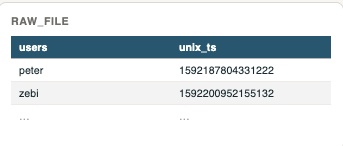
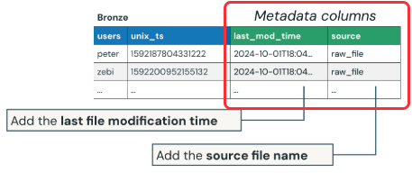
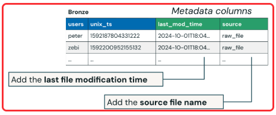
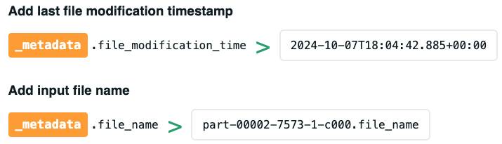

# Appending Metadata Columns on Injest

## Overview

You will learn how metadata columns such as source file name and modification time can be appened during data ingestion from cloud storage using the `_metadata` column, enabling essential context to be captured for each row during table creation in the Lakehouse. 

## Learning Objectives

1. **Explain the purpose of metadata columns** and why they are valuable during data ingestion

2. **Use the `_metadata` column to append file-level metadata** such as the file name and modification time during table creation 

3. **Identify commona `_metadata` fields** including `_metadata.file_name` and `_metadata.file_modification_time`

## Adding a Metadata Column 

You can append metadata column information from input data source fields when creating a table.

1. Raw Files
    - Suppose your cloud storage location contains a set of raw files. These could be CSV, TXT, JSON, or other formats. 

        

2. Create a Delta table
    - You want to ingest those files into a bronze-level table. 

        

3. As part of that ingestion, you may want to add specific metadata columns to each row in the table. These columns can include information from the ingestion source such as: 
    - The last modification time of the file the row originated from 
    - The soruce file name 

        

4. This helps preserve important context about the data's origin, which van be valuable for auditing, lineage, and debugging purposes. 
    - `last_mod_time`: Add the last file modification time
    - `source`: Add the source file name
        
        

For example, suppose your cloud storage location contains **a set of raw files** (CSV, TXT, JSON, or other formats) and you wnat to ingest those files into a **bronze-level table**. 

As part of that ingestion, you may want to add specific metadata columns to each row in the table. These columns can include information from the ingestion source, suc has: 

- The **last modification time** of the file the row originated from 
- The **source file name** 

This helps preserve important context about the data's origin, which can be valuable for auditing, lineage, and debugging purposes.

## Common File Metadata Fields 

To add metadata columns during ingestion, you can use the special `_metadata` columns. This is a hidden column that is available for all input file formats. 

Documentation: [Metadata Column Documentation](https://docs.databricks.com/aws/en/ingestion/file-metadata-column)

To include the `_metadata` column in the returned DataFrame, you must explicity select it in your read query when specifying the source. 

The `_metadata` column is the returned DataFrame, you must explicitly select it in your read query when specifying the source. 

1. `_metadata.file_modification_time` - provides the last modification timestamp of the input file
2. `_metadata.file_name` - returns the name of the source file for each row

## Conclusion

- **Metadata columns** preserve context about data origin, which is valuable for auditing, lineage, and debugging.

- The special `_metadata` **column** is available for all input file formats. You must explicitly select it in your read query. 