# Data Engineering in Databricks

## Overview 

This lecture introduces the fundamentals of data engineering with Databricks, focusing on how **LakeFlow Connect** simplifies and unified data ingestion from diverse sources into the **Databricks Data Intelligence Platform**. 

You will learn about the **different ingestion methods** available through LakeFlow Connect, including batch, incremental batch, and streaming. 

This lecture also provides a review of **Delta Lake**, covering Unity Catalog table componenets, key features, and the Medallion Architecture for progressively refining data quality. 

## Learning Objectives 

1. **Describe the purpose and benefits of LakeFlow Connect** fro scalable data ingestion into Databricks 
2. **Identify the different types of connectors**, including Standard and Managed connectors 
3. **Explain various data ingestion techniques** such as batch, incremental batch, and streaming 
4. **Select the appropriate ingestion method** based on data and use case requirements 
5. **Review the key benefits of UC tables** and the Medallion Architecture for data management and analytics

## Introduction to Data Engineering in Databricks 

### Data Engineering Platform Overview 

Databricks offers LakeFlow, and end-to-end data engineering solution for deliverying high-quality data for downstream analytics, AI, and operational applications. 

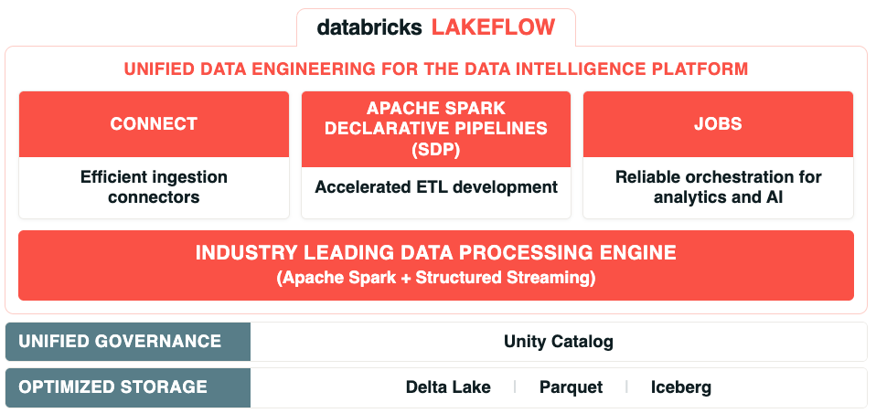
/// caption
This course focuses on data ingestion with LakeFlow Connect into the Databricks Data Intelligence Platform. 
///

Lakeflow provides a unified platform for data ingestion, transformation, and orchestration: 

- **LakeFlow Connect** - Efficient ingestion connectors for enterprise applications, databases, cloud storage, message buses, and local files 

- **Apache Spark Declarative Pipelines** - A framework for building batch and streaming pipelines using SQL and Python 

- **LakeFlow Jobs** - Workflow automation that orchestrates data processing workloads and coordinates multiple tasks within complex workflows

## What is LakeFlow Connect? 

LakeFlow Connect streamlines data ingestion with simple, efficient connectors that enable you to bring in data from files, cloud storage, databases, enterprise applications, and streaming sources directly into the Databricks Lakehouse - all wihtin a unified, managed platform.

### Traditional Data Ingestion Challenges 

Traditionally, organizations resort to a patchwork of solutions for data ingestion when working with enterprise systems, cloud stroage, and streaming. 

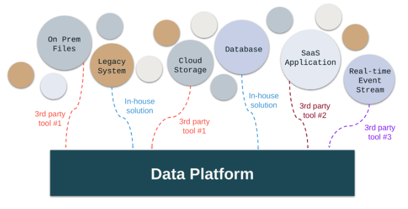

- Multiple data sources each require their own set of tools and solutions. 
- On-premises files, legacy systems, databases, cloud storage, SaaS applications, and real-time event streams all use different connectors.
- A mix of third-party tools and in-house solutions creates complexity. 
- The result of increase operational overhead, inconsistent governance, and fragmented observability. 

### LakeFlow Connect: Unified Ingestion 

With LakeFlow connect, you can build efficient ingestion pipelines entirely within Databricjs. It provides simple setup and maintenance, along with unified orchestration, observability, and governance - all within the Databricks Data Intelligence Platform.

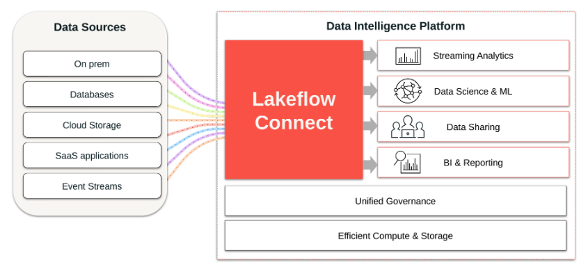

### Key Benefits of LakeFLow Connect

LakeFlow Connect provides built-in connectors for the Databricks Data Intelligence Platform to streamline data ingestion. 

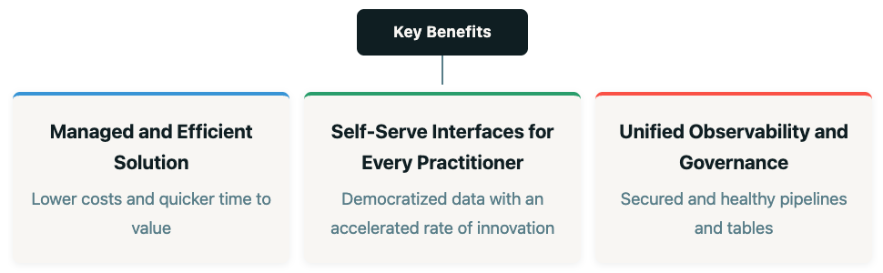

### LakeFlow Connect Connectors Overview

LakeFlow Connect provides three categories of connectors, each designed for a different type of data source and ingestion pattern. 

**Upload Files**

- Upload local files to Databricks 
- Upload a file to a volume
- Create a table form a local file

**Standard Connectors**

Supported Sources: 

- Cloud Object Storage
- Kafka
- Other Sources

Ingestion Methods: 

- Batch 
- Incremental Batch
- Streaming 

**Managed Connectors** 

Ingest data into the lakehouse from: 

- Software as a Service (SaaS) 
- Databases 
- Leverage efficient **incremental reads and writes** 
- Faster, scalable, and more cost-efficient

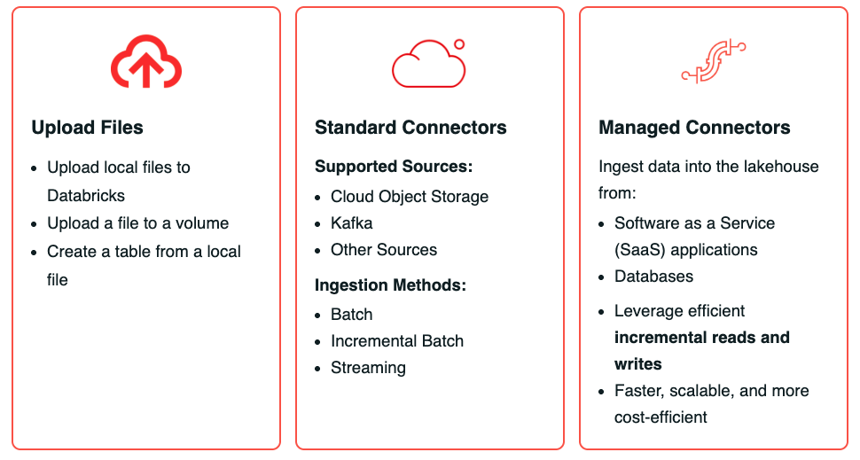

- **Manual File Uploads** allow users to quickly upload local files into volumes or tables. 
- **Standard Connectors** enable ingestion from sources like cloud storage and Kafka using batch, incremental, or streaming modes. 
- **Managed Connectors** are designed for enterprise applications and databases, enabling scaling and efficient incremental data ingestion into the lakehouse. 

## Ingestion Methods 

When ingesting data into Databricks using LakeFlow Connect Standard Connectors, you can choose from several ingestion methods. 

### Batch, Incremental, and Streaming Ingestion

#### Batch Ingestion 

1. Batch ingestion is well-suited for large volumes of historical data where real-time processing is not required. 

2. It is typically simpler to implement and manage, making it a common choice for scheduled data pipelines. 

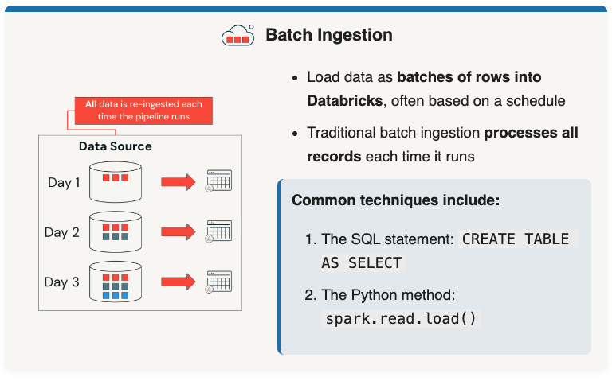

#### Incremental Batch Ingestion 

1. Databricks supports both traditional batch ingestion and incremental batch ingestion options. 
2. While traditional batch ingestion processes all records every time it runs, incremental batch ingestion automatically detects new records in the data source and skips records that have already been ingested. 

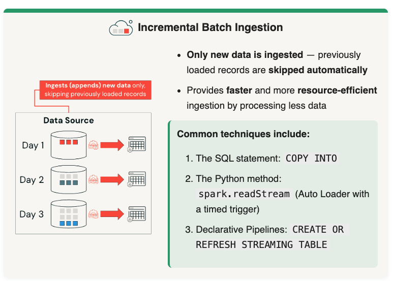

#### Streaming Ingestion

1. With streaming ingestion, data is continuously loadsed as it is generated, allowing you to query it in near real-time. This method is ideal for loading streaming data such as Apache Kafka, Amazon Kinesis, Google Pub/Sub, and Apache Pulsar. 

2. Streaming ingeation processes data as it arrives, enabling low-latency analysis and immediate action. In contrast, micro-batch ingestion collects data over short, frequent intervals (seconds or minutes) and processes it in small batches - striking a balance between latency and system efficiency. 

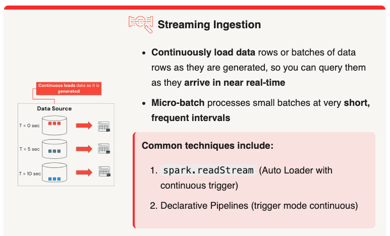

## Delta Lake Review

Delta Lake delivers open, reliable, and scalable data management for the Lakehouse, empowering you to ignest data from external sources and efficiently manage it across **Bronze (raw)**, and **Gold (curated)** layers -- all with full ACID transactions, time travel, schema enforcement, and support for both batch and streaming workloads. 

### Ingesting Data Into Delta Lake

The goal is to ingest files from **external data sources** like cloud object storage into **Delta Lake as Unity Catalog tables**.

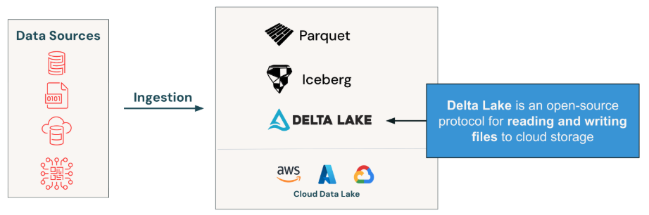

Delta Lake is an open-source protocol for reading and writing files to cloud storage. Unity Catalog tables offer an open table format that supports the **Lakehouse architecture** and storage on AWS, Azure, and GCP cloud data lakes.

### Unity Catalog Table Components Overview

WIthin Delta Lake you will work with Unity Catalog tables. THe diagram below shows how data is stored internall. 

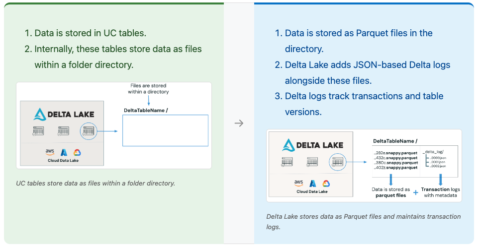

### Unity Catalog Table Key Features

**Unity Catalog Tables Key Features Review**
Key capabilities Delta Lake brings to your cloud data lake 

- **ACID Transactions** - **A**tomicity, **Consistency**, **Isolation**, **Durability** for all operations, allowing **multiple users to read and write data** concurrently without conflicts. 

- **Data Manipulation Langauge (DML)** - Supports DML operations much as **INSERT, UPDATE, DELETE, and MERGE** enabling flexible data management. 

- **Time Travel** - Allows users to **query** and **revert** to previous versions of data, facilitating **auditing and recovery**> 

- **Schema Evolution and Enforcement** - Enforces a defined **schema for data integrity** while allowing schema evolution, enabling structural changes without breaking existing workflows.

- **Many more!** - Unified **batch and streaming** processing, **optimization and performance**, and **scalability** - and Delta Lake is **Open source**. 

The **transaction log** enables key functionality in Unity Catalog tables by maintaining table states. 

- It records every **insert, update, and delete** as transactions, ensuring the table stays consistent and up to date. 

- This allow sfor **reliable data views and time travel**, making it easy to access previous versions of data. 

Traditionally, modifying data in a data lake required **manually recreating files and tracking changes**, which was complex and inefficient.

- Within Delta Lake, data modifications are **simpler, faster, and more efficient to manage**.

## Medallion Architecture Review

Each layer of the Medallion Architecture builds on the previous one, refining data quality and usability as data flows from ingestion through to business consumers: 

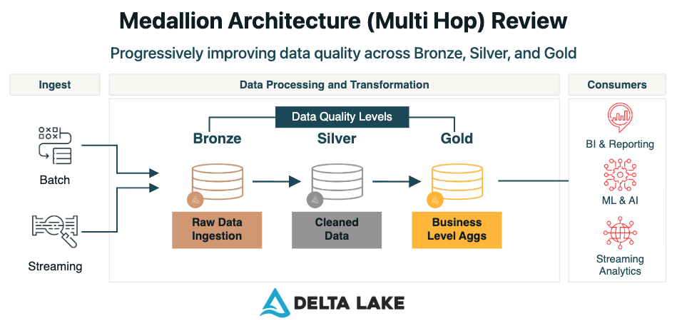

As you ingest data into your Delta Lake through batch or streaming methods, or both, you can begin processing and transforming your data in Databricks. The goal is to incrementally and progressively improve the structure and quality of data as it moves through each layer: Bronze, Silver, and Gold. 

- It begins with hte bronze layer, the raw data ingestion layer. This layer ingests raw, unprocessed data form various sources 'as-is`, serving as the foundaitonal storage for all data. 

- In the Silver layer, the data is cleaned, transformed, and enriched, providing a more refined dataset that is suitable for analysis. 

- Lastly the Gold layer contains curated, aggregated, and high-quality data, optimized for reporting and advanced analytics, often used for business intelligence applications. 

## Conclusion 

1. **LakeFlow Connect** is the ingestion layer within the Databricks Data Intelligence Platform that replaces the traditional patchwork of ingestion tools with a unified, managed solution. 

2. LakeFlow connect provides three types of connectors: **Upload Files, Standard Connectors,** and **Manage Connectors**, each designed for different data source types.

3. Three ingestion methods are available: **Batch** (processes all records), **Incremental Batch** (processes only new records), and **Streaming** (continuous, near real-time ingestion).

4. **Delta Lake** is an open-source protocol that stores data as Parquet files with transaction logs, enabling ACID transactions, time travel, DML support, and schema enforcement. 

5. The **Medallion Architecture** (Bronze, Silver, Gold) progressively improves data quality as it moves through each layer.
