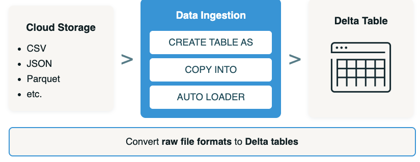

# Data Ingestion From Cloud Storage

## Overview

In this lecture, you will learn how raw files from cloud storage can be efficiently coverted into Delta tables using Databricks tools, unlocking advanced management and analytics capabilities within the Lakehouse. 

## Learning Objectives

1. **Demonstrate how to ignest data from cloud object storage into Delta tables** using `CREATE TABLE AS`, `COPY INTO`, and `Auto Loader`, including **capturing input file metadata in Bronze layer tables**

2. **Explain how rescued columns are used during ingestion** to manage malformed records 

## Data Ingestion Patterns From Cloud Object Storage

Data ingetion is a critical component of modern Lakehouse architecture, enabling organizations to take advantage of large columns of data stored in cloud object storage systems.



- Common file formats like **CSV, JSON, and Parquet** are frequently used due to their flexibility and ease of use. 

- Our goal is to convert these **raw files into Delta tables,** unlocking advanced functionality such as ACID transactions, time travel, and schema enforcement. 

- We'll explore three **primary methods for ingesting files** from cloud object storage into Delta tables:
    - `CREATE TABLE AS` (CTAS)
    - `COPY INTO`
    - `Auto Loader`

Ingestion from cloud object storage is performed using **Lakeflow Connect Standard Connectors**.

## Data Ingestion Methods

When ingesting data into Databricks using LakeFlow Connect Standard Connectors, you can choose from several ingestion methods. 

### Method 1 - Batch - `CREATE TABLE AS` (CTAS)

```SQL
CREATE TABLE new_table AS 
        SELECT * 
        from read_files(
            <path_to_files>,
            format => '<file_type>'
            <other_format_specific_options>
        ); 
```

`CREATE TABLE AS` (CTAS) creates a Delta table **by default** form files in cloud object storage.

The `read_files()` function reads files under a provided location and returns the data in **tabular form**.

**`CREATE TABLE AS` (CTAS)**

1. Supports reading **file formats** like: JSON | CSV | XML | TEXT | BINARYFILE | PARQUET | AVRO | ORC
2. Can detect the file format automatically and **infer a united schema** across all files.
3. Specify **specific file format options** to read in the data based on the source file format.
4. Can be used in **streaming tables** to **incrementally** ingest files into Delta Lake using Auto Loader.

### Method 2- Incremental Batch - `COPY INTO` 

```SQL
CREATE TABLE new_table; 
    COPY INTO new_table
    FROM '<dir_path>'
    FILEFORMAT = <file_type>
    FORMAT_OPTIONS (<options>)
    COPY_OPTIONS (<options>)
```

Use the `COPY INTO` statement to copy from cloud storage into the Delta Lake. This command performs a bulk load from files in cloud object storage into the table, and in this example, it will load files into empty table `new_table`. The `FROM` clause specifices the location of the CSV files.

`COPY INTO` is ideal for situation where the cloud storage location is continuously adding files, since it is a retriable idempotent operation designed for incremental; batcnh ingestion. 

**Key aspects of `COPY INTO`**: 

- **Idempotent**: Will skip any files that have already been loaded into the table; only new files will be ingested 

- **File format support**: Parquet, JSON, XML, and others

- **`FROM` clause**: Specifies the path of the cloud storage location where new files are being continuously added 

- **`FORMAT_OPTIONS()**: Controls how the source files are parsed and interrpeted (options depend on file format)

- **`COPY_OPTIONS`**: Controls the behavior of the `COPY_INTO` operation itself, such as: 
    - Schema evolution using (**mergeSchema**)
    - Idempotency using (**force**)

### Method 3 - Incremental Batch or Streaming - `AUTO LOADER`

**Incremental batch or streaming ingestion using Auto Loader**

- Process new data files **incrementally** as they arrive in cloud storage (batch or streaming)
- Ingest data **without extra setup** or complex configuration 
- **Automatically** detect and load new files into Delta tables 
- Simplify handling of incremental and streaming data
- Use with both **python** and **SQL** (via Declarative Pipelines)
- Scale to **process billions of files**
- Rely on **Spark Structured Streaming** for efficient and reliable ingestion

#### Python Auto Loader

**Auto Loader in Python to read streaming data from cloud storage**

- We start with `.readStream` and set the **format** to "`cloudFiles`", which enables Auto Loader. 
- Then we specify the **file format** as **JSON**, and define the **schema location** using `cloudFiles.schemaLocation`, which is sued to track schema inference and evolution
- Next, we use `.load()` to point to the location of the files, in this case under `/volumes` referencing Unity Catalog.
- On the write side, we configure `.writeStream` with a **checkpoint location** to maintain state and progress, and set a **trigger** interval of **every 5 seconds**. 
- Finally, we use `toTable()` to write da ta into a Delta table specified by catalog, database, and table name. 

```python
(spark
    .readStream
        .format("cloudFiles")
        .option("cloudFiles.format", "json")
        .optoin("cloudFiles.schemaLocation", "<checkpoint_path>")
        .load("Volumes/catalog/schemafiles")
    .wrireStream
        .option("checkpointLocation", "<checkpoints_path>")
        .trigger(processingTime="5 seconds")
        .toTable("catalog.database.table")
)
```

#### Auto Loader with SQL (Declarative Pipelines)

```SQL
CREATE OR REFRESH STREAMING TABLE
    catalog.schema.table
SCHEDULE EVERY 1 hour
AS 
SELECT *
FROM STREAM read_files(
    '<dir_path>',
    format => '<file_type>'
)
```

- Databricks recommends using streaming tables to ingest data with Databricks SQL (instead of `COPY INTO`). A streaming table is a table registered to **unity catalog** that includes additional support for streaming or incremental data processing. 
    - When you create a streaming table, a **pipeline** is automatically generated for it.

    - Streaming tables can be used for incremental data loading from both **Kafka** and **cloud object storage**.

- To create a streaming table from files in a volume, you use Auto Loader. databrucsj recommends using **Auto Loader with Apache Spark Declarative Pipelines** for most data ingestion taks from cloud object storage. Together, Auto Loader and Declarative Pipelines are designed to incrementally and idempotently load continuously growing datasets as they arrive. 

- Streaming tables in Databricks SQL are backed by **serverless** Spark Declarative Pipelines. Your workspace must support serverless pipelines to use this functionality. Alternatively, you can **build your own** Spark Declarative Pipelines for incremental processing, optimization, and monitoring. Declarative Pipelines offer a range of additional features. 

- To use Auto Loader in Databricks SQL, use the `read_files` function with the `STREAM` keyword in the `FROM` clause. 

## Ingestion Methods at a Glance

| **Feature** | `CREATE TABLE AS` (CTAS) + `spark.read` | `COPY INTO` | `Auto Loader` | 
|-------------|-----------------------------------------|-------------|---------------|
| **Ingestion Type** | Batch | Incremental Batch | Incremental (Batch or Streaming) | 
| **Use Cases** | Best for smaller data sets | Ideal for thousands of files  | Scale to millions+ of files per hour, backfills with billions of files. |
| **Syntax/Inferface** | - Python (`spark.read`), SQL (CTAS) | SQL | Python (`spark.readStream`), SQL with Declarative Pipelines `CREATE OR REFRESH STREAMING TABLES`|
| **Idempotency** | No | Yes| Yes | 
| **Schema Evolution** | Manual of inferred during read| Supported with options| Auto Loader automatically detects and evolves schemas. Handles new columns as they appear. | 
| **Latency** | High | Moderate (scheduled) | Low or high depending on configuration | 
| **Ease of Use** | Simple | Simple and SQL-based | Intermediate to advanced depending on the implementation | 
| **Summary** | Best for one-time, ad-hoc ingestion. Can be scheduled to always read and process all data. | Simple and repeatable for incremental file ingestion. Great for scheudled jobs or pipeliens. | Best for near real-time streaming or incremental ingestion, with high autimation and scalability. | 

## Conclusion 

- `CREATE TABLE AS` (CTAS): Batch ingestion using `read_files()` that creates Delta tables from raw files. Best for maller ad-hoc datasets. 

- `COPY INTO`: Incremental batch ingestion that is idempotent and retriable. Skips already-loadsed files and supports formats and copy options for fine-grained control. 

- `AUTO LOADER`: The most scalable method, built on Spark Structured Streaming. Supports both Python and SQL (via Declarative Pipelines), processes billions of files, and automatically handles schema evolution. 