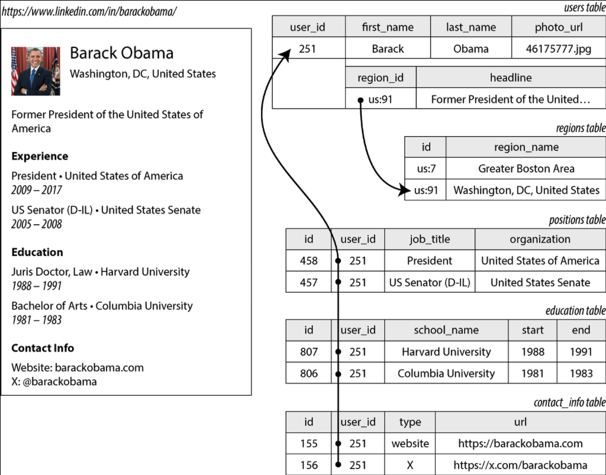
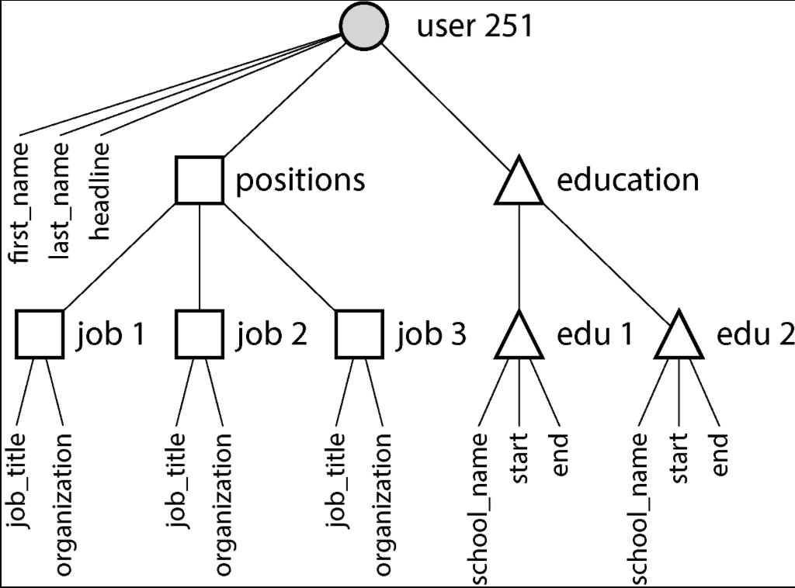
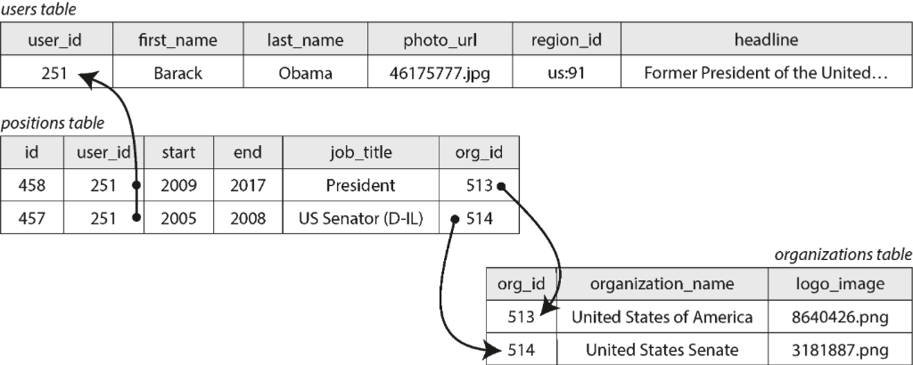
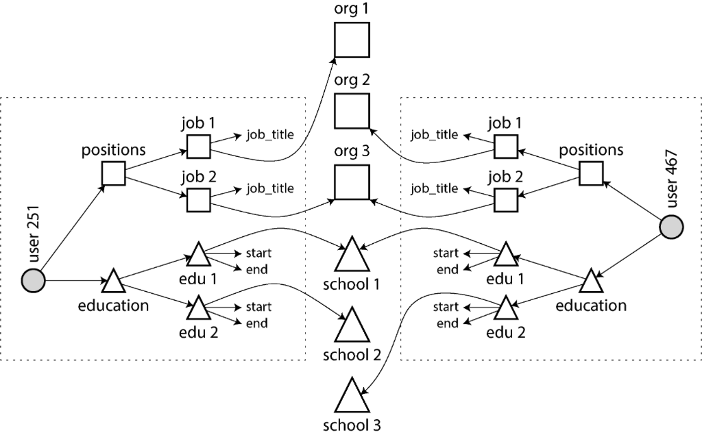
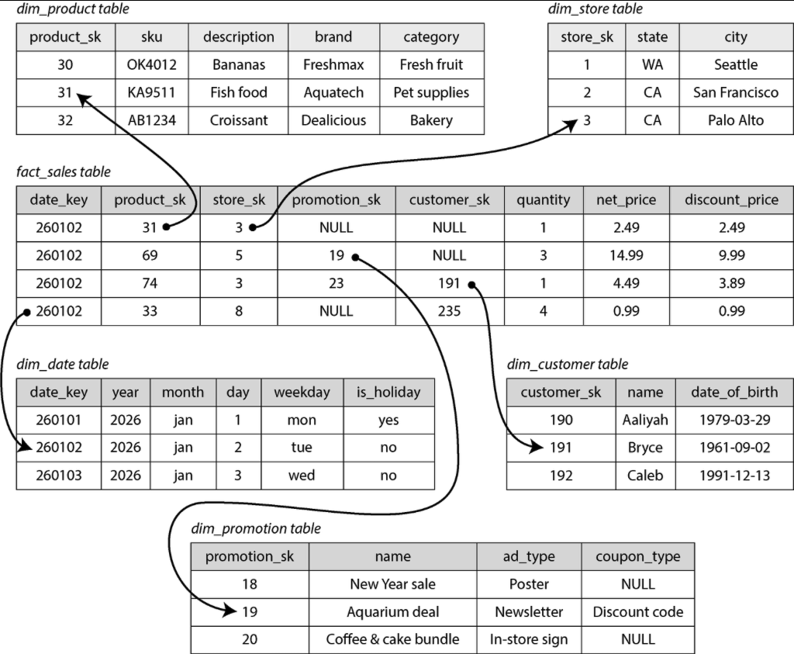
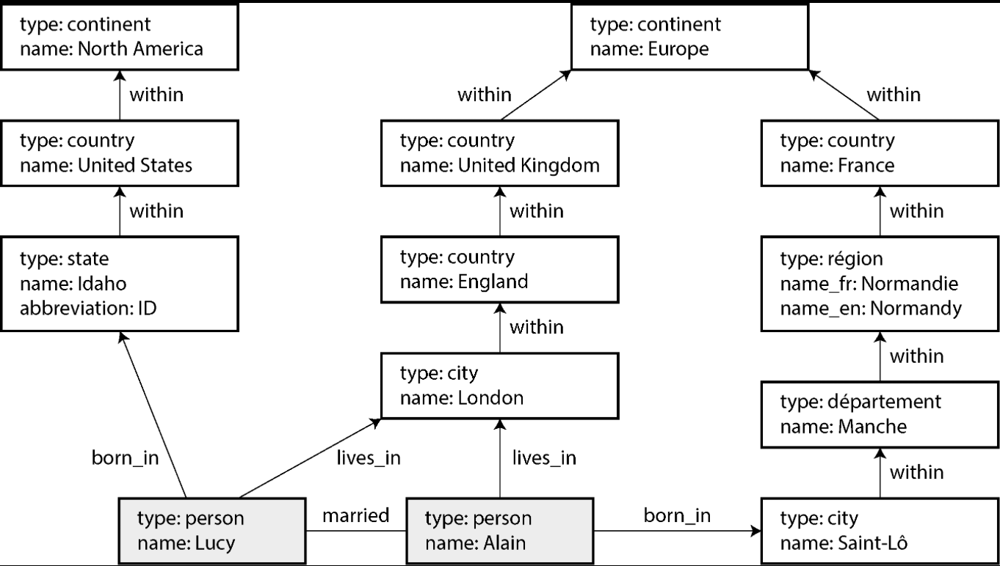
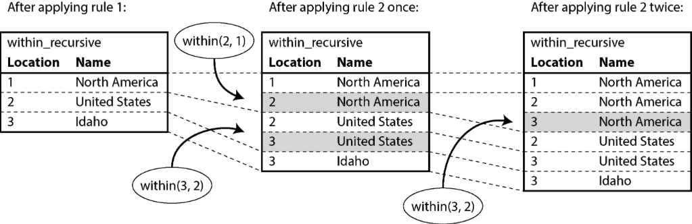
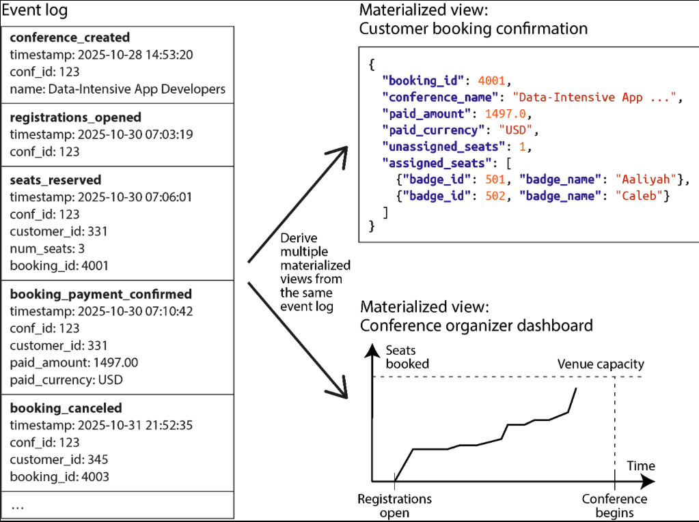

# Chapter 3. Data Models and Query Languages

> *The limits of my language mean the limits of my world* — Ludwig Wittgenstein, *Tractatus Logico-Philosophicus* (1922)
> 

Data models aer perhaps the most important part of developing software, because of the profound effect they have not only on how the software is written, but also on how we *think about the problem* that we are solving. 

Most applications are built by layering one data model on top of another. For each layer, the key question is how it is *represented* in terms of the next-lower layer. Here’s an example of application layers form the highest to the lowest level: 

1. As an application developer, you look at the real world and model it in terms of objects or data structures and APIs that manipulate those data structures, which are often specific to your application. 
2. When you want to store those data structures, you express them in terms of a general-purpose data model, such as JSON or XML documents, tables in a relational database, or vertices and edges in a graph. Those data models are the topic of this chapter. 
3. The engineers who built your database software decided on a way of representing that document, relational, or graph data in terms of bytes of memory, on disk, or no a network. The representation may allow the data to be queried, searched, manipulated, and processed in various ways. We will discuss these storage engines in Chapter 4.
4. On yet lower levels, hardware engineers have figured out how to represent bytes in terms of electrical currents, pulses of light, magnetic fields, and more. 

In a complex application there may be more intermediary levels, such as APIs built on APIs, but the basic idea is still the same: each layer hides the complexity of the layers below it by providing a clean data model. These abstractions allow different groups of people to work together effectively.

Some types of data and some queries are easy to express in one model and awkward in another. 

## Relational Versus Document Models

The relational model is data organized into *relations* (also called *tables*), where each relation is an unordered collection of *tuples* (also called *rows*).

One lasting effect of the NoSQL movement is the popularity of the *document model*, which usually represents data as JSON, JSON documents are thought to be more flexible. 

### The Object-Relational Mismatch

Much application development today is done in object-oriented programming languages, which leads to a common criticism of the SQL data model: if data is stored in relational tables, an awkward translation layer is required between the objects in the application code and the database model of tables, rows, and columns. The disconnect between the models is sometimes called an *impedance mismatch*.

#### Object-relational mapping

Object-relational mapping (ORM) frameworks reduce the amount of boilerplate code required for this transaction layer, but they are often criticized. 

- ORMs are complex and can’t completely high the differences between the two models, so developers still end up having to think about both the relational and the object representations of the data.
- ORMs are generally used for OLTP app development; data engineers making the data available for analytics purposes need to work with the underlying relational representation, so the design of the relational schema still matters when using an ORM.
- Many ORMs work only with relational OLTP databases. Organizations with diverse data systems such as search engines, graph databases, and NoSQL systems might find ORM support lacking.
- Some ORMs automatically generate relational schemas, but these might be awkward for users who are directly accessing the relational data, and they might be inefficient on the underlying database. Customizing the ORM’s schema and query generation can be complex and negate the benefit of using the ORM in the first place.
- ORMs make it easy to accidentally write inefficient queries.

Nevertheless, ORMs also have advantages: 

- For data that is well suited to a relational model, some kind of translation between the persistent relational and in-memory object representation is inevitable, and ORMs reduce the amount of boilerplate code required for this translation. Complicated queries may still need to be handled outside of the ORM, but the ORM can help with the simple and repetitive cases.
- Some ORMs help with caching the results of database queries, which can help reduce the load on the database.

#### The document data model for one-to-many relationships

Not all data lends itself to a relational representation. Another way of representing the same information, which is perhaps more natural and maps more closely to an object structure in application code, is as a JSON document.


/// caption 
Figure 3-1. Using a relational schema to represent a LinkedIn profile
///

```json 
{
  "user_id":     251,
  "first_name":  "Barack",
  "last_name":   "Obama",
  "headline":    "Former President of the United States of America",
  "region_id":   "us:91",
  "photo_url":   "/p/7/000/253/05b/308dd6e.jpg",
  "positions": [
    {"job_title": "President", "organization": "United States of America"},
    {"job_title": "US Senator (D-IL)", "organization": "United States Senate"}
  ],
  "education": [
    {"school_name": "Harvard University",  "start": 1988, "end": 1991},
    {"school_name": "Columbia University", "start": 1981, "end": 1983}
  ],
  "contact_info": {
    "website": "https://barackobama.com",
    "x": "https://x.com/barackobama"
  }
}
```
/// caption 
Example 3-1. Representing a LinkedIn profile as a JSON document
///

Some developers feel that the JSON model reduces the impedance mismatch between the application code and the storage layer. The lack of a schema is often cited as an advantage too. However, as we shall see in Chapter 5, there are also problems with JSON as a data encoding format. 

The JSON representation has better *locality* than the multi-table schema in Figure 3-1. In the JSON representation, all the relevant information is in one place, making the query both faster and simpler.


/// caption
Figure 3-2. One-to-many relationships forming a tree structure
///

### Normalization, Denormalization, and Joins

Whether you store an ID or a text string is a question of *normalization*. When you use an ID, your data is more normalized: the information that is meaningful to humans is stored only in one place, and everything that refers to it uses an ID. When you store text directly, you are duplicating the human-meaningful information in every record that uses it; this representation is *denormalized*.

The advantage of using an ID is that because it has no meaning to humans, it never needs to chance: the ID can remain the same even if the information it identifies changes.

The downside of a normalized representation is that every time you want to display a record containing an ID, you have to do an additional lookup to resolve the ID into something human-readable. In a relational data model, this is done using a *join*. For example:

```sql
SELECT users.*, regions.region_name
FROM users
JOIN regions ON users.region_id = regions.id
WHERE users.id = 251;
```

Document databases can store both normalized and denormalized data, but they are often associated with demoralization — partly because the JSON data model makes it easy to store additional denormalized fields, and partly because the weap support for joins in many document databases makes normalization inconvenient. In MongoDB, it is also possible to perform a join using the $lookup operator in an aggregation pipeline: 

```json
db.users.aggregate([
  { $match: { id: 251 } },
  { $lookup: {
      from: "regions",
      localField: "region_id",
      foreignField: "_id",
      as: "region"
  } }
])
```

#### Trade-offs of normalization

As a general principle, normalized data is usually faster to write (since there is only one copy) but slower to query (since it requires joins); denormalized data is usually faster to read (fewer joins) but more expensive to write (more copies to update, more disk space used).

You need to consider the consistency of the database if a process crashes halfway though making its updates. Databases that offer atomic transactions make it easier to remain consistent, but not all databases offer atomicity across multiple documents. It is also possible to ensure consistency through stream processing (Chapter 12).

Normalization tends to be better for OLTP systems, where both reads and updates need to be fast; analytical systems often fare better with denormalized data, since they perform updates in bulk and the performance of read-only queries is the dominant concern. 

In systems of small to moderate scale, a normalized data model is often best because you don’t have to worry about keeping multiple copies of the data consisted with one another, and the cost of performing joins is acceptable.  However, in large scale systems, the cost of joins can become problematic.

### Many-to-One and Many-to-Many Relationships


/// caption
Figure 3-3. Many-to-many relationships in the relational model
///

Many-to-one and many-to-many relationships do not easily fit within one self-contained JSON document; they lend themselves more to a normalized representation. In a document model, one possible representation is given in Example 3-2 and illustrated in Figure 3-4. The data within each dotted rectangle can be grouped into one document, but the links tto organizations and schools are best represented as references to other documents. 

```json 
{
  "user_id":    251,
  "first_name": "Barack",
  "last_name":  "Obama",
  "positions": [
    {"start": 2009, "end": 2017, "job_title": "President",         "org_id": 513},
    {"start": 2005, "end": 2008, "job_title": "US Senator (D-IL)", "org_id": 514}
  ],
  ...
}
```
/// caption
Example 3-2. A résumé that references organizations by ID
///

Many-to-many relationships often need to be queried in “both directions”. One way of enabling such queries is to store ID references on both sides. This representation is denormalized, since the relationship is stored in two places, which could become inconsistent with each other.


/// caption 
Figure 3-4. Many-to-many relationships in the document model — the data within each dotted box can be grouped into one document
///

A normalized representation stores the relationship in only once place and relies on secondary indexes (Chapter 6) to allow the relationship to be efficiently queried in both directions.

Data warehouses are usually relational, there are a few widely used conventions for the structure of tables in a data warehouse, including a star schema, a snowflake schema, dimensional modeling, and one big table (OBT). These structures are optimized for the needs of business analysts. ETL processes translate data from operational systems into the selected schema.

At the center of the star schema is a so-called *fact-table*. Each row of the fact represents an event that occurred at a particular time. 

Usually facts are captured as individual events, because this allows maximum flexibility of analysis later. However, this means that the fact table can become extremely large. A big enterprise may have many petabytes of transaction history in its data warehouse, mostly represented as fact tables.


/// caption 
Figure 3-5. A star schema for use in a data warehouse
///

Some of the columns in the fact table are attributes, other columns in the fact table are foreign-key references to other tables called *dimension tables*. As each row in the fact table represents an event, the dimensions represent the *who, what, where, when, how,* and *why* of the event

Even date and time are often represented using dimension tables, because this allows additional information about dates (such as public holidays) to be encoded, enabling queries to differentiate between sales on holidays and non-holidays. 

The name *star schema* comes from the fact that when the table relationships are visualized, the fact table is in the middle, surrounded by its dimension tables; the connections to these tables are like the rays of a star. 

A variation of this template is the *snowflake schema*, where dimensions are further broken into sub-dimensions. Snowflake schemas are more normalized than star schemas, but star schemas are often preferred because they are simpler for analysts to work with. 

In a typical data warehouse, tables are often quite wide: fact tables frequently have over a hundred columns, sometimes several hundred. Dimension tables can also be wide, as they include all the metadata that may be relevant for analysis.

A star or snowflake schema consists mostly of many-to-one relationships, represented as the fact table having foreign keys into dimension tables, or dimensions into sub-dimensions. In principle, other relationship types could exist, but they are often denormalized to simplify queries.

Some data warehouse schemas take denormalization event further and leave out the dimension tables entirely, folding the information in the dimensions into denormalization in the fact table instead (essentially, precomputing the join between the fact table and the dimension tables). This approach is known as *one big table* (OBT), and while it requires more storage space, it sometimes enables faster queries. 

In the context of analytics, such denormalization is unproblematic, since the data typically represents a log of historical data that is not going to change (except maybe for occasionally correcting an error). The issues of data consistency and write overheads that occur with denormalization on OLTP systems are not as pressing in analytics.

### When to Use Which Model

The main arguments in favor of the document data model are schema flexibility, better performance due to locality and that for some applications it is closer to the object model used by the application. The relational model counters by proving better support for joins and many-to-one and many-to-many relationships. 

If the data in your application has a document structure, then it’s probably a good idea to use a document model. The relational technique of *shredding* — splitting a document-like structure into multiple tables — can lead to cumbersome schemas and unnecessarily complicated application code .

The document model has limitations. For example, you cannot refer directly to a nested item within a document; instead, you need to say something like, “the second item in the list of positions for user 251.” If you need to reference nested items, a relational approach works better, since you can refer to any item directly by its ID. 

Some applications allow the user to choose the order of items — for example, imagine a to-do list or issue tracker where the user can drag and drop tasks to reorder them. The document model supports such applications well, because the items (or their IDS) can simply be stored in a JSON array to determine their order. In relational databases there isn’t standard way of representing such reorderable lists, and various tricks are used, such as sorting by an integer column (requiring renumbering when you insert into the middle),maintaining a linked list of IDs, or using fractional indexing. 

#### Schema flexibility in the document model

Most document databases, and the JSON support in relational databases, do not enforce any schema on the data in documents. XML support in relational databases usually comes with optional schema validation. No schema means that arbitrary keys are values can be added to a document and when reading, clients have no guaranteed as to what fields the documents may contain. 

Document databases are sometimes called *schemaless*, but that’s misleading as the code that read the data usually assumes some kind of structure — that is, there is an implicit schema, but it is not enforced by the database. A more accurate term is *schema-on-read* (the structure of the data is implicit and interpreted only when the data is read), in contrast with *schema-on-write* (the traditional approach of relational databases, where the schema is explicit and the database ensures that all data conforms to it when the data is written).

The difference between the approaches is particularly noticeable when an application wants to change the format of its data. In a document database, you would start writing new documents with the new fields and the have in the application that handles the case when old documents are read. For example:

```java
if (user && user.name && !user.first_name) {
	// Documents written before Dec 8, 2023 don't have first_name
	user.first_name = user.name.split(" ")[0];
}
```

The downside of this approach is that every part of your application that reads from the database now needs to deal with documents in old formats that may have been written a long time in the past. On the other hand, in a schema-on-write database, you would typically perform a migration along the lines of this:

```sql
ALTER TABLE users ADD COLUMN first_name text DEFAULT NULL;
UPDATE users SET first_name = split_part(name, ' ', `);     -- PostgreSQL
UPDATE users SET first_name = substring_index(name, ' ', 1) -- MySQL
```

In most relational databases, adding a column with a default value is fast and unproblematic, even on large tables. However, running the `UPDATE` statement is likely to be slow on a large table since every row needs to be rewritten, and other schema operations (such as changing the datatype of a column) also typically require the entire table to be copied. 

Various tools exist to allow this type of schema change to be performed in the background without downtime, but performing such migrations on large databases remain operationally challenging. Complicated migrations can be avoided by adding the column with a default of `NULL` (which is fast) and filling it in a read time, as you would with a document database. 

The schema-on-read approach is advantageous if the items in the collection don’t all have the same structure; for example: 

- There are many types of objects, and it is not practicable to put each type of object in its own table.
- The structure of the data is determined by external systems over which you have no control and that may change at any time.

In situations like these, a schema may hurt more than it helps, and schemaless documents can be a much more natrual data model. But when all records are expected to have the same structure, schemas are a useful mechanism for documenting and enforcing that structure. 

#### Data locality for reads and writes

A document is usually stored as a single continuous string, encoded as JSON, XML, or a binary variant. If your application often needs to access the entire document, this *storage locality* (all data in once place) has a performance advantage. If data is split across multiple tables (like Figure 3-1), multiple index lookups are required to retrieve it all, which may require more disks seeks and take more time.

The locality advantage applies only if you need large parts of the document at the same time. The database typically needs to load the entire document, which can be wasteful if you need to access only a small part of a large document. Furthermore, on updates to a document, the entire document usually needs to be rewritten. For these reasons, it is generally recommended that you keep documents fairly small and avoid frequent small updates.

However, storing related data together for locality is not limited to the document model. Some databases offer the same locality properties in a relational data model, by allowing the schema to declare that a table’s rows should be interleaved (nested) within a parent table. Other databases allow the same thing using a feature called *multi-table index cluster tables*. The *wide-column* data model has *column families*, which have a similar purpose of managing locality. 

#### Query languages for documents

Another difference between a relational and a document database is the language or API that you use to query it. Most relational databases are queries using SQL, but document databases are more varied. Some allow only key-value access by primary key, while others also offer secondary indexes to query for values inside documents, and some provide rich query languages. 

XML databases are often queried using XQuery and XPath, which are designed to allow complex queries, including joins across multiple documents, and format their results as XML. JSON Pointer and JSONPath provide an equivalent to XPath for JSON.

#### Convergence of document and relational databases

Document and relational databases have grown more similar over time, relational databases added support for JSON types and query operators, and the ability to index properties inside documents. Some document databases added support for joins, secondary indexes, and declarative query languages.

This is good news because the relational model and the document model work best when you can combine them both in the same database. Many document databases need relational-style references to other documents, and many relational databases have sections where schema flexibility is beneficial.

## Graph-Like Data Models

If many-to-many relationships are very common in your data, it becomes more natural to start modeling that data as a graph.

A graph consists of two kinds of objects: *vertices* (also known as *nodes* or *entities*) and *edges* (also known as *relationships* or *arcs*). Many kinds of data models can be modeled as graphs. Typical examples include the following: 

- *Social graphs* — vertices are people, and edges indicate which people know each other.
- *The web graph* — vertices are web pages, and edges indicate HTML links to other pages.
- *Road or rail networks* — vertices are junctions, and edges represent the roads or railway liens between them.

Graphs can be represented in several ways. In the *adjacency list* model, each vertex stores the IDs of its neighbor vertices that are one edge away. You can also use an *adjacency matrix*, a two-dimensional array in which each row and column corresponds to a vertex, where the value is 0 when there is no edge between the row vertex and the column vertex and 1 when there is an edge. An adjacency list is good for graph traversals, and matrices are good for machine learning. 

Graphs provide several different but related, ways of structuring and querying data. In this section we will discuss the *property graph* model and the *triple store* model. 

To illustrate these languages and models, see Figure 3-6 as a running example.


/// caption
Figure 3-6. Graph-structured data (boxes represent vertices, arrows represent edges)
///

### Property Graphs

In the *property graph* (Also known as *labeled property graph* model), each vertex consists of the following: 

- A unique ID
- A label (string) to describe the type of object this vertex represents
- A set of outgoing edges
- A set of incoming edges
- A collection of properties (key-value pairs)

Each edge consists of the following: 

- A unique ID
- The vertex at which the edge starts (the *tail vertex*)
- The vertex at which the edge ends (the *head vertex*)
- A label to describe the kind of relationship between the two vertices
- A collection of properties (key-value pairs)

You can think of a graph store as consisting of two relational tables, one for vertices and one for edges (Example 3-3). The head and tail vertices are stores for each edge; if you want the set of incoming or outgoing edges for a vertex, you can query the edges table by `head_vertex` or `tail_vertex`, respectively.

```sql
CREATE TABLE vertices (
	vertex_id  integer PRIMARY KEY, 
	label      text,
	properties jsonb
);

CREATE TABLE edges (
	edge_id     integer PRIMARY KEY, 
	tail_vertex integer REFERENCES vertices (vertex_id),
	head_vertex integer REFERENCES vertices (vertex_id), 
	label       text,
	properties  jsonb
);

CREATE INDEX edges_tails ON edges (tail_veretex);
CREATE INDEX edges_heads ON edges (head_vertex);
```
/// caption 
Example 3-3. Representing a property graph with a relational schema 
///

Some important aspects of this model are as follows: 

- Any vertex can have an edge connection it with any other vertex. There is no schema that restricts which kinds of things can or cannot be associated.
- Given any vertex, you can efficiently find both its incoming and its outgoing edges and thus *traverse* the graph (i.e., follow a path through a chain of vertices) both forward and backward.
- By using different labels for different kinds of vertices and relationships, you can store several kinds of information in s single graph, while maintaining a clean data model.

The edges table is like the many-to-many associative, or join table, generalized to allow many types of relationship to be stored in th same table. There may also be indexes on the labels and the properties, allowing vertices or edges with certain properties to be found efficiently.

!!! note
    A limitation of graph models is that an edge can assoicate only two vertices with each other, whereas a relational join table can represent three-way or even higher-degree relationships by having multiple foreign-key references on a single row. Such relationships can be represented in a graph by creating an additional vertex corresponding to each row of the join table and edges to/from that vertex, or by using a *hypergraph*.

Graphs are good for evolvability: as you add features to your application, a graph can easily be extended to accommodate changes in the application's data structure.

### The Cypher Query Language 

*Cypher* is a query language for property graphs, originall created for the Neo4j graph database and later developed into an open standard as *openCypher*.

```cypher 
CREATE
    (namerica :Location {name: 'North America', type: 'continent'}),
    (usa      :Location {name: 'United States', type: 'country'  }),
    (idaho    :Location {name: 'Idaho',         type: 'state'}),
    (lucy     :Person   {name: 'Lucy'}),
    (idaho) -[:WITHIN]-> (usa) -[:WITHIN]-> (namerica),
    (lucy)  -[BORN_IN]-> (idaho)
```
/// caption 
Example 3-4. A subset of the data in Figure306, represented as a Cypher Query
///

Example 3-5 shows how to express a query in Cypher. The same arrow notation is used in a `MATCH` clause to find patterns in the graph: `(person) -[BORN_IN]-> ()` matches any two vertices that are related by an edge labeled `BORN_IN`. The tail vertex of that edge is bound to the variable `person`, and the head vertex is left unmatched.

```cypher
MATCH
    (person) -[:BORN_IN]->  () -[:WITHIN*0..]-> (:Location {name: 'United States'}), 
    (person) -[:LIVES_IN]-> () -[:WITHIN*0..]-> (:Location {name: 'Europe'})
RETURN person.name
```
/// caption 
Example 3-5. A Cypher query to find people who emigrated from the US to Europe
///

The query can be read as follows: 

*Find any vertex (call it person) that meets both of the following conditions"*

1. *`person` has an outgoing `BORN_IN` edge to a vertex. From that vertex, you can follow a chain of outgoing `WITHIN` edges until eventually you reach a vertex if type `Location`, whose name property is equal to `United States`*

2. *That same `person` vertex also has an outgoing `LIVES_IN` edge. Following that edge, and then a chain of outgoing `WITHIN` edges, you eventually reach a vertexe of type `Location`, whose `name` property is equal to `Europe`.*

*For each such `person` vertex, return the `name` property.* 

### Graph Queries in SQL 

If we put graph data in a relational structure, can we also query it using SQL? 

The answer yes, but with some difficulty. Every edge that you traverse in a graph query is effectively a join with the `edges` table. In a relational database, you usually know in advance which joins you need in your query. On the other hand, in a graph query, you may need to transverse a variable number of edges before you find the vertex you're lokoing for - that is, the number of joins is not fixed in advance. 

In Cypher, `:WITHIN*0..` expresses that fact very concicsely: it means "follow a `WITHIN` edge, zero fr more times." It's like the `*` operator in a regular expression. 

This idea of variable-length traversal paths in a query can be expressed using *recursive common table expressions* (the `WITH RECURSIVE`s syntax.)

```sql
WITH RECURSIVE

    -- in_usa is the set of vertex IDs of all locations within the United States
    in_usa(vertex_id) AS (
            SELECT vertex_id FROM vertices
                WHERE label = 'Location' AND properties->>'name' = 'United States'
        UNION
            SELECT edges.tail.vertex FROM edges
                JOIN in_usa ON edges.head_vertex = in_usa.vertex_id
                WHERE edges.label = 'within' 
    ),

    -- in_europe is the set of vertex IDsd of all locations within Europe
    in_europe(vertex_id) AS (
            SELECT vertex_id FROM vertices
                WHERE label = 'location' AND properties->>'name' = 'Europe'
        UNION
            SELECT edges.tail_vertex FROM edges
                JOIN in_europe ON edges.head_vertex = in_europe.vertex_id
                WHERE edges.label = 'within'
    ),

    -- born_in_usa is the set of vertex IDs of all people born in the US
    born_in_usa(vertex_id) AS (
        SELECT edges.tail_vertex FROM edges
            JOIN in_usa ON edges.head_vertex = in_usa.vertex_id
            WHERE edges.label = 'born_in'
    ),

    -- lives_in_europe is the set of vertex IDs of all people living in Europe
    lives_in_europe(vertex_id) AS (
        SELECT edges.tail_vertex FROM edges
            JOIN in_europe ON edges.head_vertex = in_europe.vertex_id
            WHERE edges.label = 'lives_in'
    )

SELECT vertices.properties->>'name'
FROM vertices
-- join to find those who were born in the US *and* live in Europe
JOIN born_in_usa     ON vertices.vertex_id = born_in_usa.vertex_id
JOIN lives_in_europe ON vertices.vertex_id = lives_in_europe.vertex_id; 
```
/// caption 
Example 3-6. The same query as Example 3-5, written in SQL using recusive common table expressions. 

1. First find the vertex whose `name` property has the value `United States`, and make it the first element of the set of vertices `in_usa`.
2. Follow all incoming `within` edges from vertices in the set `in_usa` and add them to the same set, until all incoming `within` edges have been visited.
3. Do the same starting with the vertex whose `name` property has the value `Europe`, and build up the set of vertices `in_europe`.
4. For each of the vertices in the set `in_usa`, follow incoming `born_in` edges to find people who were born in some place within the US.
5. Finally, intersect the set of people born in the US with the set of people living in Europe by joining them.
///

The fact that a 4-line Cypher query requires 31 lines in SQL shows how much of a difference the right choice of data model and query language can make. 

### Triple Stores and SPARQL

The *triple store model* is mostly equivalent to the property graph model, using different wrods to describe the same ideas. It is nevertheless worth discussing, because various tools and languages for triple stores can be valuable additions to your toolbox for building applications. 

In a triple store, all information is stored in the form of very simple three-part statements: (*subject, predicate, object*). For example, in the triple (*Jim, likes, bananas*), *Jim* is the subject, *likes* is the predicate, and *bananas* is the object. 

The subject of a triple is equivalent to a vertex in a graph. The object is one of two things: 
- A key value primitive datatype, such as a string or a number. In that case, the predicate and object of the triple are equivalent to the key and value of a property on the subject vertex. Example (*lucy*, *birthYear*, *1989*) is like a vertex *lucy* with properties `{"birthYear" : 1989}`.
- Another vertex in teh graph. In that case, the predicate is an edge in the graph, the subject is the tail vertex, and the object is the head vertex. For example, in (*lucy, marriedTo, alain*), the subject *lucy* and *alain* are both vertices, and the predicate *marriedTo* is the label of the edge that connects them. 

```
@prefix : <urn:example:>.
_:lucy     a       :Person.
_:lucy     :name   "Lucy".
_:lucy     :bornIn _:idaho.
_:idaho    a       :Location.
_:idaho    :name   "Idaho".
_:idaho    :type   "state".
_:idaho    :within _:usa.
_:usa      a       :Location.
_:usa      :name   "United States".
_:usa      :type   "country".
_:usa      :within _:namerica.
_:namerica a       :Location.
_:namerica :name   "North America".
_:namerica :type   "continent".
```
/// caption 
Example 3-7. A subset of the data in Figure 3-6, represented as Turtle triples
/// 

```
@prefix : <urn:example:>.
_:lucy     a :Person;   :name "Lucy";          :bornIn _:idaho.
_:idaho    a :Location; :name "Idaho";         :type "state";   :within _:usa.
_:usa      a :Location; :name "United States"; :type "country"; :within _:namerica.
_:namerica a :Location; :name "North America"; :type "continent".
```
/// caption 
Example 3-8. A more concise way of writing the data in Example 3-7
///

### The RDF data model

The Turtle language we used in Example 3-8 is actually a way of encoding data in the *Resource Description Framework* (RDF), a data model that was designed for the Semantic Web. RDF data can also be encoded in other wayts, including XML. 

```xml 
“<rdf:RDF xmlns="urn:example:"
    xmlns:rdf="http://www.w3.org/1999/02/22-rdf-syntax-ns#">

  <Location rdf:nodeID="idaho">
    <name>Idaho</name>
    <type>state</type>
    <within>
      <Location rdf:nodeID="usa">
        <name>United States</name>
        <type>country</type>
        <within>
          <Location rdf:nodeID="namerica">
            <name>North America</name>
            <type>continent</type>
          </Location>
        </within>
      </Location>
    </within>
  </Location>

  <Person rdf:nodeID="lucy">
    <name>Lucy</name>
    <bornIn rdf:nodeID="idaho"/>
  </Person>
</rdf:RDF>”
```
/// caption
Example 3-9. The data from Example 3-8 expressed using RDF / XML syntax
///

The SPARQL query language 
*SPARQL* is a query language for triple stores using the RDF dat amodel. 

```sparql
PREFIX : <urn:example:>

SELECT ?personName WHERE {
  ?person :name ?personName.
  ?person :bornIn  / :within* / :name "United States".
  ?person :livesIn / :within* / :name "Europe".
}
```
/// caption 
Example 3-10. The same query as Example 3-5, expressed in SPARQL
/// 

SPARQL is supported by Amazon Neptune, AllegrGraph, BlazeGraph, OpenLink Virtuoso, Apache Jena, and various other triple stores. 

### Datalog: Recursive Relational Queries 

*Datalog*, a much older language than SPARQL or Cypher. The contentx of a Datalog database are known as *facts*, and each fact corresponds to a row in a relational table. 

Example 3-11 shows how to write the data from the lefthand side of Figure 3-6 in Datalog. The edges of the graph (`within, born_in` and `lives_in`) are represented as two-columns join tables. 

```prolog
location(1, "North America", "continent").
location(2, "United States", "country").
location(3, "Idaho", "state").

within(2, 1).    /* US is in North America */
within(3, 2).    /* Idaho is in the US     */

person(100, "Lucy").
born_in(100, 3). /* Lucy was born in Idaho */
```
/// caption 
Example 3-11. A subset of the data in Figure 3-6, represented as Datalog facts
/// 

```prolog 
within_recursive(LocID, PlaceName) :- location(LocID, PlaceName, _). /* Rule 1 */

within_recursive(LocID, PlaceName) :- within(LocID, ViaID),          /* Rule 2 */
                                      within_recursive(ViaID, PlaceName).

migrated(PName, BornIn, LivingIn)  :- person(PersonID, PName),       /* Rule 3 */
                                      born_in(PersonID, BornID),
                                      within_recursive(BornID, BornIn),
                                      lives_in(PersonID, LivingID),
                                      within_recursive(LivingID, LivingIn).

us_to_europe(Person) :- migrated(Person, "United States", "Europe"). /* Rule 4 */
/* us_to_europe contains the row "Lucy". */”
```
/// caption 
Example 3-12. The same query as Example 3-5, expressed in Datalog
/// 

We define *rules* that dervice new virtual tables from the underlying facts. These derviced t abels are like (virtual) SQL views: they are not stored in the database, but you can query them in the same way as a table containing stored facts. 

The content of a virtual table is defined by the part of the rule after the `:-` symbol, where we try to find rows that match a certain pattern in the tables.
A rule applies if the system can find a match for *all* patterns on the righthand side of the `:-` operator. When the rule applies, it's as though the lefthand side of the `:-` was added to the database (with variables replaced by the values they matched). 


/// caption 
Figure 3-7. Determining that Idaho is in North America, using the Datalog rules from Example 3-12
///

It allow complex queries to be built up rule by rule, with one rule referring to toher rules, similarily to the way that you break code int ofunctions that call each other. Just as functions can be recursive, Datalog rules can also invoke themselves. 

### GraphQL

*GraphQL* is a query language that is much more restrictive than others we ahve seem. It's intended for OLTP queries; its purpose is to allow client sfotware running on a user's device to request a JSON document wiht a particular structure, containing the fields necessary for rendering UI.

GraphQL interfaces allow developers to rapidly change queries in client code without changing server-side APIs. That flexibility comes at a cost. Organizations that adopt GraphQL often need tooling to convert the queries into requests to internal services, which commonly use REST or gRPC. Autorhization, rate limiting, and perfomance challenges are additional concerns. 

The language is also intentionally limited, because GraphQL queries come from untrusted sources. It does not allow anything that could be expensive to execute, since otherwise useres could cause a deinal-of-service condition on a server by running lots of expensive queries. GraphQL does not alloq recursive queries, and it does not allow arbitrary search conditions, unless the service owners specifically choose ot offer such search functionality. 

```graphql 
query ChatApp {
  channels {
    name
    recentMessages(latest: 50) {
      timestamp
      content
      sender {
        fullName
        imageUrl
      }
      replyTo {
        content
        sender {
          fullName
        }
      }
    }
  }
}
```
/// caption 
Example 3-13. A GraphQL query for a group chat application
/// 

The response is a JSON document that mirrors the structure of the query: it contains exactly hose attributes that were requested, no more and no less. This approach has the advantage that the server does not need to know which attributes the client requires in order to render the user interface; the clioent can simply request what it needs. 

```json
{
  "data": {
    "channels": [
      {
        "name": "#general",
        "recentMessages": [
          {
            "timestamp": 1693143014,
            "content": "Hey! How are y'all doing?",
            "sender": {"fullName": "Aaliyah", "imageUrl": "https://..."},
            "replyTo": null
          },
          {
            "timestamp": 1693143024,
            "content": "Great! And you?",
            "sender": {"fullName": "Caleb", "imageUrl": "https://..."},
            "replyTo": {
              "content": "Hey! How are y'all doing?",
              "sender": {"fullName": "Aaliyah"}
            }
          },
          ...
```
/// caption 
Example 3-14. A possible response to the query in Example 3-13
///

In this example, the name and image URL of the message's sender are embededd directly in the message object. If the same user sends multiple triple messages, this information will be repeated in each message. In principle, it would be possible to reduce this duplication, but GraphQL makes the design choice to accept a larger response size in order to make it simpler to render the UI based on the requested data.

Even though the response to a GraphQL query looks similar to a response from a document database, and even though it as "graph" in tis name, GraphQL can be implemented on top of any type of database - relational, document, or graph. 

## Event Sourcing and CQRS

In complex applications it can sometimes be difficult to find a single data reresentation that is able to satisfy all the ways that the data needs to be queried and presented. In such situations, it can be beneficial to write data in one form and then derive from it representations that are optimzied for different types of reads.

If we are going to derive one data representation from another anyway, we can choose different representations that are optmized for writing and reading, repspectively. 

Perhaps the simplest, fastest, and most expresive way of writing data is an *event log*: every time you want to write some data, you encode it as a self-contained string (perhaps as JSON), including a timestamp, and then append it to a sequence of events. Events in this log are *immutable*; you never change or delete them, but only ever append more events to the log (which may supersede earlier events). An event can contain arbitrary properties. 


/// caption 
Figure 3-8. Using a lot of immutable events as teh source of truth and deriving materialized views from it
/// 