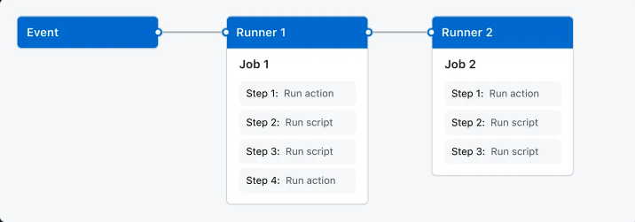

# Understanding GitHub Actions

Learn the basics of core concepts and essential termonology in GitHub Actions. 

## Overview

GitHub actions is a continuous integration and continuous delivery (CI/CD) platform that allows you to automate your build, test, and deployment pipeline. You can create workflows that build and test evert pull request to your repository, or deploy merged pull requests to production.

GitHub Actions goes beyond just DevOps and lets you run workflows when other events happen in your repository. For example, you can run a workflow to automatically add the appropriate labels whenever someone creates a new issue in your repository. 

## The components of GitHub Actions 

You can configure a GitHub actions **workflow** to be triggered when an **event** occurs in your repository, such as a pull request being opened or an issue being created. 

Your workflow contains one or more **jobs** which can run in sequential order or in parallel. Each job will run inside its own virtual machine **runner**, or inside a container, and has one or more **steps** that either run a script that you define or run an **action**, which is a reusable extension that can simplify your workflow. 

### Workflows 

A **workflow** is a configurable automated process that will run one or more jobs. Workflows are defined in the `.github/workflows` directory in a repository. A repository can have multiple workflows, each of which can perform a different set of tasks such as: 

- Building and testing pull requests
- Deploying your application every time a release is created
- Adding a label whenver a new issue is opene

You can reference a workflow within another workflow.

### Events

An **event** is a specific activity in a repository that triggers a **workflow** run. For example, an activity can originate from GitHub when someone creates a pull request, opens an issue, or pushes a commit to a repository. You can also trigger a workflow to run on a schedule, by posting to a REST API, or manually

### Jobs 

A **job** is a set of **steps**